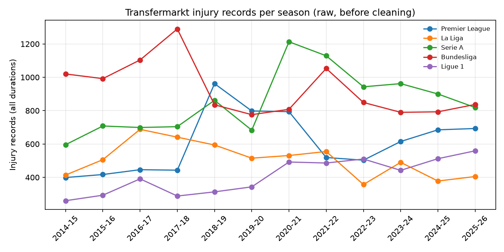

# Phase 0: Data audit

Generated 2026-10-21 by `notebooks/00_audit.ipynb` (`analysis/audit.py`). Raw data is read only.

## Key findings

- **Coverage is complete.** Match and club counts match the expected values in all three sources, for all 60 league-seasons. All 1,170 TM club-seasons have a squad.
- **Match stats:** 3 Football-Data matches lack match statistics, and Understat has no gaps. Neither needs action beyond per-match rates over the matches that have the data.
- **Injuries:** 71,375 TM records fall in the study window. 74.4% last more than 7 days, and 0.3% have no duration (mostly 2025-26 injuries still open at scrape time).
- **The "unknown injury" share rises over time**, from 5.5% in 2014-15 to 16.9% at its peak. The body-area analysis must report unknowns per season, because they can bias trends.
- **Recording differs by league.** Injury records per played player-season: Bundesliga 1.86, Serie A 1.42, Premier League 1.01, La Liga 0.85, Ligue 1 0.72. TM's community coverage, not real injury burden, may drive part of this, so league comparisons need this caveat. Within-league comparisons are safer.
- **Step changes in league series**, i.e. year-on-year changes of more than 40% in raw records: Premier League 2017-18→2018-19 (443→962); Serie A 2019-20→2020-21 (683→1,213); Ligue 1 2019-20→2020-21 (343→492). 2020-21 jumps are plausible (COVID records, congested calendar). Others, such as the Premier League doubling in 2018-19, look like changes in TM recording. Trend charts must be read against these.
- **43.1% of in-window records** happen while the player is outside a Big Five squad (before or after their Big Five seasons). They drop out when injuries are attributed to Big Five club-seasons in Phase 2.
- **Non-injuries** (Ill, Corona virus, flu, Fitness, Rest …) have to be identified from labels, because TM's category flags only a few of them.

## 1. Raw files (`data/raw/`)

| source | folder | files | size_MB | extensions |
|---|---|---|---|---|
| football_data | (all) | 60 | 8.2 | .csv 60 |
| transfermarkt | club | 1170 | 6.0 | .json 1170 |
| transfermarkt | clubs__* | 4 | 0.6 | .json 4 |
| transfermarkt | competition | 60 | 0.1 | .json 60 |
| transfermarkt | competitions__* | 2 | 0.1 | .json 2 |
| transfermarkt | player | 25696 | 17113.9 | .json 25696 |
| transfermarkt | players__* | 145 | 37.7 | .json 145 |
| understat | (all) | 60 | 30.8 | .json 60 |

## 2. Parsed tables (`data/tables/`)

All values are kept as original text. Empty cells are counted as missing.

| table | rows | columns | size_MB | source encoding | empty cells | exact duplicate rows | duplicates on key | key |
|---|---|---|---|---|---|---|---|---|
| fd_matches | 21589 | 187 | 11.4 | utf-8-sig | 50.3% | 0 | 0 | league + season_code + HomeTeam + AwayTeam |
| us_matches | 21690 | 19 | 3.4 | utf-8 (JSON) | 0.2% | 0 | 0 | id |
| us_team_matches | 43178 | 26 | 7.7 | utf-8 (JSON) | 0.0% | 0 | 0 | league + season + team_id + date |
| us_player_seasons | 32574 | 21 | 6.2 | utf-8 (JSON) | 0.0% | 0 | 0 | league + season + id + team_title |
| tm_clubs | 1170 | 8 | 0.1 | utf-8 (JSON) | 0.0% | 0 | 0 | competition_id + season_param + club_id |
| tm_squads | 42238 | 15 | 6.7 | utf-8 (JSON) | 1.5% | 0 | 0 | season_param + club_id + playerId |
| tm_injuries | 82075 | 13 | 10.4 | utf-8 (JSON) | 16.7% | 2 | 3 | playerId + start + end + name |
| tm_player_stats | 632170 | 20 | 71.4 | utf-8 (JSON) | 0.0% | 0 | 0 | player_id + season_id + competition_id + club_id |
| tm_fixtures | 52275 | 39 | 13.3 | utf-8 (JSON) | 3.0% | 0 | 0 | club_id + game_id |

- **Key duplicates:** only `tm_injuries`, with 3 repeats of player + dates + label (1 in the study window). The other tables have none on their keys.
- `tm_injuries.injuryId` is an **injury-type code**: each id has one label, and some labels have several ids. It is not an event id.

## 3. Coverage

`!` marks a cell that differs from the expected count: 380 matches (20 clubs), Bundesliga 306 (18 clubs), Ligue 1 306 (18 clubs) from 2023-24, and Ligue 1 2019-20 279 (COVID stop).

### League matches per league-season: Football-Data (0 cells off)

| league | 2014-15 | 2015-16 | 2016-17 | 2017-18 | 2018-19 | 2019-20 | 2020-21 | 2021-22 | 2022-23 | 2023-24 | 2024-25 | 2025-26 |
|---|---|---|---|---|---|---|---|---|---|---|---|---|
| Premier League | 380 | 380 | 380 | 380 | 380 | 380 | 380 | 380 | 380 | 380 | 380 | 380 |
| La Liga | 380 | 380 | 380 | 380 | 380 | 380 | 380 | 380 | 380 | 380 | 380 | 380 |
| Serie A | 380 | 380 | 380 | 380 | 380 | 380 | 380 | 380 | 380 | 380 | 380 | 380 |
| Bundesliga | 306 | 306 | 306 | 306 | 306 | 306 | 306 | 306 | 306 | 306 | 306 | 306 |
| Ligue 1 | 380 | 380 | 380 | 380 | 380 | 279 | 380 | 380 | 380 | 306 | 306 | 306 |

### League matches per league-season: Understat (0 cells off)

| league | 2014-15 | 2015-16 | 2016-17 | 2017-18 | 2018-19 | 2019-20 | 2020-21 | 2021-22 | 2022-23 | 2023-24 | 2024-25 | 2025-26 |
|---|---|---|---|---|---|---|---|---|---|---|---|---|
| Premier League | 380 | 380 | 380 | 380 | 380 | 380 | 380 | 380 | 380 | 380 | 380 | 380 |
| La Liga | 380 | 380 | 380 | 380 | 380 | 380 | 380 | 380 | 380 | 380 | 380 | 380 |
| Serie A | 380 | 380 | 380 | 380 | 380 | 380 | 380 | 380 | 380 | 380 | 380 | 380 |
| Bundesliga | 306 | 306 | 306 | 306 | 306 | 306 | 306 | 306 | 306 | 306 | 306 | 306 |
| Ligue 1 | 380 | 380 | 380 | 380 | 380 | 279 | 380 | 380 | 380 | 306 | 306 | 306 |

- Understat also lists 101 unplayed fixtures (`isResult = false`): Ligue_1 2019: 101. These are the Ligue 1 2019-20 matches cancelled for COVID, and they are absent from the team-match table.

### Clubs per league-season

**Football-Data** (0 cells off)

| league | 2014-15 | 2015-16 | 2016-17 | 2017-18 | 2018-19 | 2019-20 | 2020-21 | 2021-22 | 2022-23 | 2023-24 | 2024-25 | 2025-26 |
|---|---|---|---|---|---|---|---|---|---|---|---|---|
| Premier League | 20 | 20 | 20 | 20 | 20 | 20 | 20 | 20 | 20 | 20 | 20 | 20 |
| La Liga | 20 | 20 | 20 | 20 | 20 | 20 | 20 | 20 | 20 | 20 | 20 | 20 |
| Serie A | 20 | 20 | 20 | 20 | 20 | 20 | 20 | 20 | 20 | 20 | 20 | 20 |
| Bundesliga | 18 | 18 | 18 | 18 | 18 | 18 | 18 | 18 | 18 | 18 | 18 | 18 |
| Ligue 1 | 20 | 20 | 20 | 20 | 20 | 20 | 20 | 20 | 20 | 18 | 18 | 18 |

**Understat** (0 cells off)

| league | 2014-15 | 2015-16 | 2016-17 | 2017-18 | 2018-19 | 2019-20 | 2020-21 | 2021-22 | 2022-23 | 2023-24 | 2024-25 | 2025-26 |
|---|---|---|---|---|---|---|---|---|---|---|---|---|
| Premier League | 20 | 20 | 20 | 20 | 20 | 20 | 20 | 20 | 20 | 20 | 20 | 20 |
| La Liga | 20 | 20 | 20 | 20 | 20 | 20 | 20 | 20 | 20 | 20 | 20 | 20 |
| Serie A | 20 | 20 | 20 | 20 | 20 | 20 | 20 | 20 | 20 | 20 | 20 | 20 |
| Bundesliga | 18 | 18 | 18 | 18 | 18 | 18 | 18 | 18 | 18 | 18 | 18 | 18 |
| Ligue 1 | 20 | 20 | 20 | 20 | 20 | 20 | 20 | 20 | 20 | 18 | 18 | 18 |

**Transfermarkt** (0 cells off)

| league | 2014-15 | 2015-16 | 2016-17 | 2017-18 | 2018-19 | 2019-20 | 2020-21 | 2021-22 | 2022-23 | 2023-24 | 2024-25 | 2025-26 |
|---|---|---|---|---|---|---|---|---|---|---|---|---|
| Premier League | 20 | 20 | 20 | 20 | 20 | 20 | 20 | 20 | 20 | 20 | 20 | 20 |
| La Liga | 20 | 20 | 20 | 20 | 20 | 20 | 20 | 20 | 20 | 20 | 20 | 20 |
| Serie A | 20 | 20 | 20 | 20 | 20 | 20 | 20 | 20 | 20 | 20 | 20 | 20 |
| Bundesliga | 18 | 18 | 18 | 18 | 18 | 18 | 18 | 18 | 18 | 18 | 18 | 18 |
| Ligue 1 | 20 | 20 | 20 | 20 | 20 | 20 | 20 | 20 | 20 | 18 | 18 | 18 |

### Squads per club-season (Transfermarkt)

- 1170 club-seasons, 0 without a squad. 12,848 distinct players.
- **listed** = players on the TM season squad page. **played** = those with ≥ 1 appearance for that club that season in any competition (from `tm_player_stats`).

| league | listed min | listed median | listed max | played min | played median | played max |
|---|---|---|---|---|---|---|
| Premier League | 23 | 38 | 58 | 23 | 30 | 45 |
| La Liga | 22 | 33 | 49 | 22 | 29 | 41 |
| Serie A | 23 | 40 | 88 | 22 | 30 | 44 |
| Bundesliga | 25 | 34 | 47 | 19 | 27 | 42 |
| Ligue 1 | 22 | 35 | 57 | 21 | 29 | 48 |

Largest listed squads: these include youth and loaned-out players who never played.

| club | league | season_param | listed | played |
|---|---|---|---|---|
| Atalanta BC | Serie A | 2018 | 88 | 29 |
| Parma Calcio 1913 | Serie A | 2018 | 70 | 33 |
| Genoa CFC | Serie A | 2018 | 69 | 32 |
| Chievo Verona | Serie A | 2018 | 68 | 36 |
| Torino FC | Serie A | 2018 | 62 | 26 |

## 4. Missingness

Full per-column list: `reports/00_missingness.csv`. Columns used later with any empty cells:

| table | column | empty | share |
|---|---|---|---|
| fd_matches | HST | 2 | 0.0001 |
| fd_matches | AST | 2 | 0.0001 |
| fd_matches | HF | 2 | 0.0001 |
| fd_matches | AF | 2 | 0.0001 |
| fd_matches | HC | 2 | 0.0001 |
| fd_matches | AC | 2 | 0.0001 |
| fd_matches | HY | 3 | 0.0001 |
| fd_matches | AY | 2 | 0.0001 |
| fd_matches | HR | 2 | 0.0001 |
| fd_matches | AR | 2 | 0.0001 |
| tm_squads | date_of_birth | 25 | 0.0006 |
| tm_squads | position | 9 | 0.0002 |
| tm_injuries | start | 4 | 0.0 |
| tm_injuries | end | 516 | 0.0063 |
| tm_injuries | durationDetails.days | 520 | 0.0063 |

- **Football-Data:** 3 matches without match statistics (shots, fouls, corners or cards):

| league | season_code | Date | HomeTeam | AwayTeam |
|---|---|---|---|---|
| Serie A | 1415 | 02/03/15 | Roma | Juventus |
| Ligue 1 | 1617 | 16/04/17 | Bastia | Lyon |
| Bundesliga | 2425 | 14/12/2024 | Union Berlin | Bochum |

- **Football-Data betting columns** vary by season (bookmakers come and go), which explains most empty cells in `fd_matches`. They aren't used.
- **Understat:** no empty style columns. 4 team-matches have `ppda.def = 0` (an undefined match PPDA). This doesn't matter, because season PPDA = Σatt / Σdef.

## 5. Injuries (Transfermarkt)

- **82,075 records** cover each collected player's whole career. **71,375** start within 2014-15 to 2025-26 (season = 1 July to 30 June). 9,133 are earlier, 1,563 are later (2026-27, in progress), and 4 have no start date.
- The TM `seasonId` agrees with the date-based season for **98.3%** of in-window records.
- **Days missing:** 180 records (0.3%) have no duration ("Unknown"). 180 have no end date (ongoing or unknown).
- **Duration quantiles (days):** p25 = 7, p50 = 18, p75 = 40, p90 = 90. **> 7 days:** 53,077 (74.4%). **> 28 days:** 24,482 (34.3%).
- **Labels:** 330 distinct raw labels (348 type ids). **132** labels cover 95% of records. "unknown injury": 8,041 (11.3%).
- **Non-injuries:** TM's `category` marks only 2,474 records as "Ill" (Corona virus, Virus, Quarantine). Labels such as "Ill", "flu", "cold", "Fitness" and "Rest" sit under "Unknown", so the exclusion list has to be built from labels (Phase 2).
- **Several diagnoses for one absence:** 427 records share player + start date (205 absences), e.g. Hip injury + Torn muscle fiber. Decided: each record counts as a separate injury (see docs/DECISIONS.md).

### Per season

| season | records | players | days_missing | over_7_days | unknown_label | unknown label % |
|---|---|---|---|---|---|---|
| 2014-15 | 3387 | 1927 | 0 | 2444 | 187 | 5.5 |
| 2015-16 | 3950 | 2171 | 1 | 2784 | 209 | 5.3 |
| 2016-17 | 4841 | 2707 | 1 | 3530 | 305 | 6.3 |
| 2017-18 | 5368 | 2889 | 3 | 3839 | 408 | 7.6 |
| 2018-19 | 5751 | 3071 | 1 | 4360 | 613 | 10.7 |
| 2019-20 | 5399 | 3054 | 0 | 4087 | 427 | 7.9 |
| 2020-21 | 7392 | 3971 | 3 | 5721 | 786 | 10.6 |
| 2021-22 | 7316 | 3967 | 1 | 5401 | 961 | 13.1 |
| 2022-23 | 6812 | 3827 | 9 | 5040 | 1151 | 16.9 |
| 2023-24 | 6980 | 3957 | 9 | 5286 | 1150 | 16.5 |
| 2024-25 | 7192 | 3967 | 28 | 5405 | 988 | 13.7 |
| 2025-26 | 6987 | 3864 | 124 | 5180 | 856 | 12.3 |

### Per league (rough league: the player's squad league in that season)

| league | 2014-15 | 2015-16 | 2016-17 | 2017-18 | 2018-19 | 2019-20 | 2020-21 | 2021-22 | 2022-23 | 2023-24 | 2024-25 | 2025-26 | total |
|---|---|---|---|---|---|---|---|---|---|---|---|---|---|
| (not in a Big Five squad) | 634 | 971 | 1404 | 1899 | 2061 | 2225 | 3446 | 3446 | 3536 | 3585 | 3915 | 3663 | 30785 |
| (two leagues) | 64 | 63 | 109 | 103 | 124 | 59 | 108 | 128 | 114 | 96 | 9 | 11 | 988 |
| Bundesliga | 1020 | 992 | 1104 | 1290 | 835 | 776 | 808 | 1053 | 849 | 790 | 793 | 837 | 11147 |
| La Liga | 414 | 506 | 688 | 641 | 594 | 515 | 531 | 555 | 357 | 490 | 378 | 405 | 6074 |
| Ligue 1 | 260 | 293 | 391 | 288 | 313 | 343 | 492 | 486 | 510 | 442 | 512 | 559 | 4889 |
| Premier League | 399 | 417 | 446 | 443 | 962 | 798 | 794 | 519 | 503 | 615 | 685 | 693 | 7274 |
| Serie A | 596 | 708 | 699 | 704 | 862 | 683 | 1213 | 1129 | 943 | 962 | 900 | 819 | 10218 |

Injury records per played player-season (Big Five squads only): Bundesliga 1.86, Serie A 1.42, Premier League 1.01, La Liga 0.85, Ligue 1 0.72.

### Top 25 labels (in window)

| label | records |
|---|---|
| unknown injury | 8041 |
| Hamstring injury | 4377 |
| Muscle injury | 4001 |
| muscular problems | 3339 |
| Knee injury | 2746 |
| Ankle injury | 2329 |
| Ill | 2075 |
| Corona virus | 1979 |
| Knock | 1969 |
| Fitness | 1874 |
| Thigh problems | 1459 |
| Calf injury | 1435 |
| Knee problems | 1430 |
| Cruciate ligament tear | 1179 |
| Adductor pain | 1146 |
| Torn muscle fiber | 1057 |
| Shoulder injury | 1003 |
| minor knock | 853 |
| Foot injury | 833 |
| Groin injury | 793 |
| Adductor injury | 784 |
| Muscle fatigue | 779 |
| Hamstring strain | 752 |
| Calf problems | 742 |
| Rest | 734 |
