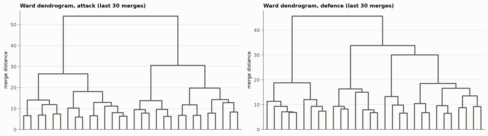

# Phase 4: Clustering

Generated 2026-10-22 by `notebooks/04_clustering.ipynb`, where each step is shown with its checks.

## Approach

Playing style per **phase of play** (Fernandez-Navarro et al. 2016; Demir et al.): attacking style from four attacking dimensions, defensive style from four defensive dimensions, each clustered with K-means (k = 4) and checked against Ward. A team-season's style is the pair. Formation (back three) is reported, not clustered.

## 1. Choosing k

| phase | k | silhouette | davies_bouldin | calinski_harabasz | stability (mean ARI) | min cluster Jaccard | Ward vs K-means (ARI) | smallest cluster | usable |
|---|---|---|---|---|---|---|---|---|---|
| attack | 2 | 0.316 | 1.246 | 596.165 | 0.878 | 0.917 | 0.554 | 388 | False |
| attack | 3 | 0.241 | 1.364 | 493.061 | 0.841 | 0.876 | 0.425 | 341 | True |
| attack | 4 | 0.217 | 1.341 | 440.134 | 0.634 | 0.637 | 0.394 | 174 | True |
| attack | 5 | 0.208 | 1.356 | 394.635 | 0.587 | 0.532 | 0.337 | 131 | False |
| attack | 6 | 0.201 | 1.374 | 365.161 | 0.576 | 0.56 | 0.403 | 84 | False |
| attack | 7 | 0.199 | 1.331 | 343.575 | 0.558 | 0.525 | 0.365 | 66 | False |
| attack | 8 | 0.202 | 1.29 | 328.855 | 0.639 | 0.583 | 0.363 | 61 | False |
| attack | 9 | 0.197 | 1.29 | 313.644 | 0.597 | 0.52 | 0.323 | 49 | False |
| attack | 10 | 0.192 | 1.322 | 299.045 | 0.539 | 0.463 | 0.323 | 46 | False |
| defence | 2 | 0.258 | 1.432 | 484.383 | 0.918 | 0.958 | 0.302 | 568 | False |
| defence | 3 | 0.247 | 1.334 | 445.961 | 0.902 | 0.912 | 0.277 | 329 | True |
| defence | 4 | 0.214 | 1.336 | 391.829 | 0.835 | 0.804 | 0.345 | 245 | True |
| defence | 5 | 0.205 | 1.432 | 355.174 | 0.611 | 0.547 | 0.258 | 191 | False |
| defence | 6 | 0.206 | 1.244 | 336.016 | 0.707 | 0.714 | 0.313 | 143 | True |
| defence | 7 | 0.194 | 1.28 | 313.97 | 0.578 | 0.494 | 0.308 | 84 | False |
| defence | 8 | 0.192 | 1.308 | 299.877 | 0.569 | 0.473 | 0.293 | 66 | False |
| defence | 9 | 0.19 | 1.319 | 285.226 | 0.502 | 0.476 | 0.304 | 62 | False |
| defence | 10 | 0.188 | 1.285 | 272.972 | 0.462 | 0.378 | 0.301 | 66 | False |

## 2. Attack styles (k = 4)

Share of team strength (points per match) explained: eta² = 0.39.

| cluster | style | n | Jaccard | points/match | npxG/match | back-three minutes | matches_all | matches_europe | short_rest_share | rest_sd | top14_share | closest to centroid |
|---|---|---|---|---|---|---|---|---|---|---|---|---|
| 1 | Direct play | 362 | 0.72 | 1.15 | 1.05 | 0.22 | 42.23 | 1.55 | 0.18 | 3.28 | 0.79 | Swansea City 2014-15, AS Saint-Étienne 2020-21, Arminia Bielefeld 2021-22, Genoa CFC 2023-24 |
| 2 | Positional possession | 174 | 0.8 | 1.96 | 1.8 | 0.23 | 51.66 | 9.21 | 0.29 | 3.09 | 0.81 | Borussia Dortmund 2022-23, Atalanta BC 2021-22, SSC Napoli 2022-23, Real Madrid 2023-24 |
| 3 | Counter-attack | 279 | 0.71 | 1.16 | 1.09 | 0.18 | 41.87 | 1.5 | 0.17 | 3.28 | 0.8 | Cagliari Calcio 2023-24, Rayo Vallecano 2014-15, Burnley FC 2019-20, Dijon FCO 2019-20 |
| 4 | Build-up into the box | 355 | 0.64 | 1.48 | 1.41 | 0.29 | 45.97 | 4.86 | 0.23 | 3.19 | 0.81 | TSG 1899 Hoffenheim 2023-24, Borussia Mönchengladbach 2017-18, LOSC Lille 2021-22, Olympique Marseille 2016-17 |

Centroids (z):

| cluster | style | possession | patience | verticality | directness |
|---|---|---|---|---|---|
| 1 | Direct play | -0.53 | -0.28 | -0.57 | 0.83 |
| 2 | Positional possession | 1.62 | 1.41 | -0.8 | -0.97 |
| 3 | Counter-attack | -0.64 | -0.71 | 1.17 | 0.45 |
| 4 | Build-up into the box | 0.25 | 0.16 | 0.05 | -0.73 |

League mix:

| style | Bundesliga | La Liga | Ligue 1 | Premier League | Serie A |
|---|---|---|---|---|---|
| Direct play | 0.15 | 0.2 | 0.23 | 0.17 | 0.25 |
| Positional possession | 0.14 | 0.14 | 0.17 | 0.3 | 0.25 |
| Counter-attack | 0.23 | 0.24 | 0.2 | 0.17 | 0.15 |
| Build-up into the box | 0.21 | 0.21 | 0.18 | 0.22 | 0.18 |

## 3. Defence styles (k = 4)

Share of team strength (points per match) explained: eta² = 0.34.

| cluster | style | n | Jaccard | points/match | npxG/match | back-three minutes | matches_all | matches_europe | short_rest_share | rest_sd | top14_share | closest to centroid |
|---|---|---|---|---|---|---|---|---|---|---|---|---|
| 1 | Compact mid-block | 289 | 0.8 | 1.55 | 1.34 | 0.27 | 46.32 | 5.11 | 0.23 | 3.18 | 0.81 | Atlético de Madrid 2025-26, SV Werder Bremen 2017-18, Borussia Mönchengladbach 2019-20, Stade Rennais FC 2023-24 |
| 2 | High press, high line | 245 | 0.86 | 1.76 | 1.64 | 0.18 | 49.6 | 7.53 | 0.27 | 3.15 | 0.81 | Stade Rennais FC 2016-17, Real Sociedad 2017-18, Atalanta BC 2018-19, Juventus FC 2024-25 |
| 3 | Low block | 350 | 0.91 | 1.07 | 1.11 | 0.27 | 41.28 | 1.08 | 0.16 | 3.25 | 0.8 | US Cremonese 2022-23, Girona FC 2025-26, AJ Auxerre 2024-25, OGC Nice 2025-26 |
| 4 | Aggressive duel press | 286 | 0.91 | 1.23 | 1.13 | 0.2 | 42.96 | 2.13 | 0.19 | 3.3 | 0.79 | Real Betis Balompié 2019-20, Inter Milan 2015-16, Deportivo Alavés 2025-26, SV Werder Bremen 2015-16 |

Centroids (z):

| cluster | style | press | high_line | territory_conceded | aggression |
|---|---|---|---|---|---|
| 1 | Compact mid-block | -0.03 | -0.66 | -0.49 | -0.2 |
| 2 | High press, high line | 0.81 | 1.09 | -0.93 | -0.67 |
| 3 | Low block | -1.04 | -0.32 | 1.01 | -0.38 |
| 4 | Aggressive duel press | 0.6 | 0.13 | 0.06 | 1.24 |

League mix:

| style | Bundesliga | La Liga | Ligue 1 | Premier League | Serie A |
|---|---|---|---|---|---|
| Compact mid-block | 0.13 | 0.22 | 0.31 | 0.13 | 0.21 |
| High press, high line | 0.22 | 0.13 | 0.25 | 0.28 | 0.12 |
| Low block | 0.24 | 0.05 | 0.15 | 0.36 | 0.2 |
| Aggressive duel press | 0.14 | 0.44 | 0.1 | 0.03 | 0.29 |

## 4. Soft memberships and consensus

Gaussian mixture (k = 4) and consensus clustering (bootstrap K-means, bootstrap GMM and Ward) against K-means:

| measure | attack | defence |
|---|---|---|
| K-means vs Ward (ARI) | 0.394 | 0.345 |
| K-means vs GMM (ARI) | 0.302 | 0.544 |
| K-means vs consensus (ARI) | 0.892 | 0.923 |
| same style as GMM | 0.602 | 0.797 |
| same style as consensus | 0.959 | 0.97 |
| clear members (GMM p ≥ 0.8) | 0.338 | 0.428 |
| lowest-BIC k | 2.0 | 2.0 |
| clear members (fuzzy ≥ 0.5) | 0.601 | 0.58 |

Fuzzy membership of each team-season's own style (clear member: ≥ 0.5), with the GMM probability for comparison:

| phase | style | fuzzy mean | clear (fuzzy ≥ 0.5) | GMM mean | most often borders on |
|---|---|---|---|---|---|
| attack | Positional possession | 0.59 | 0.68 | 0.81 | Build-up into the box |
| attack | Counter-attack | 0.59 | 0.69 | 0.4 | Direct play |
| attack | Direct play | 0.59 | 0.67 | 0.7 | Counter-attack |
| attack | Build-up into the box | 0.51 | 0.42 | 0.41 | Direct play |
| defence | High press, high line | 0.54 | 0.56 | 0.56 | Compact mid-block |
| defence | Low block | 0.57 | 0.66 | 0.83 | Compact mid-block |
| defence | Aggressive duel press | 0.55 | 0.61 | 0.7 | Compact mid-block |
| defence | Compact mid-block | 0.53 | 0.47 | 0.56 | Low block |

GMM BIC by k (lower is better):

| k | attack | defence |
|---|---|---|
| 2 | 12181.0 | 12499.0 |
| 3 | 12245.0 | 12542.0 |
| 4 | 12303.0 | 12605.0 |
| 5 | 12369.0 | 12674.0 |
| 6 | 12450.0 | 12735.0 |
| 7 | 12507.0 | 12821.0 |
| 8 | 12580.0 | 12899.0 |
| 9 | 12669.0 | 12979.0 |
| 10 | 12742.0 | 13045.0 |

## 5. Sensitivity clusterings (used in Phase 5 checks)

| measure | attack | defence |
|---|---|---|
| k = 3 vs k = 4 (ARI) | 0.474 | 0.602 |
| relative vs main (ARI) | 0.431 | 0.382 |
| same name, relative vs main | 0.744 | 0.704 |
| relative silhouette | 0.21 | 0.213 |

Attack: main style (rows) vs k = 3 cluster:

| attack style | Counter-attack (66%) | Direct play (76%) | Positional possession (51%) |
|---|---|---|---|
| Positional possession | 0 | 0 | 174 |
| Counter-attack | 233 | 46 | 0 |
| Direct play | 0 | 361 | 1 |
| Build-up into the box | 118 | 71 | 166 |

Attack: main style (rows) vs relative style:

| attack style | Positional possession | Counter-attack | Direct play | Build-up into the box |
|---|---|---|---|---|
| Positional possession | 143 | 0 | 6 | 25 |
| Counter-attack | 0 | 213 | 30 | 36 |
| Direct play | 10 | 21 | 298 | 33 |
| Build-up into the box | 34 | 48 | 57 | 216 |

Defence: main style (rows) vs k = 3 cluster:

| defence style | Aggressive duel press (75%) | High press, high line (74%) | Low block (76%) |
|---|---|---|---|
| High press, high line | 0 | 245 | 0 |
| Low block | 0 | 1 | 349 |
| Aggressive duel press | 286 | 0 | 0 |
| Compact mid-block | 94 | 83 | 112 |

Defence: main style (rows) vs relative style:

| defence style | High press, high line | Low block | Aggressive duel press | Compact mid-block |
|---|---|---|---|---|
| High press, high line | 150 | 3 | 71 | 21 |
| Low block | 0 | 289 | 30 | 31 |
| Aggressive duel press | 6 | 65 | 188 | 27 |
| Compact mid-block | 5 | 36 | 51 | 197 |

## 6. Plausibility: well-known team-seasons, leagues and outliers

Team-seasons whose coaches' styles are widely described, and the styles the clustering gave them:

| team-season | commonly described as | attacking style | membership (attack) | defensive style | membership (defence) |
|---|---|---|---|---|---|
| Manchester City 2017-18 | Guardiola: possession, high press | Positional possession | 0.57 | High press, high line | 0.42 |
| Liverpool FC 2019-20 | Klopp: high press, fast vertical attacks | Positional possession | 0.55 | High press, high line | 0.51 |
| Brighton & Hove Albion 2022-23 | De Zerbi: possession build-up, high press | Positional possession | 0.84 | High press, high line | 0.86 |
| Bayer 04 Leverkusen 2023-24 | Alonso: possession, control | Positional possession | 0.64 | Compact mid-block | 0.43 |
| SSC Napoli 2017-18 | Sarri: possession, short passing | Positional possession | 0.75 | High press, high line | 0.54 |
| Atalanta BC 2019-20 | Gasperini: aggressive man-to-man pressing | Build-up into the box | 0.38 | High press, high line | 0.38 |
| Atlético de Madrid 2015-16 | Simeone: compact deep block, counters | Build-up into the box | 0.8 | Compact mid-block | 0.37 |
| Leicester City 2015-16 | Ranieri: counter-attack, deep block | Counter-attack | 0.5 | Low block | 0.37 |
| Burnley FC 2017-18 | Dyche: direct play, low block | Direct play | 0.73 | Low block | 0.66 |

Association of styles with league and season (Cramér's V; 1 = a style is one league or season):

| measure | attack | defence |
|---|---|---|
| Cramér's V with league | 0.109 | 0.292 |
| Cramér's V with season | 0.241 | 0.199 |
| largest league share in a style | 0.305 | 0.444 |

Outliers (K-means uses Euclidean distance on equal-weight z-scored dimensions):

| dimension | team-seasons beyond 3 SD | largest distance (SD) |
|---|---|---|
| attack_possession | 14 | 4.64 |
| attack_patience | 7 | 5.83 |
| attack_verticality | 6 | 3.64 |
| attack_directness | 1 | 3.22 |
| defence_press | 5 | 3.52 |
| defence_high_line | 9 | 6.44 |
| defence_territory_conceded | 1 | 3.03 |
| defence_aggression | 4 | 3.5 |

## 7. Density check (HDBSCAN)

Over 10 settings per phase, HDBSCAN finds at most 2 dense groups and labels at least 49% of team-seasons as noise (all of them in 13 of 20 runs): the team-seasons form a continuum without separated groups, so the K-means styles are divisions of that continuum, not natural clusters.

| phase | min_cluster_size | min_samples | clusters | noise share | largest cluster share | K-means agreement (ARI, non-noise) |
|---|---|---|---|---|---|---|
| attack | 10 | 10 | 2 | 0.526 | 0.461 | 0.05 |
| attack | 10 | 5 | 2 | 0.488 | 0.502 | 0.037 |
| attack | 20 | 20 | 0 | 1.0 | 0.0 | nan |
| attack | 20 | 5 | 2 | 0.703 | 0.278 | 0.058 |
| attack | 40 | 40 | 0 | 1.0 | 0.0 | nan |
| attack | 40 | 5 | 0 | 1.0 | 0.0 | nan |
| attack | 80 | 80 | 0 | 1.0 | 0.0 | nan |
| attack | 80 | 5 | 0 | 1.0 | 0.0 | nan |
| attack | 120 | 120 | 0 | 1.0 | 0.0 | nan |
| attack | 120 | 5 | 0 | 1.0 | 0.0 | nan |
| defence | 10 | 10 | 2 | 0.964 | 0.023 | 0.599 |
| defence | 10 | 5 | 2 | 0.732 | 0.257 | -0.005 |
| defence | 20 | 20 | 0 | 1.0 | 0.0 | nan |
| defence | 20 | 5 | 2 | 0.882 | 0.071 | 0.311 |
| defence | 40 | 40 | 0 | 1.0 | 0.0 | nan |
| defence | 40 | 5 | 2 | 0.882 | 0.071 | 0.311 |
| defence | 80 | 80 | 0 | 1.0 | 0.0 | nan |
| defence | 80 | 5 | 0 | 1.0 | 0.0 | nan |
| defence | 120 | 120 | 0 | 1.0 | 0.0 | nan |
| defence | 120 | 5 | 0 | 1.0 | 0.0 | nan |

## 8. Combined styles

| attack \ defence | High press, high line | Low block | Aggressive duel press | Compact mid-block |
|---|---|---|---|---|
| Positional possession | 104 | 6 | 7 | 57 |
| Counter-attack | 25 | 114 | 91 | 49 |
| Direct play | 44 | 123 | 129 | 66 |
| Build-up into the box | 72 | 107 | 59 | 117 |

| style | team-seasons | rare | points/match | back-three minutes | typical |
|---|---|---|---|---|---|
| Direct play · Aggressive duel press | 129 | False | 1.15 | 0.2 | AC Milan 2014-15, Rayo Vallecano 2018-19, Cádiz CF 2023-24, Real Valladolid CF 2018-19 |
| Direct play · Low block | 123 | False | 0.98 | 0.25 | SC Freiburg 2018-19, Southampton FC 2022-23, FC Nantes 2022-23, Montpellier HSC 2021-22 |
| Build-up into the box · Compact mid-block | 117 | False | 1.64 | 0.29 | LOSC Lille 2021-22, Stade Rennais FC 2024-25, Olympique Lyon 2019-20, Borussia Mönchengladbach 2019-20 |
| Counter-attack · Low block | 114 | False | 1.05 | 0.24 | Dijon FCO 2019-20, Udinese Calcio 2017-18, Cagliari Calcio 2023-24, West Bromwich Albion 2017-18 |
| Build-up into the box · Low block | 107 | False | 1.18 | 0.32 | OGC Nice 2025-26, FC Empoli 2018-19, Celta de Vigo 2023-24, TSG 1899 Hoffenheim 2023-24 |
| Positional possession · High press, high line | 104 | False | 2.06 | 0.19 | Paris Saint-Germain 2021-22, Brighton & Hove Albion 2022-23, SSC Napoli 2022-23, Chelsea FC 2021-22 |
| Counter-attack · Aggressive duel press | 91 | False | 1.16 | 0.12 | Málaga CF 2016-17, Eintracht Frankfurt 2015-16, Valencia CF 2017-18, Hamburger SV 2016-17 |
| Build-up into the box · High press, high line | 72 | False | 1.71 | 0.24 | Olympique Marseille 2016-17, Eintracht Frankfurt 2019-20, Manchester United 2019-20, Real Madrid 2016-17 |
| Direct play · Compact mid-block | 66 | False | 1.28 | 0.27 | AS Saint-Étienne 2020-21, EA Guingamp 2017-18, VfL Wolfsburg 2016-17, FC Schalke 04 2019-20 |
| Build-up into the box · Aggressive duel press | 59 | False | 1.43 | 0.32 | Sevilla FC 2025-26, Athletic Bilbao 2017-18, Real Betis Balompié 2021-22, Hellas Verona 2021-22 |
| Positional possession · Compact mid-block | 57 | False | 1.88 | 0.32 | Manchester United 2020-21, SS Lazio 2024-25, Atlético de Madrid 2025-26, SSC Napoli 2018-19 |
| Counter-attack · Compact mid-block | 49 | False | 1.34 | 0.16 | Hertha BSC 2020-21, LOSC Lille 2018-19, Stade Reims 2015-16, VfB Stuttgart 2017-18 |
| Direct play · High press, high line | 44 | False | 1.37 | 0.09 | VfL Wolfsburg 2015-16, AS Monaco 2017-18, SD Eibar 2020-21, OGC Nice 2015-16 |
| Counter-attack · High press, high line | 25 | True | 1.35 | 0.16 | Everton FC 2019-20, Celta de Vigo 2017-18, LOSC Lille 2014-15, AS Saint-Étienne 2019-20 |
| Positional possession · Aggressive duel press | 7 | True | 1.66 | 0.29 | RC Lens 2024-25, Inter Milan 2019-20, US Sassuolo 2020-21, Chelsea FC 2023-24 |
| Positional possession · Low block | 6 | True | 1.44 | 0.14 | Sunderland AFC 2025-26, Fulham FC 2025-26, SC Freiburg 2024-25, AC Monza 2023-24 |

