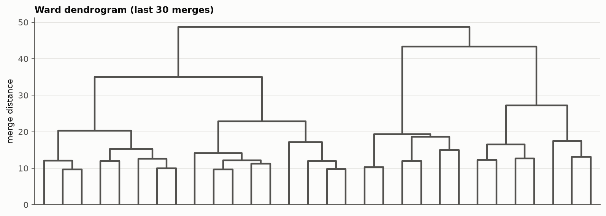
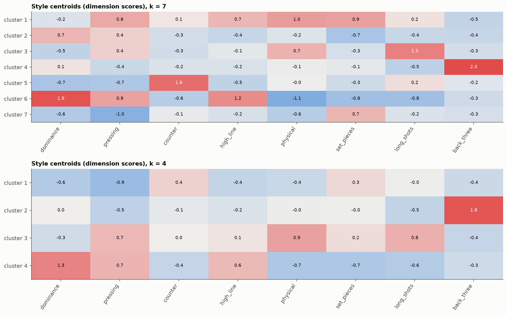
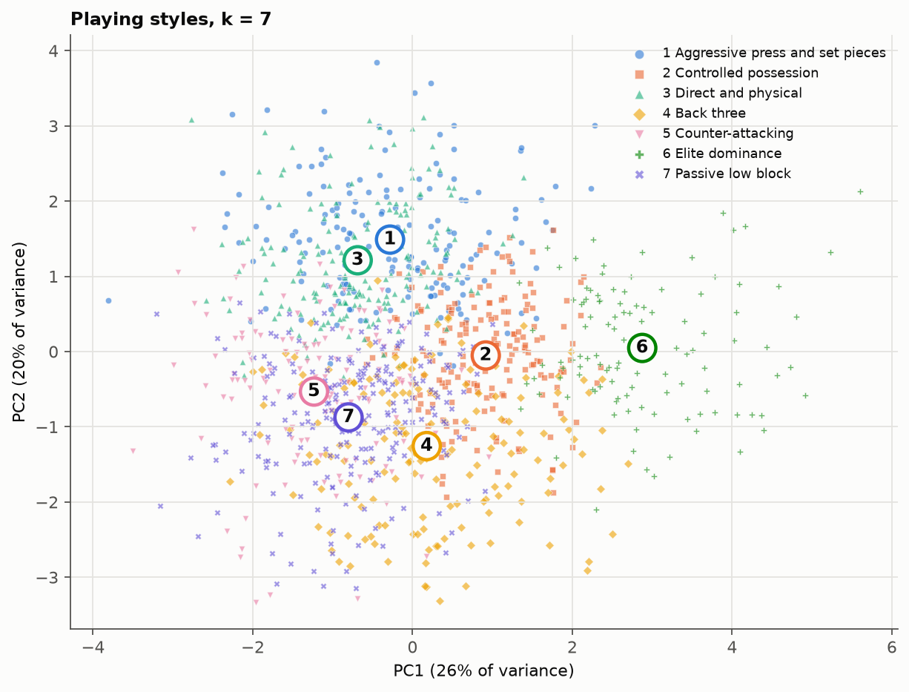

# Phase 4: Clustering

Generated 2026-10-21 by `notebooks/04_clustering.ipynb`, where each step is shown with its checks.

## Status

Main clustering **k = 7**: 1 Aggressive press and set pieces, 2 Controlled possession, 3 Direct and physical, 4 Back three, 5 Counter-attacking, 6 Elite dominance, 7 Passive low block. Robustness check **k = 4**: 1 Passive low block, 2 Back three, 3 Direct and physical, 4 Dominant pressing.

Clustered on 8 equal-weight style dimensions (dominance, pressing, counter, high_line, physical, set_pieces, long_shots, back_three), built in Phase 3 from 15 style features. Team strength and workload are shown, not clustered. Usable k (every cluster Jaccard ≥ 0.6, no cluster under 3%): [3, 4, 7].

## 1. Choosing k

| k | silhouette | davies_bouldin | calinski_harabasz | stability (mean ARI) | min cluster Jaccard | Ward vs K-means (ARI) | smallest cluster | usable |
|---|---|---|---|---|---|---|---|---|
| 2 | 0.165 | 2.037 | 232.329 | 0.817 | 0.872 | 0.343 | 397 | False |
| 3 | 0.155 | 1.896 | 226.149 | 0.881 | 0.918 | 0.256 | 300 | True |
| 4 | 0.159 | 1.78 | 206.797 | 0.863 | 0.888 | 0.456 | 203 | True |
| 5 | 0.142 | 1.833 | 182.008 | 0.648 | 0.527 | 0.377 | 194 | False |
| 6 | 0.139 | 1.854 | 166.949 | 0.609 | 0.528 | 0.321 | 156 | False |
| 7 | 0.127 | 1.852 | 155.69 | 0.654 | 0.61 | 0.361 | 114 | True |
| 8 | 0.126 | 1.878 | 144.156 | 0.556 | 0.484 | 0.347 | 86 | False |
| 9 | 0.123 | 1.868 | 135.345 | 0.512 | 0.422 | 0.341 | 79 | False |
| 10 | 0.126 | 1.742 | 128.221 | 0.497 | 0.346 | 0.319 | 70 | False |

## 2. Profiles

### k = 7 (main)

Share of team strength (points per match) explained by the clusters: eta² = 0.41.

| cluster | name | n | Jaccard | points/match | npxG/match | matches_all | matches_europe | short_rest_share | rest_sd | top14_share | closest to centroid |
|---|---|---|---|---|---|---|---|---|---|---|---|
| 1 | Aggressive press and set pieces | 178 | 0.68 | 1.29 | 1.17 | 43.69 | 2.84 | 0.21 | 3.28 | 0.8 | Cagliari Calcio 2018-19, Real Sociedad 2025-26, AS Monaco 2017-18, CA Osasuna 2019-20 |
| 2 | Controlled possession | 175 | 0.66 | 1.72 | 1.51 | 49.29 | 7.29 | 0.28 | 3.17 | 0.8 | Chelsea FC 2025-26, Stade Reims 2023-24, LOSC Lille 2021-22, Athletic Bilbao 2025-26 |
| 3 | Direct and physical | 178 | 0.64 | 1.2 | 1.04 | 42.56 | 1.56 | 0.18 | 3.33 | 0.79 | GFC Ajaccio 2015-16, SM Caen 2017-18, FC Metz 2017-18, Torino FC 2016-17 |
| 4 | Back three | 166 | 0.84 | 1.4 | 1.34 | 44.31 | 4.01 | 0.19 | 3.16 | 0.81 | 1.FSV Mainz 05 2022-23, FC Toulouse 2025-26, Clermont Foot 63 2022-23, Wolverhampton Wanderers 2024-25 |
| 5 | Counter-attacking | 132 | 0.61 | 1.13 | 1.11 | 40.86 | 1.3 | 0.15 | 3.28 | 0.79 | Hertha BSC 2019-20, UD Almería 2023-24, Angers SCO 2022-23, Hertha BSC 2020-21 |
| 6 | Elite dominance | 114 | 0.8 | 2.04 | 1.94 | 52.74 | 9.71 | 0.31 | 3.04 | 0.81 | Paris Saint-Germain 2021-22, Brighton & Hove Albion 2022-23, Borussia Dortmund 2020-21, FC Barcelona 2025-26 |
| 7 | Passive low block | 227 | 0.71 | 1.11 | 1.11 | 42.0 | 1.36 | 0.17 | 3.26 | 0.8 | Aston Villa 2021-22, FC Nantes 2022-23, VfL Wolfsburg 2024-25, Everton FC 2023-24 |

Centroids on the style dimensions:

| feature | 1 | 2 | 3 | 4 | 5 | 6 | 7 |
|---|---|---|---|---|---|---|---|
| dominance | -0.2 | 0.69 | -0.48 | 0.13 | -0.72 | 1.87 | -0.61 |
| pressing | 0.84 | 0.39 | 0.37 | -0.39 | -0.67 | 0.91 | -1.04 |
| counter | 0.11 | -0.3 | -0.3 | -0.21 | 1.55 | -0.57 | -0.09 |
| high_line | 0.67 | -0.42 | -0.14 | -0.23 | -0.48 | 1.17 | -0.24 |
| physical | 0.98 | -0.19 | 0.73 | -0.06 | -0.02 | -1.12 | -0.57 |
| set_pieces | 0.93 | -0.71 | -0.25 | -0.12 | -0.34 | -0.79 | 0.7 |
| long_shots | 0.16 | -0.39 | 1.31 | -0.51 | 0.21 | -0.79 | -0.21 |
| back_three | -0.47 | -0.41 | -0.29 | 1.96 | -0.17 | -0.34 | -0.26 |

League mix (share of each cluster):

| cluster | Bundesliga | La Liga | Ligue 1 | Premier League | Serie A |
|---|---|---|---|---|---|
| 1 | 0.23 | 0.46 | 0.2 | 0.04 | 0.08 |
| 2 | 0.09 | 0.27 | 0.22 | 0.23 | 0.19 |
| 3 | 0.07 | 0.21 | 0.25 | 0.08 | 0.38 |
| 4 | 0.23 | 0.05 | 0.14 | 0.13 | 0.46 |
| 5 | 0.24 | 0.19 | 0.27 | 0.14 | 0.16 |
| 6 | 0.23 | 0.13 | 0.16 | 0.4 | 0.08 |
| 7 | 0.22 | 0.11 | 0.18 | 0.4 | 0.08 |

### k = 4 (robustness check)

Share of team strength (points per match) explained by the clusters: eta² = 0.33.

| cluster | name | n | Jaccard | points/match | npxG/match | matches_all | matches_europe | short_rest_share | rest_sd | top14_share | closest to centroid |
|---|---|---|---|---|---|---|---|---|---|---|---|
| 1 | Passive low block | 364 | 0.89 | 1.15 | 1.12 | 41.93 | 1.45 | 0.17 | 3.26 | 0.8 | Deportivo Alavés 2023-24, Valencia CF 2025-26, Tottenham Hotspur 2020-21, Borussia Mönchengladbach 2014-15 |
| 2 | Back three | 203 | 0.92 | 1.34 | 1.31 | 43.51 | 3.59 | 0.18 | 3.17 | 0.81 | Clermont Foot 63 2022-23, FC Toulouse 2025-26, Wolverhampton Wanderers 2024-25, 1.FSV Mainz 05 2022-23 |
| 3 | Direct and physical | 345 | 0.9 | 1.28 | 1.11 | 43.72 | 2.59 | 0.2 | 3.31 | 0.79 | AS Monaco 2018-19, UD Las Palmas 2016-17, Getafe CF 2015-16, Cagliari Calcio 2018-19 |
| 4 | Dominant pressing | 258 | 0.91 | 1.85 | 1.72 | 50.76 | 8.36 | 0.29 | 3.11 | 0.81 | Paris Saint-Germain 2021-22, Arsenal FC 2016-17, Juventus FC 2024-25, Chelsea FC 2022-23 |

Centroids on the style dimensions:

| feature | 1 | 2 | 3 | 4 |
|---|---|---|---|---|
| dominance | -0.62 | 0.01 | -0.31 | 1.28 |
| pressing | -0.85 | -0.49 | 0.65 | 0.71 |
| counter | 0.36 | -0.11 | 0.01 | -0.44 |
| high_line | -0.44 | -0.22 | 0.13 | 0.63 |
| physical | -0.39 | -0.03 | 0.93 | -0.67 |
| set_pieces | 0.27 | -0.02 | 0.22 | -0.66 |
| long_shots | -0.02 | -0.46 | 0.75 | -0.61 |
| back_three | -0.37 | 1.83 | -0.43 | -0.35 |

League mix (share of each cluster):

| cluster | Bundesliga | La Liga | Ligue 1 | Premier League | Serie A |
|---|---|---|---|---|---|
| 1 | 0.2 | 0.14 | 0.23 | 0.32 | 0.12 |
| 2 | 0.28 | 0.05 | 0.13 | 0.12 | 0.42 |
| 3 | 0.12 | 0.39 | 0.22 | 0.04 | 0.23 |
| 4 | 0.18 | 0.18 | 0.19 | 0.33 | 0.12 |

How the seven styles sit inside the four (team-seasons):

| k = 7 vs k = 4 | Back three | Direct and physical | Dominant pressing | Passive low block |
|---|---|---|---|---|
| Aggressive press and set pieces | 4 | 148 | 18 | 8 |
| Back three | 162 | 0 | 4 | 0 |
| Controlled possession | 2 | 26 | 112 | 35 |
| Counter-attacking | 13 | 17 | 2 | 100 |
| Direct and physical | 5 | 154 | 2 | 17 |
| Elite dominance | 0 | 0 | 114 | 0 |
| Passive low block | 17 | 0 | 6 | 204 |

