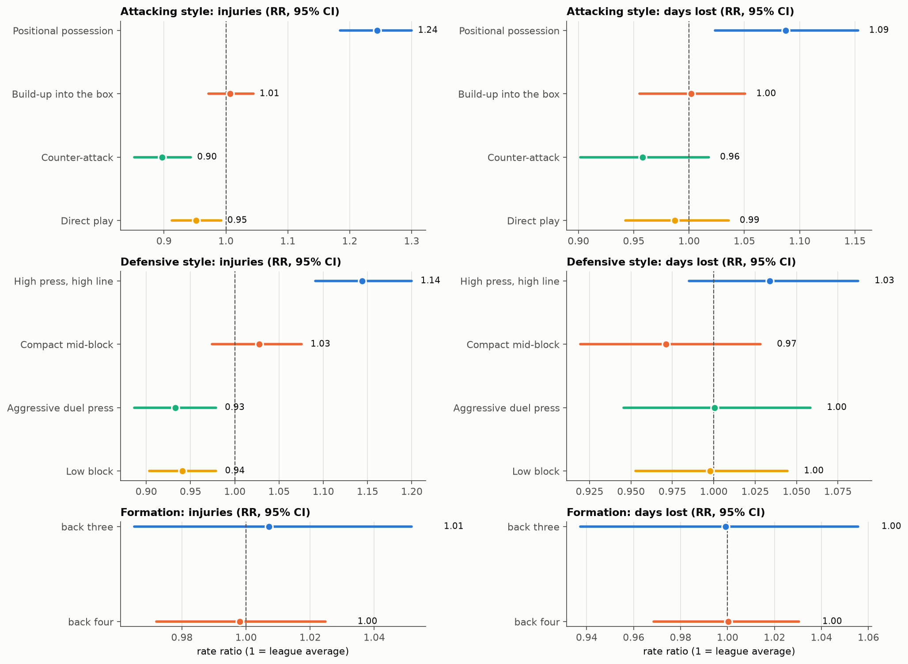
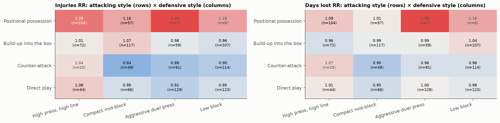
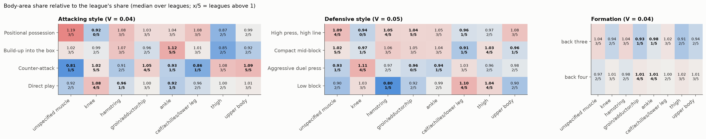
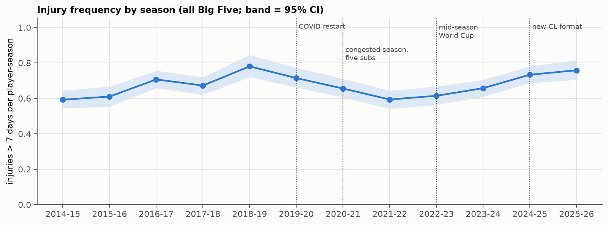
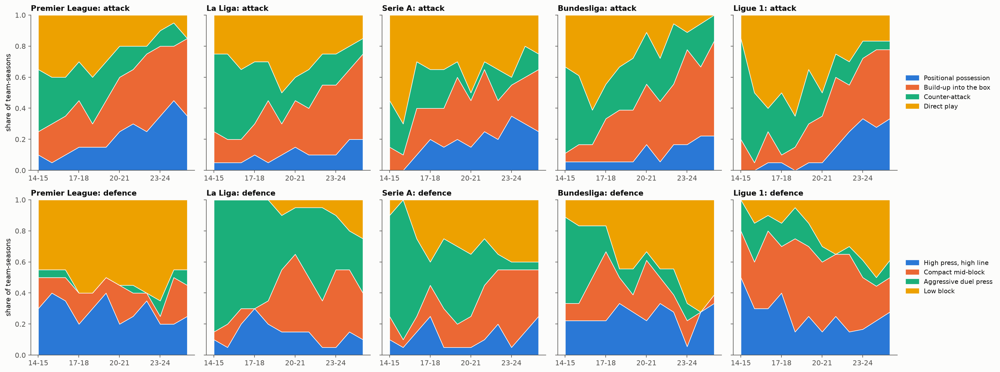
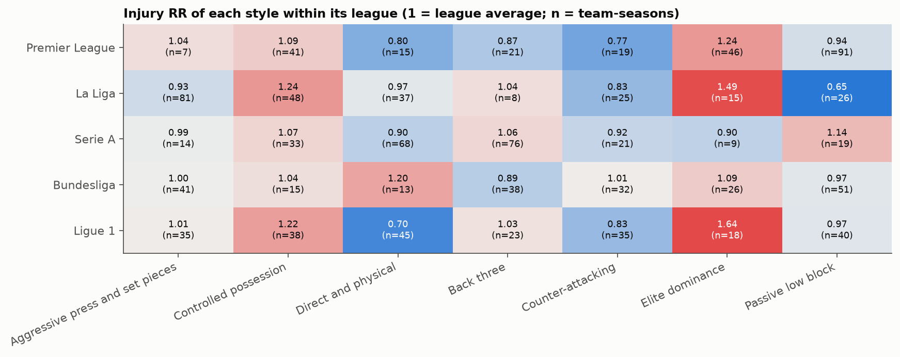
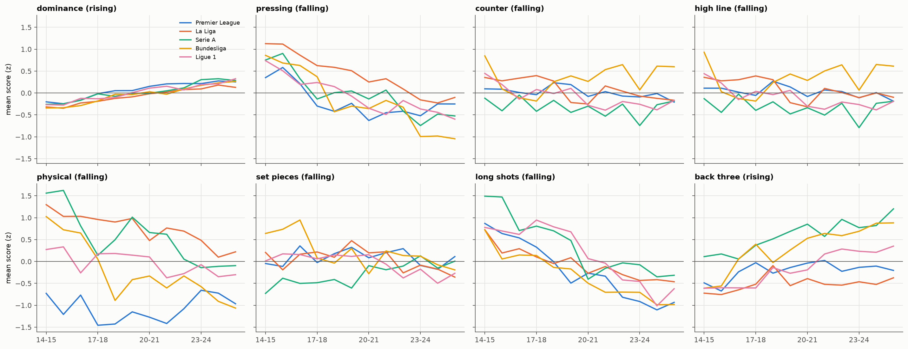
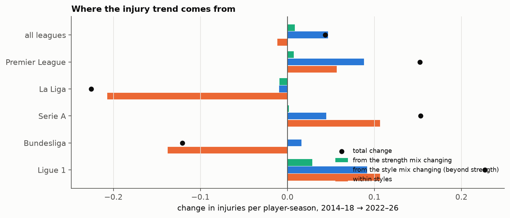
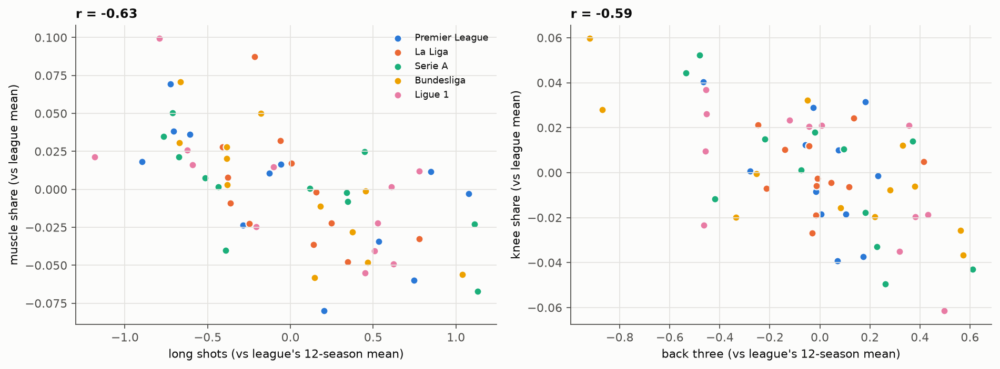

# Phase 5: Injury analysis

Generated 2026-10-21 by `notebooks/05_injury_analysis.ipynb`, where each step is shown with its checks.

## Key numbers

- 36,525 player-club-seasons, 24,581 injuries > 7 days, 1,105,621 days lost.
- Attacking style: injury RR CI excludes 1 for Positional possession 1.21, Counter-attack 0.91; days RR for none; robust in every sensitivity check: Positional possession, Counter-attack.
- Defensive style: injury RR CI excludes 1 for High press, high line 1.14, Aggressive duel press 0.94, Low block 0.93; days RR for none; robust in every sensitivity check: High press, high line, Low block.
- Formation: injury RR CI excludes 1 for none; days RR for none; robust in every sensitivity check: back three.

## 1. Injuries by style

### Attacking style

| attacking style | player-seasons | team-seasons | injuries | injuries / player-season | per 1,000 min | days lost / player-season | severe share | excess / 100 player-seasons | excess days / player-season | RR (95% CI) | days RR (95% CI) |
|---|---|---|---|---|---|---|---|---|---|---|---|
| Positional possession | 5417 | 174 | 4605 | 0.85 | 0.516 | 33.8 | 0.396 | 14.7 | 2.1 | 1.21 (1.11–1.32) | 1.07 (0.98–1.17) |
| Build-up into the box | 11095 | 355 | 7558 | 0.681 | 0.467 | 30.8 | 0.447 | 0.5 | 0.2 | 1.01 (0.95–1.06) | 1.01 (0.95–1.06) |
| Counter-attack | 8553 | 279 | 5113 | 0.598 | 0.442 | 29.0 | 0.474 | -6.0 | -1.1 | 0.91 (0.86–0.96) | 0.96 (0.91–1.02) |
| Direct play | 11460 | 362 | 7305 | 0.637 | 0.482 | 29.0 | 0.461 | -3.0 | -0.4 | 0.96 (0.91–1.00) | 0.99 (0.94–1.04) |

### Defensive style

| defensive style | player-seasons | team-seasons | injuries | injuries / player-season | per 1,000 min | days lost / player-season | severe share | excess / 100 player-seasons | excess days / player-season | RR (95% CI) | days RR (95% CI) |
|---|---|---|---|---|---|---|---|---|---|---|---|
| High press, high line | 7548 | 245 | 5683 | 0.753 | 0.471 | 31.9 | 0.427 | 9.2 | 1.2 | 1.14 (1.05–1.22) | 1.04 (0.98–1.10) |
| Compact mid-block | 8859 | 289 | 5839 | 0.659 | 0.44 | 27.6 | 0.414 | 2.5 | -0.5 | 1.04 (0.97–1.10) | 0.98 (0.93–1.03) |
| Aggressive duel press | 9059 | 286 | 5754 | 0.635 | 0.473 | 28.9 | 0.457 | -4.4 | -0.3 | 0.94 (0.87–1.00) | 0.99 (0.93–1.06) |
| Low block | 11059 | 350 | 7305 | 0.661 | 0.51 | 32.4 | 0.482 | -4.7 | -0.2 | 0.93 (0.89–0.97) | 0.99 (0.95–1.04) |

### Combined style

| combined style | player-seasons | team-seasons | injuries | injuries / player-season | per 1,000 min | days lost / player-season | severe share | excess / 100 player-seasons | excess days / player-season | RR (95% CI) | days RR (95% CI) |
|---|---|---|---|---|---|---|---|---|---|---|---|
| Positional possession · High press, high line | 3254 | 104 | 2803 | 0.861 | 0.511 | 34.2 | 0.396 | 17.2 | 2.4 | 1.25 (1.15–1.36) | 1.08 (0.98–1.18) |
| Positional possession · Compact mid-block | 1745 | 57 | 1407 | 0.806 | 0.492 | 30.3 | 0.372 | 9.7 | -0.0 | 1.14 (1.01–1.31) | 1.00 (0.86–1.16) |
| Build-up into the box · High press, high line | 2207 | 72 | 1526 | 0.691 | 0.437 | 30.6 | 0.448 | 2.4 | -0.4 | 1.04 (0.92–1.14) | 0.99 (0.88–1.09) |
| Build-up into the box · Compact mid-block | 3580 | 117 | 2499 | 0.698 | 0.452 | 28.8 | 0.414 | 5.5 | 0.2 | 1.09 (1.00–1.16) | 1.01 (0.92–1.08) |
| Build-up into the box · Aggressive duel press | 1890 | 59 | 1257 | 0.665 | 0.475 | 28.2 | 0.419 | -2.4 | -0.3 | 0.96 (0.86–1.06) | 0.99 (0.86–1.10) |
| Build-up into the box · Low block | 3418 | 107 | 2276 | 0.666 | 0.504 | 34.4 | 0.499 | -4.3 | 0.8 | 0.94 (0.87–1.01) | 1.02 (0.94–1.09) |
| Counter-attack · Compact mid-block | 1483 | 49 | 735 | 0.496 | 0.348 | 24.2 | 0.468 | -7.2 | -2.2 | 0.87 (0.77–0.97) | 0.92 (0.80–1.02) |
| Counter-attack · Aggressive duel press | 2805 | 91 | 1639 | 0.584 | 0.431 | 27.9 | 0.473 | -8.3 | -2.0 | 0.88 (0.79–0.96) | 0.93 (0.84–1.03) |
| Counter-attack · Low block | 3520 | 114 | 2245 | 0.638 | 0.492 | 31.2 | 0.47 | -5.6 | -0.6 | 0.92 (0.85–0.99) | 0.98 (0.89–1.07) |
| Direct play · High press, high line | 1342 | 44 | 860 | 0.641 | 0.434 | 28.2 | 0.449 | 4.4 | 0.1 | 1.07 (0.98–1.19) | 1.00 (0.88–1.13) |
| Direct play · Compact mid-block | 2051 | 66 | 1198 | 0.584 | 0.43 | 25.8 | 0.427 | -1.8 | -0.8 | 0.97 (0.86–1.07) | 0.97 (0.87–1.06) |
| Direct play · Aggressive duel press | 4132 | 129 | 2622 | 0.635 | 0.484 | 28.7 | 0.464 | -4.2 | 0.1 | 0.94 (0.87–1.02) | 1.01 (0.92–1.10) |
| Direct play · Low block | 3935 | 123 | 2625 | 0.667 | 0.527 | 31.3 | 0.476 | -4.8 | -0.8 | 0.93 (0.87–0.99) | 0.97 (0.91–1.05) |

### Formation

| formation | player-seasons | team-seasons | injuries | injuries / player-season | per 1,000 min | days lost / player-season | severe share | excess / 100 player-seasons | excess days / player-season | RR (95% CI) | days RR (95% CI) |
|---|---|---|---|---|---|---|---|---|---|---|---|
| back three | 7016 | 220 | 5245 | 0.748 | 0.553 | 31.3 | 0.406 | -1.3 | -0.6 | 0.98 (0.93–1.04) | 0.98 (0.92–1.05) |
| back four | 29509 | 950 | 19336 | 0.655 | 0.456 | 30.0 | 0.458 | 0.3 | 0.1 | 1.00 (0.96–1.05) | 1.00 (0.97–1.04) |

Injury RR, attacking style (rows) × defensive style (columns):

| attack \ defence | High press, high line | Compact mid-block | Aggressive duel press | Low block |
|---|---|---|---|---|
| Positional possession | 1.25 | 1.14 | 1.32 | 1.08 |
| Build-up into the box | 1.04 | 1.09 | 0.96 | 0.94 |
| Counter-attack | 1.05 | 0.87 | 0.88 | 0.92 |
| Direct play | 1.07 | 0.97 | 0.94 | 0.93 |

Days lost RR:

| attack \ defence | High press, high line | Compact mid-block | Aggressive duel press | Low block |
|---|---|---|---|---|
| Positional possession | 1.08 | 1.0 | 1.38 | 1.06 |
| Build-up into the box | 0.99 | 1.01 | 0.99 | 1.02 |
| Counter-attack | 1.08 | 0.92 | 0.93 | 0.98 |
| Direct play | 1.0 | 0.97 | 1.01 | 0.97 |

## 2. Body areas by style (relative to the league's share; median over leagues, leagues above 1)

### Attacking style (pooled chi² p = 6.3e-08, Cramér's V = 0.036)

| attacking style | unspecified muscle | knee | hamstring | groin/adductor/hip | ankle | calf/achilles/lower leg | thigh | upper body |
|---|---|---|---|---|---|---|---|---|
| Positional possession | 1.19 | 0.92 | 1.08 | 1.04 | 1.04 | 1.08 | 0.87 | 0.99 |
| Build-up into the box | 1.02 | 0.99 | 1.07 | 0.96 | 1.12 | 1.01 | 0.85 | 0.92 |
| Counter-attack | 0.81 | 1.02 | 0.91 | 1.05 | 0.93 | 0.86 | 1.08 | 1.1 |
| Direct play | 0.92 | 1.08 | 0.96 | 1.0 | 0.92 | 0.96 | 1.0 | 1.01 |

| attacking style | unspecified muscle | knee | hamstring | groin/adductor/hip | ankle | calf/achilles/lower leg | thigh | upper body |
|---|---|---|---|---|---|---|---|---|
| Positional possession | 3 | 0 | 4 | 3 | 3 | 3 | 2 | 2 |
| Build-up into the box | 3 | 2 | 3 | 2 | 5 | 3 | 2 | 2 |
| Counter-attack | 1 | 5 | 2 | 4 | 1 | 1 | 3 | 5 |
| Direct play | 2 | 4 | 1 | 3 | 1 | 2 | 2 | 3 |

### Defensive style (pooled chi² p = 9.8e-22, Cramér's V = 0.051)

| defensive style | unspecified muscle | knee | hamstring | groin/adductor/hip | ankle | calf/achilles/lower leg | thigh | upper body |
|---|---|---|---|---|---|---|---|---|
| High press, high line | 1.09 | 0.94 | 1.05 | 1.04 | 1.04 | 0.96 | 0.97 | 1.08 |
| Compact mid-block | 1.02 | 0.97 | 1.06 | 1.05 | 1.04 | 0.91 | 1.03 | 0.96 |
| Aggressive duel press | 0.93 | 1.11 | 0.97 | 0.96 | 0.94 | 1.03 | 0.96 | 0.98 |
| Low block | 0.9 | 1.03 | 0.8 | 0.92 | 0.99 | 1.1 | 1.05 | 0.9 |

| defensive style | unspecified muscle | knee | hamstring | groin/adductor/hip | ankle | calf/achilles/lower leg | thigh | upper body |
|---|---|---|---|---|---|---|---|---|
| High press, high line | 4 | 0 | 4 | 5 | 3 | 1 | 2 | 3 |
| Compact mid-block | 5 | 1 | 3 | 3 | 3 | 1 | 4 | 1 |
| Aggressive duel press | 1 | 4 | 2 | 1 | 1 | 3 | 2 | 2 |
| Low block | 2 | 3 | 1 | 2 | 2 | 4 | 4 | 2 |

### Formation (pooled chi² p = 0.00069, Cramér's V = 0.036)

| formation | unspecified muscle | knee | hamstring | groin/adductor/hip | ankle | calf/achilles/lower leg | thigh | upper body |
|---|---|---|---|---|---|---|---|---|
| back three | 1.04 | 0.94 | 1.04 | 0.93 | 0.98 | 1.02 | 0.91 | 0.94 |
| back four | 0.97 | 1.01 | 0.98 | 1.01 | 1.01 | 1.0 | 1.02 | 1.01 |

| formation | unspecified muscle | knee | hamstring | groin/adductor/hip | ankle | calf/achilles/lower leg | thigh | upper body |
|---|---|---|---|---|---|---|---|---|
| back three | 3 | 2 | 3 | 1 | 1 | 3 | 2 | 2 |
| back four | 2 | 3 | 2 | 4 | 4 | 2 | 3 | 3 |

## 3. Seasons

| season | player-seasons | injuries / player-season | days lost / player-season | severe share | unknown body area |
|---|---|---|---|---|---|
| 2014-15 | 2939 | 0.592 | 28.7 | 0.48 | 0.157 |
| 2015-16 | 3008 | 0.61 | 29.1 | 0.458 | 0.137 |
| 2016-17 | 3005 | 0.707 | 33.1 | 0.47 | 0.123 |
| 2017-18 | 2997 | 0.672 | 29.4 | 0.427 | 0.099 |
| 2018-19 | 2944 | 0.781 | 32.7 | 0.423 | 0.138 |
| 2019-20 | 3032 | 0.714 | 31.8 | 0.429 | 0.096 |
| 2020-21 | 3161 | 0.655 | 26.2 | 0.396 | 0.156 |
| 2021-22 | 3233 | 0.594 | 25.7 | 0.445 | 0.145 |
| 2022-23 | 3148 | 0.614 | 28.0 | 0.471 | 0.142 |
| 2023-24 | 3144 | 0.657 | 32.3 | 0.484 | 0.14 |
| 2024-25 | 3012 | 0.733 | 35.1 | 0.46 | 0.122 |
| 2025-26 | 2902 | 0.758 | 31.9 | 0.433 | 0.101 |

## 4. Leagues

| league | player-seasons | team-seasons | injuries | injuries / player-season | per 1,000 min | days lost / player-season | severe share | excess / 100 player-seasons | excess days / player-season | RR (95% CI) | days RR (95% CI) |
|---|---|---|---|---|---|---|---|---|---|---|---|
| Premier League | 7524 | 240 | 5151 | 0.685 | 0.451 | 36.1 | 0.512 | 0.0 | 0.0 | 1.00 (0.90–1.08) | 1.00 (0.93–1.06) |
| La Liga | 7429 | 240 | 4451 | 0.599 | 0.402 | 26.9 | 0.448 | 0.0 | 0.0 | 1.00 (0.85–1.14) | 1.00 (0.89–1.10) |
| Serie A | 7787 | 240 | 6410 | 0.823 | 0.608 | 30.3 | 0.371 | 0.0 | 0.0 | 1.00 (0.94–1.07) | 1.00 (0.94–1.06) |
| Bundesliga | 6616 | 216 | 5227 | 0.79 | 0.593 | 37.1 | 0.474 | 0.0 | 0.0 | 1.00 (0.94–1.06) | 1.00 (0.95–1.05) |
| Ligue 1 | 7169 | 234 | 3342 | 0.466 | 0.334 | 21.4 | 0.452 | 0.0 | 0.0 | 1.00 (0.87–1.13) | 1.00 (0.91–1.10) |

Attacking style RR within each league:

| league | Positional possession | Build-up into the box | Counter-attack | Direct play |
|---|---|---|---|---|
| Premier League | 1.22 | 0.95 | 0.91 | 0.93 |
| La Liga | 1.71 | 1.06 | 0.83 | 0.87 |
| Serie A | 1.04 | 0.96 | 1.0 | 1.01 |
| Bundesliga | 1.11 | 1.04 | 0.95 | 0.96 |
| Ligue 1 | 1.22 | 1.06 | 0.83 | 0.96 |

Defensive style RR within each league:

| league | High press, high line | Compact mid-block | Aggressive duel press | Low block |
|---|---|---|---|---|
| Premier League | 1.16 | 1.03 | 1.1 | 0.9 |
| La Liga | 1.32 | 1.23 | 0.86 | 0.57 |
| Serie A | 0.94 | 1.05 | 0.99 | 1.0 |
| Bundesliga | 1.06 | 1.02 | 0.95 | 0.98 |
| Ligue 1 | 1.27 | 0.88 | 1.03 | 0.9 |

## 5. Adjusting step by step (RR, 95% CI over clubs)

Each row adds one adjustment; per-match rows use team matches (all competitions) as exposure.

### Attacking style

| exposure | adjustment | Positional possession | Build-up into the box | Counter-attack | Direct play |
|---|---|---|---|---|---|
| per player-season | league × season | 1.21 (1.11–1.32) | 1.01 (0.95–1.06) | 0.91 (0.86–0.96) | 0.96 (0.91–1.00) |
| per player-season | + team strength | 1.09 (1.03–1.15) | 0.98 (0.93–1.02) | 0.96 (0.91–1.01) | 1.00 (0.96–1.04) |
| per player-season | + age × position | 1.08 (1.01–1.15) | 0.99 (0.94–1.04) | 0.96 (0.92–1.00) | 1.00 (0.95–1.04) |
| per team match | league × season | 1.06 (0.98–1.13) | 0.98 (0.93–1.03) | 0.97 (0.91–1.02) | 1.01 (0.97–1.06) |
| per team match | + team strength | 1.05 (1.00–1.10) | 0.98 (0.93–1.02) | 0.98 (0.93–1.03) | 1.01 (0.97–1.05) |

### Defensive style

| exposure | adjustment | High press, high line | Compact mid-block | Aggressive duel press | Low block |
|---|---|---|---|---|---|
| per player-season | league × season | 1.14 (1.05–1.22) | 1.04 (0.97–1.10) | 0.94 (0.87–1.00) | 0.93 (0.89–0.97) |
| per player-season | + team strength | 1.05 (1.00–1.10) | 1.00 (0.95–1.05) | 0.98 (0.92–1.03) | 0.98 (0.95–1.02) |
| per player-season | + age × position | 1.05 (0.99–1.10) | 1.00 (0.95–1.06) | 0.98 (0.93–1.03) | 0.98 (0.94–1.01) |
| per team match | league × season | 1.02 (0.96–1.08) | 0.99 (0.94–1.05) | 0.97 (0.91–1.03) | 1.01 (0.96–1.06) |
| per team match | + team strength | 1.02 (0.97–1.05) | 1.00 (0.94–1.05) | 0.99 (0.93–1.04) | 1.00 (0.96–1.04) |

### Formation

| exposure | adjustment | back three | back four |
|---|---|---|---|
| per player-season | league × season | 0.98 (0.93–1.04) | 1.00 (0.96–1.05) |
| per player-season | + team strength | 0.99 (0.94–1.04) | 1.00 (0.97–1.04) |
| per player-season | + age × position | 0.99 (0.95–1.04) | 1.00 (0.97–1.04) |
| per team match | league × season | 0.99 (0.94–1.05) | 1.00 (0.97–1.04) |
| per team match | + team strength | 0.99 (0.94–1.04) | 1.00 (0.97–1.03) |

Attacking style: squad and team profile

| attacking style | mean age | team matches | weaker third | middle third | stronger third | Defender | Forward | Goalkeeper | Midfielder |
|---|---|---|---|---|---|---|---|---|---|
| Positional possession | 25.7 | 51.7 | 0.02 | 0.09 | 0.88 | 0.34 | 0.26 | 0.09 | 0.31 |
| Build-up into the box | 25.7 | 46.0 | 0.2 | 0.35 | 0.45 | 0.34 | 0.28 | 0.08 | 0.3 |
| Counter-attack | 26.2 | 41.8 | 0.51 | 0.38 | 0.11 | 0.34 | 0.28 | 0.09 | 0.29 |
| Direct play | 26.0 | 42.2 | 0.56 | 0.33 | 0.11 | 0.33 | 0.29 | 0.08 | 0.3 |

Defensive style: squad and team profile

| defensive style | mean age | team matches | weaker third | middle third | stronger third | Defender | Forward | Goalkeeper | Midfielder |
|---|---|---|---|---|---|---|---|---|---|
| High press, high line | 25.5 | 49.7 | 0.1 | 0.19 | 0.71 | 0.34 | 0.26 | 0.09 | 0.31 |
| Compact mid-block | 25.8 | 46.4 | 0.19 | 0.33 | 0.49 | 0.34 | 0.28 | 0.09 | 0.3 |
| Aggressive duel press | 26.1 | 43.0 | 0.47 | 0.36 | 0.18 | 0.34 | 0.28 | 0.09 | 0.3 |
| Low block | 26.1 | 41.3 | 0.6 | 0.34 | 0.06 | 0.34 | 0.29 | 0.08 | 0.29 |

## 6. Team strength and workload

Attacking style RR within strength thirds:

| strength | Positional possession | Build-up into the box | Counter-attack | Direct play |
|---|---|---|---|---|
| weaker third | 1.49 | 1.0 | 1.0 | 0.99 |
| middle third | 1.1 | 0.99 | 0.97 | 1.02 |
| stronger third | 1.08 | 0.96 | 0.83 | 0.98 |

Attacking style RR within congestion thirds:

| congestion | Positional possession | Build-up into the box | Counter-attack | Direct play |
|---|---|---|---|---|
| lightest third | 0.99 | 0.98 | 0.92 | 0.91 |
| middle third | 1.13 | 0.96 | 0.83 | 0.92 |
| busiest third | 1.28 | 1.06 | 1.02 | 1.14 |

Defensive style RR within strength thirds:

| strength | High press, high line | Compact mid-block | Aggressive duel press | Low block |
|---|---|---|---|---|
| weaker third | 0.99 | 1.06 | 1.0 | 0.99 |
| middle third | 1.18 | 1.02 | 0.93 | 0.98 |
| stronger third | 1.03 | 0.97 | 1.01 | 0.94 |

Defensive style RR within congestion thirds:

| congestion | High press, high line | Compact mid-block | Aggressive duel press | Low block |
|---|---|---|---|---|
| lightest third | 0.95 | 0.96 | 0.89 | 0.95 |
| middle third | 1.03 | 0.97 | 0.89 | 0.9 |
| busiest third | 1.23 | 1.14 | 1.08 | 0.96 |

By congestion:

| congestion | player-seasons | team-seasons | injuries | injuries / player-season | per 1,000 min | days lost / player-season | severe share | excess / 100 player-seasons | excess days / player-season | RR (95% CI) | days RR (95% CI) |
|---|---|---|---|---|---|---|---|---|---|---|---|
| lightest third | 12400 | 397 | 8048 | 0.649 | 0.521 | 29.5 | 0.455 | -4.6 | -1.0 | 0.93 (0.89–0.97) | 0.97 (0.93–1.01) |
| middle third | 11970 | 386 | 7200 | 0.602 | 0.437 | 28.4 | 0.459 | -4.5 | -1.1 | 0.93 (0.88–0.98) | 0.96 (0.91–1.01) |
| busiest third | 12155 | 387 | 9333 | 0.768 | 0.469 | 33.0 | 0.431 | 9.1 | 2.1 | 1.13 (1.06–1.20) | 1.07 (1.01–1.12) |

### Same club, with and without the style

Injury RR in a style's seasons ÷ the same clubs' RR in their other seasons (95% CI over clubs):

| grouping | style | clubs | style seasons | other seasons | ratio, league × season | low, league × season | high, league × season | ratio, + team strength | low, + team strength | high, + team strength | ratio, per team match, + strength | low, per team match, + strength | high, per team match, + strength |
|---|---|---|---|---|---|---|---|---|---|---|---|---|---|
| attacking style | Positional possession | 41 | 162 | 271 | 1.15 | 1.04 | 1.27 | 1.08 | 0.99 | 1.17 | 1.07 | 0.99 | 1.14 |
| attacking style | Build-up into the box | 96 | 337 | 586 | 0.97 | 0.92 | 1.02 | 0.95 | 0.91 | 1.0 | 0.95 | 0.91 | 0.99 |
| attacking style | Counter-attack | 102 | 252 | 579 | 0.94 | 0.88 | 0.99 | 0.98 | 0.93 | 1.02 | 0.99 | 0.94 | 1.04 |
| attacking style | Direct play | 108 | 324 | 577 | 0.98 | 0.93 | 1.03 | 1.02 | 0.97 | 1.07 | 1.02 | 0.98 | 1.07 |
| defensive style | High press, high line | 65 | 221 | 442 | 1.1 | 1.02 | 1.18 | 1.03 | 0.98 | 1.09 | 1.0 | 0.95 | 1.05 |
| defensive style | Compact mid-block | 91 | 280 | 578 | 1.03 | 0.97 | 1.09 | 0.99 | 0.94 | 1.04 | 1.0 | 0.94 | 1.05 |
| defensive style | Aggressive duel press | 81 | 242 | 451 | 0.96 | 0.92 | 1.01 | 1.0 | 0.95 | 1.05 | 1.0 | 0.95 | 1.06 |
| defensive style | Low block | 84 | 276 | 415 | 0.97 | 0.91 | 1.03 | 1.0 | 0.95 | 1.06 | 1.01 | 0.96 | 1.06 |

Seasons right after a club switched into or out of a style (RR against league × season × strength):

| grouping | style | switch | switches | RR season before (+ strength) | RR season after (+ strength) | change |
|---|---|---|---|---|---|---|
| attacking style | Positional possession | into | 61 | 1.06 | 1.08 | 0.02 |
| attacking style | Positional possession | out of | 40 | 1.08 | 1.1 | 0.02 |
| attacking style | Build-up into the box | into | 136 | 1.03 | 0.98 | -0.05 |
| attacking style | Build-up into the box | out of | 123 | 0.97 | 1.06 | 0.09 |
| attacking style | Counter-attack | into | 94 | 0.97 | 0.99 | 0.03 |
| attacking style | Counter-attack | out of | 133 | 0.97 | 0.94 | -0.03 |
| attacking style | Direct play | into | 138 | 0.98 | 1.0 | 0.02 |
| attacking style | Direct play | out of | 133 | 1.03 | 0.98 | -0.06 |
| defensive style | High press, high line | into | 99 | 1.01 | 1.04 | 0.02 |
| defensive style | High press, high line | out of | 97 | 1.08 | 1.1 | 0.02 |
| defensive style | Compact mid-block | into | 140 | 1.0 | 1.01 | 0.01 |
| defensive style | Compact mid-block | out of | 144 | 0.97 | 1.06 | 0.09 |
| defensive style | Aggressive duel press | into | 78 | 1.02 | 1.02 | -0.0 |
| defensive style | Aggressive duel press | out of | 98 | 0.98 | 1.01 | 0.03 |
| defensive style | Low block | into | 98 | 0.96 | 1.06 | 0.1 |
| defensive style | Low block | out of | 76 | 0.97 | 0.91 | -0.06 |

## 7. Fitness absences (Bundesliga, secondary outcome)

| attacking style | player_seasons | fitness_absences | per 100 player-seasons |
|---|---|---|---|
| Positional possession | 733 | 73 | 10.0 |
| Build-up into the box | 2244 | 235 | 10.5 |
| Counter-attack | 1957 | 198 | 10.1 |
| Direct play | 1682 | 214 | 12.7 |

| defensive style | player_seasons | fitness_absences | per 100 player-seasons |
|---|---|---|---|
| High press, high line | 1646 | 185 | 11.2 |
| Compact mid-block | 1149 | 115 | 10.0 |
| Aggressive duel press | 1198 | 136 | 11.4 |
| Low block | 2623 | 284 | 10.8 |

## 8. Sensitivity checks (injury RR against league × season)

### Attacking style

| variant | Positional possession | Build-up into the box | Counter-attack | Direct play |
|---|---|---|---|---|
| main (> 7 days) | 1.21 | 1.01 | 0.91 | 0.96 |
| ≥ 900 minutes only | 1.26 | 1.02 | 0.88 | 0.93 |
| severe only (> 28 days) | 1.07 | 1.0 | 0.95 | 1.01 |
| > 3 days (adds mild) | 1.27 | 1.02 | 0.89 | 0.93 |
| multi-club players out | 1.23 | 1.01 | 0.9 | 0.95 |
| ≥ 1 appearance only | 1.23 | 1.01 | 0.9 | 0.95 |
| COVID seasons out | 1.19 | 1.03 | 0.9 | 0.95 |

### Defensive style

| variant | High press, high line | Compact mid-block | Aggressive duel press | Low block |
|---|---|---|---|---|
| main (> 7 days) | 1.14 | 1.04 | 0.94 | 0.93 |
| ≥ 900 minutes only | 1.19 | 1.06 | 0.92 | 0.89 |
| severe only (> 28 days) | 1.05 | 0.98 | 1.0 | 0.98 |
| > 3 days (adds mild) | 1.18 | 1.05 | 0.92 | 0.91 |
| multi-club players out | 1.15 | 1.04 | 0.94 | 0.92 |
| ≥ 1 appearance only | 1.15 | 1.04 | 0.93 | 0.93 |
| COVID seasons out | 1.15 | 1.05 | 0.93 | 0.92 |

### Formation

| variant | back three | back four |
|---|---|---|
| main (> 7 days) | 0.98 | 1.0 |
| ≥ 900 minutes only | 0.99 | 1.0 |
| severe only (> 28 days) | 0.95 | 1.01 |
| > 3 days (adds mild) | 0.99 | 1.0 |
| multi-club players out | 0.98 | 1.0 |
| ≥ 1 appearance only | 0.98 | 1.0 |
| COVID seasons out | 0.99 | 1.0 |

### Alternative clusterings (Phase 4)

Attack:

| clustering | style | team-seasons | RR | RR low | RR high |
|---|---|---|---|---|---|
| main (k = 4) | Build-up into the box | 355 | 1.01 | 0.95 | 1.06 |
| main (k = 4) | Counter-attack | 279 | 0.91 | 0.86 | 0.96 |
| main (k = 4) | Direct play | 362 | 0.96 | 0.91 | 1.0 |
| main (k = 4) | Positional possession | 174 | 1.21 | 1.11 | 1.32 |
| k = 3 | Counter-attack (66%) | 351 | 0.91 | 0.86 | 0.96 |
| k = 3 | Direct play (76%) | 478 | 0.96 | 0.91 | 1.0 |
| k = 3 | Positional possession (51%) | 341 | 1.15 | 1.08 | 1.22 |
| relative to league-season | Build-up into the box | 310 | 1.05 | 0.99 | 1.11 |
| relative to league-season | Counter-attack | 282 | 0.89 | 0.84 | 0.94 |
| relative to league-season | Direct play | 391 | 0.94 | 0.9 | 0.98 |
| relative to league-season | Positional possession | 187 | 1.21 | 1.1 | 1.34 |
| relative, + team strength | Build-up into the box | 310 | 1.0 | 0.95 | 1.05 |
| relative, + team strength | Counter-attack | 282 | 0.95 | 0.9 | 0.99 |
| relative, + team strength | Direct play | 391 | 0.99 | 0.96 | 1.03 |
| relative, + team strength | Positional possession | 187 | 1.08 | 1.0 | 1.15 |

Defence:

| clustering | style | team-seasons | RR | RR low | RR high |
|---|---|---|---|---|---|
| main (k = 4) | Aggressive duel press | 286 | 0.94 | 0.87 | 1.0 |
| main (k = 4) | Compact mid-block | 289 | 1.04 | 0.97 | 1.1 |
| main (k = 4) | High press, high line | 245 | 1.14 | 1.05 | 1.22 |
| main (k = 4) | Low block | 350 | 0.93 | 0.89 | 0.97 |
| k = 3 | Aggressive duel press (75%) | 380 | 0.96 | 0.9 | 1.03 |
| k = 3 | High press, high line (74%) | 329 | 1.13 | 1.05 | 1.21 |
| k = 3 | Low block (76%) | 461 | 0.94 | 0.9 | 0.98 |
| relative to league-season | Aggressive duel press | 340 | 0.98 | 0.92 | 1.04 |
| relative to league-season | Compact mid-block | 276 | 1.06 | 0.99 | 1.15 |
| relative to league-season | High press, high line | 161 | 1.16 | 1.07 | 1.26 |
| relative to league-season | Low block | 393 | 0.91 | 0.88 | 0.95 |
| relative, + team strength | Aggressive duel press | 340 | 1.0 | 0.95 | 1.04 |
| relative, + team strength | Compact mid-block | 276 | 1.01 | 0.95 | 1.06 |
| relative, + team strength | High press, high line | 161 | 1.05 | 0.98 | 1.12 |
| relative, + team strength | Low block | 393 | 0.97 | 0.93 | 1.01 |

### Days lost counted three ways (days RR)

Attacking style:

| days lost | Positional possession | Build-up into the box | Counter-attack | Direct play |
|---|---|---|---|---|
| overlaps merged (main) | 1.07 | 1.01 | 0.96 | 0.99 |
| raw (overlaps counted twice) | 1.07 | 1.01 | 0.96 | 0.99 |
| each injury capped at 365 days | 1.07 | 1.0 | 0.96 | 0.99 |

Defensive style:

| days lost | High press, high line | Compact mid-block | Aggressive duel press | Low block |
|---|---|---|---|---|
| overlaps merged (main) | 1.04 | 0.98 | 0.99 | 0.99 |
| raw (overlaps counted twice) | 1.04 | 0.98 | 0.99 | 1.0 |
| each injury capped at 365 days | 1.04 | 0.99 | 0.99 | 0.99 |

Median days per injury (overlaps merged):

| grouping | style | median days per injury |
|---|---|---|
| attacking style | Positional possession | 23.0 |
| attacking style | Build-up into the box | 25.0 |
| attacking style | Counter-attack | 27.0 |
| attacking style | Direct play | 26.0 |
| defensive style | High press, high line | 24.0 |
| defensive style | Compact mid-block | 24.0 |
| defensive style | Aggressive duel press | 26.0 |
| defensive style | Low block | 27.0 |

## 9. Style cards (core team-seasons)

### Attacking styles

- **Positional possession** (174 team-seasons, core 118 (68%)): dominates the ball and plays in the opponent's half; builds up slowly and patiently; works the ball into the box before shooting. deep completions per match: 10.0 (all 6.1); shots from slow, patient attacks: 9% (all 6%); shots from outside the box: 33% (all 38%). Back-three minutes 23%; points/match 2.03; most often with High press, high line (60%), Compact mid-block (33%). Typical: SSC Napoli 2017-18, FC Barcelona 2014-15 | Atalanta BC 2021-22, FC Barcelona 2020-21 | Borussia Dortmund 2022-23, SSC Napoli 2022-23.
- **Build-up into the box** (355 team-seasons, core 148 (42%)): works the ball into the box before shooting; dominates the ball and plays in the opponent's half; builds up slowly and patiently. shots from outside the box: 34% (all 38%); deep completions per match: 6.8 (all 6.1); shots from slow, patient attacks: 6% (all 6%). Back-three minutes 29%; points/match 1.49; most often with Compact mid-block (33%), Low block (30%). Typical: Borussia Mönchengladbach 2017-18, Olympique Marseille 2016-17 | LOSC Lille 2021-22, Leicester City 2021-22 | TSG 1899 Hoffenheim 2023-24, AFC Bournemouth 2025-26.
- **Counter-attack** (279 team-seasons, core 193 (69%)): attacks fast and vertically, on the break; rarely builds up slowly; spends long spells without the ball. shots from fast attacks: 8% (all 6%); shots from slow, patient attacks: 4% (all 6%); deep completions per match: 4.6 (all 6.1). Back-three minutes 18%; points/match 1.15; most often with Low block (41%), Aggressive duel press (33%). Typical: Rayo Vallecano 2014-15, RCD Espanyol Barcelona 2014-15 | Burnley FC 2019-20, Dijon FCO 2019-20 | Cagliari Calcio 2023-24, RCD Mallorca 2023-24.
- **Direct play** (362 team-seasons, core 244 (67%)): shoots from distance and relies on set plays; rarely attacks at speed; spends long spells without the ball. shots from outside the box: 42% (all 38%); shots from fast attacks: 5% (all 6%); deep completions per match: 4.7 (all 6.1). Back-three minutes 22%; points/match 1.11; most often with Aggressive duel press (36%), Low block (34%). Typical: Swansea City 2014-15, Norwich City 2015-16 | Arminia Bielefeld 2021-22, AS Saint-Étienne 2020-21 | Genoa CFC 2023-24, Elche CF 2022-23.

### Defensive styles

- **High press, high line** (245 team-seasons, core 137 (56%)): holds a high line, exposed to counters; keeps opponents far from goal; presses high and wins the ball back quickly. shots conceded from fast attacks: 8% (all 6%); deep completions conceded per match: 4.6 (all 6.1); PPDA (lower = more pressing): 8.8 (all 10.9). Back-three minutes 18%; points/match 1.85; most often with Positional possession (42%), Build-up into the box (29%). Typical: Stade Rennais FC 2016-17, Real Sociedad 2017-18 | Atalanta BC 2018-19, FC Barcelona 2018-19 | Brighton & Hove Albion 2022-23, Juventus FC 2024-25.
- **Compact mid-block** (289 team-seasons, core 136 (47%)): keeps a deep, protected line; keeps opponents far from goal; defends cleanly, few fouls. shots conceded from fast attacks: 5% (all 6%); deep completions conceded per match: 5.2 (all 6.1); fouls per match: 12.3 (all 12.5). Back-three minutes 27%; points/match 1.58; most often with Build-up into the box (40%), Direct play (23%). Typical: SV Werder Bremen 2017-18, FC Girondins Bordeaux 2016-17 | Borussia Mönchengladbach 2019-20, Stade Rennais FC 2018-19 | Atlético de Madrid 2025-26, Stade Rennais FC 2023-24.
- **Aggressive duel press** (286 team-seasons, core 175 (61%)): defends through fouls and duels, many cards; presses high and wins the ball back quickly; holds a high line, exposed to counters. fouls per match: 14.8 (all 12.5); PPDA (lower = more pressing): 9.3 (all 10.9); shots conceded from fast attacks: 6% (all 6%). Back-three minutes 20%; points/match 1.24; most often with Direct play (45%), Counter-attack (32%). Typical: Inter Milan 2015-16, SV Werder Bremen 2015-16 | Real Betis Balompié 2019-20, Rayo Vallecano 2018-19 | Deportivo Alavés 2025-26, Rayo Vallecano 2025-26.
- **Low block** (350 team-seasons, core 231 (66%)): sits off and lets the opponent have the ball; lets opponents near the box; defends cleanly, few fouls. PPDA (lower = more pressing): 13.7 (all 10.9); deep completions conceded per match: 7.8 (all 6.1); fouls per match: 11.5 (all 12.5). Back-three minutes 27%; points/match 1.04; most often with Direct play (35%), Counter-attack (33%). Typical: Hull City 2014-15, SC Freiburg 2016-17 | Everton FC 2021-22, Brighton & Hove Albion 2018-19 | AJ Auxerre 2024-25, Stade Reims 2024-25.

Injury RR, all teams vs core teams only:

| attacking style | RR, all teams | RR, core teams | days RR, all teams | days RR, core teams |
|---|---|---|---|---|
| Positional possession | 1.21 | 1.22 | 1.07 | 1.06 |
| Build-up into the box | 1.01 | 1.05 | 1.01 | 1.03 |
| Counter-attack | 0.91 | 0.9 | 0.96 | 0.96 |
| Direct play | 0.96 | 0.95 | 0.99 | 1.01 |

| defensive style | RR, all teams | RR, core teams | days RR, all teams | days RR, core teams |
|---|---|---|---|---|
| High press, high line | 1.14 | 1.16 | 1.04 | 1.08 |
| Compact mid-block | 1.04 | 1.05 | 0.98 | 0.99 |
| Aggressive duel press | 0.94 | 0.96 | 0.99 | 1.01 |
| Low block | 0.93 | 0.92 | 0.99 | 0.97 |

## 10. How the ways of attacking and defending changed

| dimension (z) | 2014–18 | 2018–22 | 2022–26 | shape |
|---|---|---|---|---|
| attack_possession | -0.19 | 0.03 | 0.16 | rising |
| attack_patience | -0.65 | -0.02 | 0.68 | rising |
| attack_verticality | 0.09 | -0.02 | -0.07 | falling |
| attack_directness | 0.47 | 0.01 | -0.49 | falling |
| defence_press | 0.53 | -0.1 | -0.44 | falling |
| defence_high_line | 0.08 | -0.03 | -0.06 | falling |
| defence_territory_conceded | -0.08 | -0.02 | 0.1 | rising |
| defence_aggression | 0.24 | -0.05 | -0.2 | falling |

| dimension | all leagues | Premier League | La Liga | Serie A | Bundesliga | Ligue 1 |
|---|---|---|---|---|---|---|
| attack_possession | rising | rising | rising | peak | rising | rising |
| attack_patience | rising | rising | rising | rising | rising | rising |
| attack_verticality | falling | falling | falling | falling | rising | falling |
| attack_directness | falling | falling | falling | falling | falling | falling |
| defence_press | falling | falling | falling | falling | falling | falling |
| defence_high_line | falling | falling | falling | falling | rising | falling |
| defence_territory_conceded | rising | rising | dip | peak | rising | rising |
| defence_aggression | falling | dip | falling | falling | falling | falling |

| measure (all leagues) | 2014–18 | 2018–22 | 2022–26 |
|---|---|---|---|
| deep completions per match | 5.701 | 6.046 | 6.534 |
| shots from slow, patient attacks | 0.044 | 0.057 | 0.071 |
| shots from fast attacks | 0.062 | 0.06 | 0.06 |
| shots from outside the box | 0.413 | 0.376 | 0.344 |
| PPDA (lower = more pressing) | 9.66 | 11.116 | 11.894 |
| shots conceded from fast attacks | 0.062 | 0.061 | 0.06 |
| deep completions conceded per match | 5.701 | 6.045 | 6.534 |
| fouls per match | 13.314 | 12.376 | 11.866 |
| minutes in a back three | 0.134 | 0.257 | 0.311 |

## 11. How teams move between styles

Attack: style kept from one season to the next 53%.

| attack → next season | Positional possession | Build-up into the box | Counter-attack | Direct play |
|---|---|---|---|---|
| Positional possession | 73.0 | 24.0 | 0.0 | 3.0 |
| Build-up into the box | 16.0 | 58.0 | 10.0 | 16.0 |
| Counter-attack | 2.0 | 20.0 | 37.0 | 41.0 |
| Direct play | 4.0 | 21.0 | 24.0 | 51.0 |

| from | next | clubs |
|---|---|---|
| Counter-attack | Direct play | 87 |
| Direct play | Counter-attack | 64 |
| Direct play | Build-up into the box | 58 |
| Build-up into the box | Direct play | 47 |
| Build-up into the box | Positional possession | 46 |

Defence: style kept from one season to the next 55%.

| defence → next season | High press, high line | Compact mid-block | Aggressive duel press | Low block |
|---|---|---|---|---|
| High press, high line | 55.0 | 27.0 | 10.0 | 8.0 |
| Compact mid-block | 23.0 | 45.0 | 13.0 | 19.0 |
| Aggressive duel press | 10.0 | 20.0 | 56.0 | 14.0 |
| Low block | 7.0 | 17.0 | 10.0 | 66.0 |

| from | next | clubs |
|---|---|---|
| Compact mid-block | High press, high line | 60 |
| High press, high line | Compact mid-block | 58 |
| Compact mid-block | Low block | 50 |
| Aggressive duel press | Compact mid-block | 44 |
| Low block | Compact mid-block | 38 |

## 12. Style mix and injuries per era

### Attacking style

| era | Positional possession | Build-up into the box | Counter-attack | Direct play |
|---|---|---|---|---|
| 2014–18 | 6.4 | 17.3 | 36.2 | 40.1 |
| 2018–22 | 13.0 | 31.4 | 21.2 | 34.4 |
| 2022–26 | 25.4 | 42.5 | 14.0 | 18.1 |

Injury RR per era (fixed league baselines):

| era | Positional possession | Build-up into the box | Counter-attack | Direct play |
|---|---|---|---|---|
| 2014–18 | 1.22 | 1.09 | 0.93 | 0.99 |
| 2018–22 | 1.26 | 0.99 | 0.93 | 0.95 |
| 2022–26 | 1.18 | 0.99 | 0.84 | 0.9 |

### Defensive style

| era | High press, high line | Compact mid-block | Aggressive duel press | Low block |
|---|---|---|---|---|
| 2014–18 | 24.2 | 18.9 | 38.3 | 18.6 |
| 2018–22 | 19.9 | 28.6 | 21.4 | 30.1 |
| 2022–26 | 18.7 | 26.7 | 13.5 | 41.2 |

Injury RR per era (fixed league baselines):

| era | High press, high line | Compact mid-block | Aggressive duel press | Low block |
|---|---|---|---|---|
| 2014–18 | 1.15 | 1.0 | 0.96 | 0.93 |
| 2018–22 | 1.1 | 1.03 | 0.92 | 0.97 |
| 2022–26 | 1.17 | 1.07 | 0.9 | 0.91 |

### Formation

| era | back three | back four |
|---|---|---|
| 2014–18 | 8.2 | 91.8 |
| 2018–22 | 20.2 | 79.8 |
| 2022–26 | 28.2 | 71.8 |

Injury RR per era (fixed league baselines):

| era | back three | back four |
|---|---|---|
| 2014–18 | 0.94 | 1.01 |
| 2018–22 | 0.98 | 1.01 |
| 2022–26 | 1.0 | 1.0 |

## 13. Where the injury trend comes from (Kitagawa decomposition)

| outcome | eras | from | to | change | from strength mix | from style mix | within styles | style mix, strength ignored |
|---|---|---|---|---|---|---|---|---|
| injuries | 2014–18 → 2018–22 | 0.646 | 0.684 | 0.038 | 0.001 | 0.014 | 0.023 | 0.029 |
| injuries | 2018–22 → 2022–26 | 0.684 | 0.689 | 0.006 | 0.003 | 0.04 | -0.038 | 0.043 |
| injuries | 2014–18 → 2022–26 | 0.646 | 0.689 | 0.043 | 0.008 | 0.046 | -0.011 | 0.065 |
| days lost | 2014–18 → 2018–22 | 30.061 | 28.992 | -1.07 | -0.225 | -0.423 | -0.422 | -0.057 |
| days lost | 2018–22 → 2022–26 | 28.992 | 31.771 | 2.779 | 0.154 | 2.5 | 0.125 | 1.811 |
| days lost | 2014–18 → 2022–26 | 30.061 | 31.771 | 1.71 | 0.069 | 1.586 | 0.054 | 2.526 |
| severe injuries | 2014–18 → 2018–22 | 0.296 | 0.289 | -0.007 | -0.001 | -0.004 | -0.002 | -0.001 |
| severe injuries | 2018–22 → 2022–26 | 0.289 | 0.318 | 0.029 | 0.001 | 0.024 | 0.004 | 0.017 |
| severe injuries | 2014–18 → 2022–26 | 0.296 | 0.318 | 0.022 | 0.001 | 0.013 | 0.007 | 0.017 |
| hamstring injuries | 2014–18 → 2018–22 | 0.083 | 0.082 | -0.001 | -0.0 | -0.0 | -0.0 | -0.0 |
| hamstring injuries | 2018–22 → 2022–26 | 0.082 | 0.101 | 0.019 | 0.001 | 0.007 | 0.011 | 0.008 |
| hamstring injuries | 2014–18 → 2022–26 | 0.083 | 0.101 | 0.018 | 0.002 | 0.008 | 0.008 | 0.01 |
| knee injuries | 2014–18 → 2018–22 | 0.105 | 0.099 | -0.006 | -0.001 | -0.003 | -0.002 | -0.003 |
| knee injuries | 2018–22 → 2022–26 | 0.099 | 0.094 | -0.005 | 0.0 | 0.006 | -0.012 | 0.007 |
| knee injuries | 2014–18 → 2022–26 | 0.105 | 0.094 | -0.011 | 0.0 | 0.004 | -0.016 | 0.009 |

Style-mix part, 2014–18 → 2022–26, by which phase's styles are used:

| outcome | attacking style | combined style | defensive style |
|---|---|---|---|
| injuries | 0.038 | 0.046 | 0.007 |
| days lost | 1.433 | 1.586 | -0.078 |
| severe injuries | 0.013 | 0.013 | -0.003 |
| hamstring injuries | 0.008 | 0.008 | 0.001 |
| knee injuries | 0.006 | 0.004 | 0.001 |

## 14. Style dimensions vs injury outcomes (60 league-seasons, within league)

Levels:

| dimension | injuries / player-season | days lost / player-season | severe share | hamstring share | knee share | muscle share |
|---|---|---|---|---|---|---|
| attack_possession | 0.09 | 0.04 | -0.02 | 0.08 | -0.32 | 0.43 |
| attack_patience | 0.2 | 0.15 | -0.06 | 0.05 | -0.55 | 0.64 |
| attack_verticality | -0.06 | -0.01 | 0.03 | 0.2 | 0.16 | -0.21 |
| attack_directness | -0.2 | -0.14 | 0.08 | -0.13 | 0.51 | -0.66 |
| defence_press | -0.09 | 0.01 | 0.1 | -0.06 | 0.51 | -0.49 |
| defence_high_line | -0.06 | -0.01 | 0.05 | 0.2 | 0.18 | -0.2 |
| defence_territory_conceded | 0.08 | 0.12 | 0.07 | 0.05 | -0.04 | 0.26 |
| defence_aggression | -0.05 | 0.1 | 0.16 | -0.11 | 0.39 | -0.38 |

Season-to-season changes (n = 55):

| dimension | injuries / player-season | days lost / player-season | severe share | hamstring share | knee share | muscle share |
|---|---|---|---|---|---|---|
| attack_possession | -0.02 | 0.2 | 0.22 | 0.11 | 0.22 | -0.05 |
| attack_patience | 0.06 | -0.0 | -0.03 | -0.23 | -0.13 | 0.06 |
| attack_verticality | 0.11 | 0.15 | 0.04 | -0.05 | 0.02 | -0.1 |
| attack_directness | -0.09 | -0.21 | -0.06 | -0.04 | -0.08 | -0.32 |
| defence_press | 0.01 | 0.09 | 0.01 | 0.01 | 0.08 | 0.01 |
| defence_high_line | 0.12 | 0.14 | 0.04 | -0.05 | 0.05 | -0.14 |
| defence_territory_conceded | 0.01 | 0.31 | 0.24 | 0.14 | 0.35 | -0.03 |
| defence_aggression | 0.04 | 0.26 | 0.13 | 0.12 | 0.02 | -0.23 |

## 15. One story per league

**Premier League.** From 2014–18 to 2022–26: attack Positional possession 10% → 35%, Direct play 36% → 12%; defence Low block 49% → 54%, High press, high line 31% → 25%; back-three minutes 13% → 18%. Trends: possession (attack) rising, patience (attack) rising, verticality (attack) falling, directness (attack) falling, press (defence) falling, high line (defence) falling, territory conceded (defence) rising, aggression (defence) dip. Injuries per player-season 0.56 → 0.71 (+0.15: +0.088 from the style mix, +0.057 within styles); days lost 34.4 → 38.5; hamstring injuries 0.114 → 0.139 (style mix +0.011); knee 0.113 → 0.110 (style mix +0.013).

**La Liga.** From 2014–18 to 2022–26: attack Build-up into the box 18% → 48%, Counter-attack 48% → 16%; defence Compact mid-block 8% → 38%, Aggressive duel press 76% → 39%; back-three minutes 3% → 9%. Trends: possession (attack) rising, patience (attack) rising, verticality (attack) falling, directness (attack) falling, press (defence) falling, high line (defence) falling, territory conceded (defence) dip, aggression (defence) falling. Injuries per player-season 0.71 → 0.49 (-0.23: -0.009 from the style mix, -0.207 within styles); days lost 30.8 → 23.7; hamstring injuries 0.118 → 0.087 (style mix +0.002); knee 0.101 → 0.064 (style mix -0.009).

**Serie A.** From 2014–18 to 2022–26: attack Positional possession 8% → 28%, Direct play 48% → 30%; defence Compact mid-block 12% → 39%, Aggressive duel press 55% → 6%; back-three minutes 29% → 52%. Trends: possession (attack) peak, patience (attack) rising, verticality (attack) falling, directness (attack) falling, press (defence) falling, high line (defence) falling, territory conceded (defence) peak, aggression (defence) falling. Injuries per player-season 0.74 → 0.89 (+0.15: +0.044 from the style mix, +0.108 within styles); days lost 26.9 → 34.8; hamstring injuries 0.083 → 0.133 (style mix +0.010); knee 0.104 → 0.098 (style mix +0.002).

**Bundesliga.** From 2014–18 to 2022–26: attack Build-up into the box 14% → 51%, Direct play 44% → 6%; defence Low block 15% → 61%, Aggressive duel press 39% → 7%; back-three minutes 18% → 46%. Trends: possession (attack) rising, patience (attack) rising, verticality (attack) rising, directness (attack) falling, press (defence) falling, high line (defence) rising, territory conceded (defence) rising, aggression (defence) falling. Injuries per player-season 0.86 → 0.74 (-0.12: +0.015 from the style mix, -0.137 within styles); days lost 40.9 → 35.6; hamstring injuries 0.034 → 0.060 (style mix +0.013); knee 0.151 → 0.111 (style mix -0.011).

**Ligue 1.** From 2014–18 to 2022–26: attack Build-up into the box 12% → 41%, Counter-attack 41% → 9%; defence Low block 10% → 39%, High press, high line 38% → 20%; back-three minutes 5% → 32%. Trends: possession (attack) rising, patience (attack) rising, verticality (attack) falling, directness (attack) falling, press (defence) falling, high line (defence) falling, territory conceded (defence) rising, aggression (defence) falling. Injuries per player-season 0.37 → 0.60 (+0.23: +0.091 from the style mix, +0.106 within styles); days lost 18.4 → 26.1; hamstring injuries 0.059 → 0.079 (style mix +0.004); knee 0.060 → 0.086 (style mix +0.024).

## 16. Clearer results (fixed in advance, not tuned on outcomes)

### Shrinkage of small cells (empirical Bayes)

Attack × defence grid, raw vs shrunk injury RR (weight on own data: 1 = kept as is, 0 = fully pulled to the average):

| attack | defence | team-seasons | RR raw | RR shrunk | RR weight on own data |
|---|---|---|---|---|---|
| Build-up into the box | Aggressive duel press | 59 | 0.96 | 0.97 | 0.82 |
| Build-up into the box | Compact mid-block | 117 | 1.09 | 1.08 | 0.9 |
| Build-up into the box | High press, high line | 72 | 1.04 | 1.03 | 0.81 |
| Build-up into the box | Low block | 107 | 0.94 | 0.94 | 0.92 |
| Counter-attack | Aggressive duel press | 91 | 0.88 | 0.89 | 0.87 |
| Counter-attack | Compact mid-block | 49 | 0.87 | 0.9 | 0.8 |
| Counter-attack | High press, high line | 25 | 1.05 | 1.04 | 0.69 |
| Counter-attack | Low block | 114 | 0.92 | 0.93 | 0.88 |
| Direct play | Aggressive duel press | 129 | 0.94 | 0.95 | 0.86 |
| Direct play | Compact mid-block | 66 | 0.97 | 0.98 | 0.81 |
| Direct play | High press, high line | 44 | 1.07 | 1.06 | 0.83 |
| Direct play | Low block | 123 | 0.93 | 0.94 | 0.91 |
| Positional possession | Aggressive duel press | 7 | 1.32 | 1.27 | 0.86 |
| Positional possession | Compact mid-block | 57 | 1.14 | 1.1 | 0.75 |
| Positional possession | High press, high line | 104 | 1.25 | 1.22 | 0.88 |
| Positional possession | Low block | 6 | 1.08 | 1.05 | 0.58 |

Attacking style RR within each league, shrunk:

| league | Positional possession | Build-up into the box | Counter-attack | Direct play |
|---|---|---|---|---|
| Premier League | 1.2 | 0.97 | 0.94 | 0.96 |
| La Liga | 1.26 | 1.05 | 0.88 | 0.93 |
| Serie A | 1.04 | 0.98 | 1.01 | 1.01 |
| Bundesliga | 1.09 | 1.04 | 0.96 | 0.97 |
| Ligue 1 | 1.12 | 1.05 | 0.89 | 0.98 |

Defensive style RR within each league, shrunk:

| league | High press, high line | Compact mid-block | Aggressive duel press | Low block |
|---|---|---|---|---|
| Premier League | 1.12 | 1.02 | 1.04 | 0.91 |
| La Liga | 1.13 | 1.12 | 0.9 | 0.84 |
| Serie A | 0.96 | 1.03 | 0.99 | 1.0 |
| Bundesliga | 1.04 | 1.01 | 0.96 | 0.98 |
| Ligue 1 | 1.14 | 0.92 | 1.0 | 0.91 |

### 3-season rolling averages

| season | injuries / player-season | days lost / player-season | unknown body area | injuries / player-season (3-season mean) | days lost / player-season (3-season mean) | unknown body area (3-season mean) |
|---|---|---|---|---|---|---|
| 2014-15 | 0.592 | 28.697 | 0.157 | 0.601 | 28.888 | 0.147 |
| 2015-16 | 0.61 | 29.08 | 0.137 | 0.636 | 30.283 | 0.139 |
| 2016-17 | 0.707 | 33.072 | 0.123 | 0.663 | 30.506 | 0.12 |
| 2017-18 | 0.672 | 29.366 | 0.099 | 0.72 | 31.714 | 0.12 |
| 2018-19 | 0.781 | 32.705 | 0.138 | 0.722 | 31.303 | 0.111 |
| 2019-20 | 0.714 | 31.837 | 0.096 | 0.717 | 30.254 | 0.13 |
| 2020-21 | 0.655 | 26.22 | 0.156 | 0.654 | 27.903 | 0.132 |
| 2021-22 | 0.594 | 25.652 | 0.145 | 0.621 | 26.616 | 0.148 |
| 2022-23 | 0.614 | 27.976 | 0.142 | 0.622 | 28.63 | 0.142 |
| 2023-24 | 0.657 | 32.261 | 0.14 | 0.668 | 31.767 | 0.135 |
| 2024-25 | 0.733 | 35.064 | 0.122 | 0.716 | 33.087 | 0.121 |
| 2025-26 | 0.758 | 31.937 | 0.101 | 0.746 | 33.5 | 0.112 |

### Body-area patterns surviving false-discovery-rate correction (2 of 72; permutation test within league-seasons; Mantel–Haenszel odds ratio over league × era, Benjamini–Hochberg q < 0.05)

| grouping | style | area | MH odds ratio | q (BH) | leagues above 1 |
|---|---|---|---|---|---|
| defensive style | High press, high line | knee | 0.8451 | 0.0396 | 0 |
| defensive style | Low block | hamstring | 0.8178 | 0.0216 | 1 |

### Who carries a style's excess: RR by position and age band

Attacking style × position:

| attacking style | Defender | Forward | Goalkeeper | Midfielder |
|---|---|---|---|---|
| Positional possession | 1.37 | 1.21 | 0.71 | 1.18 |
| Build-up into the box | 1.13 | 0.99 | 0.62 | 0.99 |
| Counter-attack | 0.99 | 0.91 | 0.59 | 0.91 |
| Direct play | 1.07 | 0.96 | 0.58 | 0.93 |

Attacking style × age band:

| attacking style | 22–25 | 26–29 | 30+ | ≤21 |
|---|---|---|---|---|
| Positional possession | 1.16 | 1.42 | 1.49 | 0.61 |
| Build-up into the box | 0.92 | 1.19 | 1.25 | 0.54 |
| Counter-attack | 0.85 | 1.0 | 1.06 | 0.54 |
| Direct play | 0.9 | 1.07 | 1.15 | 0.53 |

Defensive style × position:

| defensive style | Defender | Forward | Goalkeeper | Midfielder |
|---|---|---|---|---|
| High press, high line | 1.25 | 1.11 | 0.71 | 1.17 |
| Compact mid-block | 1.17 | 1.05 | 0.63 | 1.0 |
| Aggressive duel press | 1.08 | 0.87 | 0.59 | 0.93 |
| Low block | 1.03 | 0.98 | 0.56 | 0.89 |

Defensive style × age band:

| defensive style | 22–25 | 26–29 | 30+ | ≤21 |
|---|---|---|---|---|
| High press, high line | 1.1 | 1.3 | 1.42 | 0.62 |
| Compact mid-block | 0.98 | 1.23 | 1.29 | 0.49 |
| Aggressive duel press | 0.83 | 1.06 | 1.13 | 0.54 |
| Low block | 0.87 | 1.04 | 1.09 | 0.56 |

## 17. Outputs

- `data/05_injury_analysis/player_seasons.parquet`: the player-club-season table with styles, formation, strength, workload, age, position and injuries.
