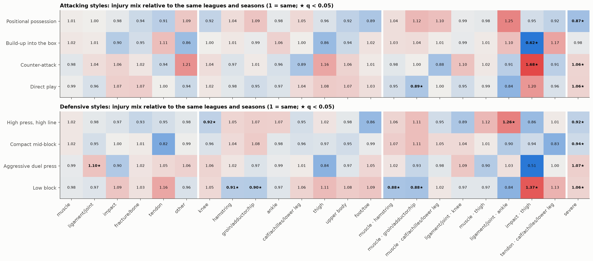
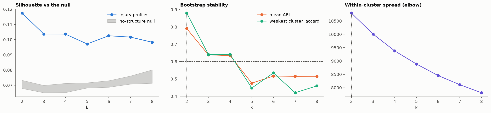
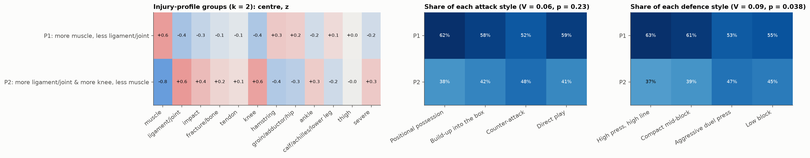

# Phase 6: Injury profiles per style

Generated 2026-10-25 by `notebooks/06_injury_profiles.ipynb`, where each step is shown with its checks.

## Key numbers

- 24,555 injuries > 7 days in 1,170 team-seasons; 17,258 with a known type, 17,056 with a known location.
- **RQ-P1 (does the mix differ by style?):** attack × type: p = 0.0672, V = 0.023; attack × location: p = 0.0129, V = 0.031; attack × pattern: p = 0.0001, V = 0.036; attack × severity: p = 0.0001, V = 0.063; defence × type: p = 0.0251, V = 0.024; defence × location: p = 0.0001, V = 0.036; defence × pattern: p = 0.0001, V = 0.037; defence × severity: p = 0.0001, V = 0.061.
- **RQ-P2 (which patterns?):** 184 style × category tests; 18 findings at q < 0.05, 1 of them robust to position and team strength.
- **RQ-P3 (injury-profile groups):** usable k: 2, 3, 4; chosen k = 2; silhouette 0.117 vs null 95th percentile 0.073; agreement with attacking style V = 0.063 (p = 0.23; within strength 0.455), defensive style V = 0.085 (p = 0.0382; within strength 0.165), strength V = 0.078, league V = 0.038.

## 1. Categories

| family | category | injuries | share of its denominator |
|---|---|---|---|
| type | muscle | 11418 | 0.662 |
| type | ligament/joint | 2138 | 0.124 |
| type | impact | 1805 | 0.105 |
| type | fracture/bone | 842 | 0.049 |
| type | tendon | 562 | 0.033 |
| type | other | 493 | 0.029 |
| location | knee | 3624 | 0.212 |
| location | hamstring | 3249 | 0.19 |
| location | groin/adductor/hip | 2305 | 0.135 |
| location | ankle | 2155 | 0.126 |
| location | calf/achilles/lower leg | 1882 | 0.11 |
| location | thigh | 1069 | 0.063 |
| location | upper body | 1023 | 0.06 |
| location | foot/toe | 837 | 0.049 |
| pattern | muscle · hamstring | 3244 | 0.132 |
| pattern | muscle · groin/adductor/hip | 1676 | 0.068 |
| pattern | muscle · calf/achilles/lower leg | 1350 | 0.055 |
| pattern | ligament/joint · knee | 1246 | 0.051 |
| pattern | muscle · thigh | 723 | 0.029 |
| pattern | ligament/joint · ankle | 566 | 0.023 |
| pattern | impact · thigh | 342 | 0.014 |
| pattern | tendon · calf/achilles/lower leg | 326 | 0.013 |
| severity | severe | 10989 | 0.448 |

## 2. Does the mix differ by style? (omnibus permutation tests)

| phase | family | categories | injuries | T | shuffled T (median) | p | V |
|---|---|---|---|---|---|---|---|
| attack | type | 6 | 17258 | 27.4435 | 16.2835 | 0.0672 | 0.023 |
| attack | location | 9 | 17056 | 47.9446 | 26.4394 | 0.0129 | 0.0306 |
| attack | pattern | 9 | 24555 | 94.3046 | 29.6504 | 0.0001 | 0.0358 |
| attack | severity | 2 | 24555 | 96.951 | 3.3699 | 0.0001 | 0.0628 |
| defence | type | 6 | 17258 | 29.2899 | 14.8077 | 0.0251 | 0.0238 |
| defence | location | 9 | 17056 | 65.7283 | 24.0408 | 0.0001 | 0.0358 |
| defence | pattern | 9 | 24555 | 103.0452 | 27.6655 | 0.0001 | 0.0374 |
| defence | severity | 2 | 24555 | 91.2369 | 3.043 | 0.0001 | 0.061 |

## 3. Profile ratios (observed ÷ expected from league × season; 95% CI over clubs)

### Findings (Benjamini–Hochberg q < 0.05)

| phase | style | family | category | observed | expected | ratio | low | high | q (BH) | ratio + position | ratio + position + strength | adjusted low | adjusted high | robust |
|---|---|---|---|---|---|---|---|---|---|---|---|---|---|---|
| attack | Build-up into the box | pattern | impact · thigh | 77 | 123.484 | 0.624 | 0.403 | 0.888 | 0.003 | 0.63 | 0.713 | 0.5 | 0.993 | True |
| attack | Counter-attack | severity | severe | 2421 | 2291.164 | 1.057 | 1.023 | 1.086 | 0.008 | 1.054 | 1.005 | 0.979 | 1.029 | False |
| attack | Counter-attack | pattern | impact · thigh | 79 | 46.982 | 1.682 | 1.094 | 2.164 | 0.006 | 1.677 | 1.342 | 0.916 | 1.707 | False |
| attack | Direct play | pattern | muscle · groin/adductor/hip | 462 | 519.602 | 0.889 | 0.805 | 0.975 | 0.044 | 0.886 | 0.96 | 0.876 | 1.037 | False |
| attack | Direct play | severity | severe | 3363 | 3172.871 | 1.06 | 1.03 | 1.089 | 0.003 | 1.06 | 1.012 | 0.984 | 1.042 | False |
| attack | Positional possession | severity | severe | 1825 | 2090.647 | 0.873 | 0.826 | 0.918 | 0.003 | 0.874 | 0.955 | 0.905 | 1.001 | False |
| defence | Aggressive duel press | severity | severe | 2630 | 2463.418 | 1.068 | 1.024 | 1.113 | 0.003 | 1.067 | 1.036 | 0.998 | 1.074 | False |
| defence | Aggressive duel press | type | ligament/joint | 588 | 536.464 | 1.096 | 1.013 | 1.177 | 0.038 | 1.09 | 1.064 | 0.992 | 1.136 | False |
| defence | Compact mid-block | severity | severe | 2413 | 2562.468 | 0.942 | 0.899 | 0.987 | 0.005 | 0.942 | 0.983 | 0.947 | 1.02 | False |
| defence | High press, high line | severity | severe | 2426 | 2644.039 | 0.918 | 0.875 | 0.966 | 0.003 | 0.92 | 0.976 | 0.937 | 1.016 | False |
| defence | High press, high line | location | knee | 801 | 871.282 | 0.919 | 0.864 | 0.978 | 0.041 | 0.921 | 0.968 | 0.914 | 1.02 | False |
| defence | High press, high line | pattern | ligament/joint · ankle | 161 | 128.01 | 1.258 | 1.043 | 1.459 | 0.01 | 1.252 | 1.123 | 0.977 | 1.253 | False |
| defence | Low block | pattern | muscle · groin/adductor/hip | 437 | 497.239 | 0.879 | 0.801 | 0.953 | 0.025 | 0.875 | 0.941 | 0.875 | 1.007 | False |
| defence | Low block | pattern | muscle · hamstring | 867 | 980.66 | 0.884 | 0.815 | 0.952 | 0.003 | 0.882 | 0.936 | 0.87 | 1.001 | False |
| defence | Low block | location | groin/adductor/hip | 612 | 677.926 | 0.903 | 0.832 | 0.973 | 0.024 | 0.899 | 0.948 | 0.878 | 1.014 | False |
| defence | Low block | location | hamstring | 870 | 960.976 | 0.905 | 0.844 | 0.968 | 0.006 | 0.906 | 0.948 | 0.886 | 1.01 | False |
| defence | Low block | severity | severe | 3520 | 3319.075 | 1.061 | 1.029 | 1.091 | 0.003 | 1.059 | 1.003 | 0.977 | 1.03 | False |
| defence | Low block | pattern | impact · thigh | 141 | 103.276 | 1.365 | 1.04 | 1.664 | 0.01 | 1.365 | 1.109 | 0.856 | 1.33 | False |

### All tests

| phase | style | family | category | observed | expected | ratio | low | high | q (BH) | ratio + position | ratio + position + strength | adjusted low | adjusted high | robust | p |
|---|---|---|---|---|---|---|---|---|---|---|---|---|---|---|---|
| attack | Positional possession | type | muscle | 2320 | 2303.451 | 1.007 | 0.974 | 1.051 | 0.714 | 1.009 | 0.994 | 0.969 | 1.024 | False | 0.493 |
| attack | Positional possession | type | ligament/joint | 368 | 368.071 | 1.0 | 0.903 | 1.088 | 0.996 | 0.999 | 1.009 | 0.921 | 1.088 | False | 0.996 |
| attack | Positional possession | type | impact | 354 | 360.273 | 0.983 | 0.832 | 1.179 | 0.849 | 0.976 | 1.065 | 0.928 | 1.245 | False | 0.73 |
| attack | Positional possession | type | fracture/bone | 143 | 152.421 | 0.938 | 0.769 | 1.115 | 0.574 | 0.928 | 0.926 | 0.743 | 1.098 | False | 0.351 |
| attack | Positional possession | type | tendon | 87 | 95.444 | 0.912 | 0.656 | 1.132 | 0.563 | 0.914 | 0.956 | 0.716 | 1.171 | False | 0.328 |
| attack | Positional possession | type | other | 97 | 89.34 | 1.086 | 0.878 | 1.268 | 0.527 | 1.095 | 1.055 | 0.873 | 1.219 | False | 0.286 |
| attack | Positional possession | location | knee | 606 | 656.486 | 0.923 | 0.851 | 1.0 | 0.129 | 0.931 | 0.996 | 0.933 | 1.057 | False | 0.02 |
| attack | Positional possession | location | hamstring | 694 | 667.961 | 1.039 | 0.947 | 1.127 | 0.463 | 1.039 | 0.994 | 0.91 | 1.068 | False | 0.224 |
| attack | Positional possession | location | groin/adductor/hip | 453 | 414.987 | 1.092 | 0.989 | 1.188 | 0.137 | 1.089 | 1.006 | 0.917 | 1.092 | False | 0.027 |
| attack | Positional possession | location | ankle | 399 | 405.668 | 0.984 | 0.878 | 1.085 | 0.825 | 0.984 | 0.966 | 0.868 | 1.064 | False | 0.698 |
| attack | Positional possession | location | calf/achilles/lower leg | 391 | 373.158 | 1.048 | 0.955 | 1.139 | 0.527 | 1.046 | 1.042 | 0.958 | 1.132 | False | 0.281 |
| attack | Positional possession | location | thigh | 205 | 212.828 | 0.963 | 0.814 | 1.132 | 0.765 | 0.973 | 1.053 | 0.906 | 1.202 | False | 0.578 |
| attack | Positional possession | location | upper body | 167 | 181.73 | 0.919 | 0.797 | 1.043 | 0.379 | 0.903 | 0.959 | 0.859 | 1.075 | False | 0.169 |
| attack | Positional possession | location | foot/toe | 137 | 154.116 | 0.889 | 0.732 | 1.065 | 0.277 | 0.895 | 0.938 | 0.784 | 1.105 | False | 0.101 |
| attack | Positional possession | pattern | muscle · hamstring | 694 | 670.078 | 1.036 | 0.928 | 1.14 | 0.562 | 1.04 | 0.974 | 0.883 | 1.059 | False | 0.317 |
| attack | Positional possession | pattern | muscle · groin/adductor/hip | 334 | 298.415 | 1.119 | 0.963 | 1.264 | 0.132 | 1.115 | 0.997 | 0.882 | 1.104 | False | 0.022 |
| attack | Positional possession | pattern | muscle · calf/achilles/lower leg | 308 | 278.915 | 1.104 | 0.948 | 1.26 | 0.219 | 1.101 | 1.056 | 0.93 | 1.188 | False | 0.064 |
| attack | Positional possession | pattern | ligament/joint · knee | 206 | 208.346 | 0.989 | 0.854 | 1.102 | 0.922 | 0.993 | 0.985 | 0.846 | 1.084 | False | 0.852 |
| attack | Positional possession | pattern | muscle · thigh | 129 | 131.367 | 0.982 | 0.781 | 1.19 | 0.916 | 0.986 | 0.949 | 0.777 | 1.121 | False | 0.822 |
| attack | Positional possession | pattern | ligament/joint · ankle | 113 | 90.69 | 1.246 | 1.054 | 1.45 | 0.067 | 1.235 | 1.082 | 0.943 | 1.23 | False | 0.008 |
| attack | Positional possession | pattern | impact · thigh | 76 | 79.905 | 0.951 | 0.677 | 1.294 | 0.824 | 0.956 | 1.233 | 0.982 | 1.564 | False | 0.681 |
| attack | Positional possession | pattern | tendon · calf/achilles/lower leg | 50 | 54.324 | 0.92 | 0.544 | 1.327 | 0.733 | 0.92 | 0.903 | 0.538 | 1.271 | False | 0.518 |
| attack | Positional possession | severity | severe | 1825 | 2090.647 | 0.873 | 0.826 | 0.918 | 0.003 | 0.874 | 0.955 | 0.905 | 1.001 | False | 0.0 |
| attack | Build-up into the box | type | muscle | 3625 | 3566.414 | 1.016 | 0.992 | 1.041 | 0.212 | 1.018 | 1.008 | 0.986 | 1.03 | False | 0.059 |
| attack | Build-up into the box | type | ligament/joint | 655 | 646.869 | 1.013 | 0.928 | 1.094 | 0.825 | 1.01 | 1.037 | 0.959 | 1.116 | False | 0.696 |
| attack | Build-up into the box | type | impact | 487 | 538.955 | 0.904 | 0.778 | 1.041 | 0.132 | 0.896 | 0.926 | 0.812 | 1.054 | False | 0.024 |
| attack | Build-up into the box | type | fracture/bone | 239 | 251.212 | 0.951 | 0.845 | 1.066 | 0.574 | 0.952 | 0.969 | 0.877 | 1.066 | False | 0.355 |
| attack | Build-up into the box | type | tendon | 176 | 158.91 | 1.108 | 0.952 | 1.282 | 0.322 | 1.102 | 1.087 | 0.946 | 1.245 | False | 0.128 |
| attack | Build-up into the box | type | other | 125 | 144.639 | 0.864 | 0.712 | 1.018 | 0.158 | 0.862 | 0.87 | 0.729 | 1.013 | False | 0.037 |
| attack | Build-up into the box | location | knee | 1119 | 1116.617 | 1.002 | 0.94 | 1.069 | 0.957 | 1.0 | 1.018 | 0.964 | 1.077 | False | 0.928 |
| attack | Build-up into the box | location | hamstring | 1053 | 1038.578 | 1.014 | 0.942 | 1.091 | 0.768 | 1.017 | 1.005 | 0.94 | 1.078 | False | 0.586 |
| attack | Build-up into the box | location | groin/adductor/hip | 705 | 712.902 | 0.989 | 0.9 | 1.08 | 0.849 | 0.991 | 0.977 | 0.897 | 1.051 | False | 0.725 |
| attack | Build-up into the box | location | ankle | 738 | 693.597 | 1.064 | 0.965 | 1.157 | 0.161 | 1.059 | 1.054 | 0.97 | 1.133 | False | 0.038 |
| attack | Build-up into the box | location | calf/achilles/lower leg | 604 | 601.023 | 1.005 | 0.918 | 1.09 | 0.942 | 1.005 | 0.975 | 0.901 | 1.047 | False | 0.892 |
| attack | Build-up into the box | location | thigh | 298 | 346.332 | 0.86 | 0.724 | 1.008 | 0.051 | 0.863 | 0.893 | 0.766 | 1.037 | False | 0.005 |
| attack | Build-up into the box | location | upper body | 301 | 320.609 | 0.939 | 0.843 | 1.049 | 0.351 | 0.943 | 0.945 | 0.859 | 1.041 | False | 0.147 |
| attack | Build-up into the box | location | foot/toe | 265 | 258.571 | 1.025 | 0.916 | 1.155 | 0.783 | 1.021 | 1.033 | 0.932 | 1.152 | False | 0.622 |
| attack | Build-up into the box | pattern | muscle · hamstring | 1051 | 1016.502 | 1.034 | 0.947 | 1.128 | 0.502 | 1.036 | 1.01 | 0.934 | 1.093 | False | 0.254 |
| attack | Build-up into the box | pattern | muscle · groin/adductor/hip | 525 | 504.677 | 1.04 | 0.939 | 1.145 | 0.536 | 1.047 | 1.002 | 0.912 | 1.09 | False | 0.294 |
| attack | Build-up into the box | pattern | muscle · calf/achilles/lower leg | 437 | 434.409 | 1.006 | 0.867 | 1.156 | 0.942 | 1.008 | 0.954 | 0.834 | 1.075 | False | 0.896 |
| attack | Build-up into the box | pattern | ligament/joint · knee | 379 | 384.317 | 0.986 | 0.88 | 1.103 | 0.857 | 0.983 | 1.022 | 0.919 | 1.131 | False | 0.745 |
| attack | Build-up into the box | pattern | muscle · thigh | 221 | 218.514 | 1.011 | 0.854 | 1.167 | 0.922 | 1.011 | 0.983 | 0.854 | 1.113 | False | 0.851 |
| attack | Build-up into the box | pattern | ligament/joint · ankle | 184 | 166.768 | 1.103 | 0.922 | 1.286 | 0.306 | 1.098 | 1.046 | 0.89 | 1.198 | False | 0.12 |
| attack | Build-up into the box | pattern | impact · thigh | 77 | 123.484 | 0.624 | 0.403 | 0.888 | 0.003 | 0.63 | 0.713 | 0.5 | 0.993 | True | 0.0 |
| attack | Build-up into the box | pattern | tendon · calf/achilles/lower leg | 106 | 90.804 | 1.167 | 0.936 | 1.394 | 0.236 | 1.164 | 1.173 | 0.954 | 1.399 | False | 0.076 |
| attack | Build-up into the box | severity | severe | 3380 | 3434.319 | 0.984 | 0.948 | 1.023 | 0.434 | 0.985 | 1.01 | 0.977 | 1.045 | False | 0.203 |
| attack | Counter-attack | type | muscle | 2260 | 2316.011 | 0.976 | 0.943 | 1.004 | 0.199 | 0.974 | 0.989 | 0.959 | 1.016 | False | 0.054 |
| attack | Counter-attack | type | ligament/joint | 506 | 488.478 | 1.036 | 0.933 | 1.123 | 0.574 | 1.037 | 1.005 | 0.916 | 1.08 | False | 0.355 |
| attack | Counter-attack | type | impact | 397 | 374.738 | 1.059 | 0.877 | 1.246 | 0.527 | 1.074 | 1.046 | 0.884 | 1.202 | False | 0.286 |
| attack | Counter-attack | type | fracture/bone | 196 | 192.305 | 1.019 | 0.883 | 1.163 | 0.87 | 1.004 | 1.007 | 0.873 | 1.145 | False | 0.762 |
| attack | Counter-attack | type | tendon | 132 | 141.097 | 0.936 | 0.775 | 1.112 | 0.648 | 0.938 | 0.925 | 0.787 | 1.07 | False | 0.433 |
| attack | Counter-attack | type | other | 123 | 101.371 | 1.213 | 0.994 | 1.437 | 0.088 | 1.219 | 1.142 | 0.952 | 1.349 | False | 0.012 |
| attack | Counter-attack | location | knee | 822 | 793.369 | 1.036 | 0.968 | 1.105 | 0.495 | 1.033 | 0.999 | 0.934 | 1.056 | False | 0.247 |
| attack | Counter-attack | location | hamstring | 629 | 649.823 | 0.968 | 0.883 | 1.051 | 0.591 | 0.965 | 1.004 | 0.929 | 1.076 | False | 0.379 |
| attack | Counter-attack | location | groin/adductor/hip | 491 | 485.22 | 1.012 | 0.929 | 1.093 | 0.875 | 1.011 | 1.034 | 0.959 | 1.109 | False | 0.776 |
| attack | Counter-attack | location | ankle | 433 | 451.068 | 0.96 | 0.843 | 1.07 | 0.574 | 0.963 | 0.979 | 0.871 | 1.078 | False | 0.341 |
| attack | Counter-attack | location | calf/achilles/lower leg | 337 | 379.719 | 0.887 | 0.791 | 0.989 | 0.132 | 0.891 | 0.923 | 0.825 | 1.014 | False | 0.023 |
| attack | Counter-attack | location | thigh | 232 | 199.822 | 1.161 | 0.981 | 1.333 | 0.132 | 1.153 | 1.09 | 0.943 | 1.23 | False | 0.022 |
| attack | Counter-attack | location | upper body | 246 | 232.052 | 1.06 | 0.927 | 1.21 | 0.519 | 1.072 | 1.058 | 0.938 | 1.187 | False | 0.271 |
| attack | Counter-attack | location | foot/toe | 190 | 187.528 | 1.013 | 0.876 | 1.145 | 0.922 | 1.011 | 0.958 | 0.832 | 1.072 | False | 0.84 |
| attack | Counter-attack | pattern | muscle · hamstring | 627 | 641.166 | 0.978 | 0.882 | 1.072 | 0.768 | 0.973 | 1.024 | 0.942 | 1.105 | False | 0.597 |
| attack | Counter-attack | pattern | muscle · groin/adductor/hip | 355 | 353.306 | 1.005 | 0.909 | 1.108 | 0.957 | 1.005 | 1.057 | 0.966 | 1.15 | False | 0.929 |
| attack | Counter-attack | pattern | muscle · calf/achilles/lower leg | 219 | 249.737 | 0.877 | 0.74 | 1.018 | 0.219 | 0.885 | 0.947 | 0.822 | 1.075 | False | 0.063 |
| attack | Counter-attack | pattern | ligament/joint · knee | 304 | 276.655 | 1.099 | 0.97 | 1.232 | 0.225 | 1.095 | 1.069 | 0.958 | 1.182 | False | 0.068 |
| attack | Counter-attack | pattern | muscle · thigh | 151 | 148.739 | 1.015 | 0.851 | 1.196 | 0.922 | 1.011 | 1.018 | 0.856 | 1.191 | False | 0.848 |
| attack | Counter-attack | pattern | ligament/joint · ankle | 116 | 127.221 | 0.912 | 0.749 | 1.064 | 0.509 | 0.911 | 0.974 | 0.809 | 1.129 | False | 0.26 |
| attack | Counter-attack | pattern | impact · thigh | 79 | 46.982 | 1.682 | 1.094 | 2.164 | 0.006 | 1.677 | 1.342 | 0.916 | 1.707 | False | 0.0 |
| attack | Counter-attack | pattern | tendon · calf/achilles/lower leg | 76 | 83.224 | 0.913 | 0.702 | 1.13 | 0.635 | 0.915 | 0.884 | 0.695 | 1.074 | False | 0.418 |
| attack | Counter-attack | severity | severe | 2421 | 2291.164 | 1.057 | 1.023 | 1.086 | 0.008 | 1.054 | 1.005 | 0.979 | 1.029 | False | 0.0 |
| attack | Direct play | type | muscle | 3213 | 3232.123 | 0.994 | 0.967 | 1.02 | 0.75 | 0.992 | 1.004 | 0.978 | 1.028 | False | 0.546 |
| attack | Direct play | type | ligament/joint | 609 | 634.581 | 0.96 | 0.887 | 1.026 | 0.447 | 0.962 | 0.954 | 0.881 | 1.022 | False | 0.212 |
| attack | Direct play | type | impact | 567 | 531.034 | 1.068 | 0.972 | 1.162 | 0.296 | 1.072 | 1.0 | 0.92 | 1.085 | False | 0.114 |
| attack | Direct play | type | fracture/bone | 264 | 246.062 | 1.073 | 0.936 | 1.211 | 0.386 | 1.093 | 1.072 | 0.945 | 1.205 | False | 0.174 |
| attack | Direct play | type | tendon | 167 | 166.549 | 1.003 | 0.835 | 1.175 | 0.977 | 1.004 | 1.003 | 0.845 | 1.155 | False | 0.972 |
| attack | Direct play | type | other | 148 | 157.65 | 0.939 | 0.783 | 1.086 | 0.562 | 0.933 | 0.988 | 0.841 | 1.135 | False | 0.313 |
| attack | Direct play | location | knee | 1077 | 1057.528 | 1.018 | 0.957 | 1.081 | 0.681 | 1.018 | 0.985 | 0.93 | 1.043 | False | 0.466 |
| attack | Direct play | location | hamstring | 873 | 892.638 | 0.978 | 0.893 | 1.066 | 0.672 | 0.977 | 0.996 | 0.926 | 1.065 | False | 0.453 |
| attack | Direct play | location | groin/adductor/hip | 656 | 691.892 | 0.948 | 0.878 | 1.024 | 0.278 | 0.948 | 0.996 | 0.934 | 1.063 | False | 0.104 |
| attack | Direct play | location | ankle | 585 | 604.667 | 0.967 | 0.897 | 1.041 | 0.574 | 0.97 | 0.976 | 0.905 | 1.048 | False | 0.35 |
| attack | Direct play | location | calf/achilles/lower leg | 550 | 528.1 | 1.041 | 0.94 | 1.142 | 0.527 | 1.04 | 1.053 | 0.959 | 1.144 | False | 0.285 |
| attack | Direct play | location | thigh | 334 | 310.019 | 1.077 | 0.928 | 1.225 | 0.358 | 1.071 | 1.019 | 0.888 | 1.148 | False | 0.152 |
| attack | Direct play | location | upper body | 309 | 288.609 | 1.071 | 0.961 | 1.18 | 0.339 | 1.068 | 1.038 | 0.947 | 1.142 | False | 0.14 |
| attack | Direct play | location | foot/toe | 245 | 236.785 | 1.035 | 0.911 | 1.159 | 0.742 | 1.036 | 1.038 | 0.923 | 1.153 | False | 0.53 |
| attack | Direct play | pattern | muscle · hamstring | 872 | 916.254 | 0.952 | 0.857 | 1.052 | 0.329 | 0.951 | 0.992 | 0.917 | 1.068 | False | 0.132 |
| attack | Direct play | pattern | muscle · groin/adductor/hip | 462 | 519.602 | 0.889 | 0.805 | 0.975 | 0.044 | 0.886 | 0.96 | 0.876 | 1.037 | False | 0.004 |
| attack | Direct play | pattern | muscle · calf/achilles/lower leg | 386 | 386.939 | 0.998 | 0.874 | 1.121 | 0.975 | 0.992 | 1.046 | 0.929 | 1.151 | False | 0.958 |
| attack | Direct play | pattern | ligament/joint · knee | 357 | 376.682 | 0.948 | 0.848 | 1.042 | 0.467 | 0.951 | 0.935 | 0.834 | 1.029 | False | 0.229 |
| attack | Direct play | pattern | muscle · thigh | 222 | 224.379 | 0.989 | 0.859 | 1.115 | 0.926 | 0.99 | 1.038 | 0.907 | 1.165 | False | 0.86 |
| attack | Direct play | pattern | ligament/joint · ankle | 153 | 181.321 | 0.844 | 0.703 | 0.988 | 0.088 | 0.852 | 0.918 | 0.776 | 1.06 | False | 0.011 |
| attack | Direct play | pattern | impact · thigh | 110 | 91.63 | 1.2 | 0.9 | 1.557 | 0.243 | 1.181 | 0.969 | 0.75 | 1.223 | False | 0.081 |
| attack | Direct play | pattern | tendon · calf/achilles/lower leg | 94 | 97.647 | 0.963 | 0.74 | 1.189 | 0.825 | 0.964 | 0.997 | 0.787 | 1.211 | False | 0.699 |
| attack | Direct play | severity | severe | 3363 | 3172.871 | 1.06 | 1.03 | 1.089 | 0.003 | 1.06 | 1.012 | 0.984 | 1.042 | False | 0.0 |
| defence | High press, high line | type | muscle | 2715 | 2665.858 | 1.018 | 0.988 | 1.052 | 0.236 | 1.021 | 1.003 | 0.979 | 1.026 | False | 0.077 |
| defence | High press, high line | type | ligament/joint | 491 | 500.743 | 0.981 | 0.905 | 1.052 | 0.768 | 0.984 | 1.002 | 0.93 | 1.066 | False | 0.594 |
| defence | High press, high line | type | impact | 477 | 494.054 | 0.965 | 0.868 | 1.083 | 0.637 | 0.954 | 1.011 | 0.919 | 1.113 | False | 0.422 |
| defence | High press, high line | type | fracture/bone | 182 | 195.491 | 0.931 | 0.796 | 1.06 | 0.495 | 0.922 | 0.909 | 0.772 | 1.052 | False | 0.247 |
| defence | High press, high line | type | tendon | 131 | 137.41 | 0.953 | 0.759 | 1.151 | 0.75 | 0.95 | 1.021 | 0.839 | 1.215 | False | 0.55 |
| defence | High press, high line | type | other | 105 | 107.445 | 0.977 | 0.793 | 1.137 | 0.871 | 0.983 | 1.021 | 0.858 | 1.173 | False | 0.767 |
| defence | High press, high line | location | knee | 801 | 871.282 | 0.919 | 0.864 | 0.978 | 0.041 | 0.921 | 0.968 | 0.914 | 1.02 | False | 0.004 |
| defence | High press, high line | location | hamstring | 814 | 771.716 | 1.055 | 0.967 | 1.142 | 0.225 | 1.058 | 1.005 | 0.925 | 1.08 | False | 0.068 |
| defence | High press, high line | location | groin/adductor/hip | 600 | 560.978 | 1.07 | 0.993 | 1.148 | 0.186 | 1.069 | 1.035 | 0.97 | 1.103 | False | 0.048 |
| defence | High press, high line | location | ankle | 564 | 528.635 | 1.067 | 0.965 | 1.176 | 0.219 | 1.063 | 1.026 | 0.93 | 1.129 | False | 0.064 |
| defence | High press, high line | location | calf/achilles/lower leg | 418 | 438.307 | 0.954 | 0.842 | 1.059 | 0.511 | 0.95 | 0.967 | 0.871 | 1.063 | False | 0.264 |
| defence | High press, high line | location | thigh | 270 | 263.588 | 1.024 | 0.853 | 1.197 | 0.824 | 1.033 | 1.099 | 0.938 | 1.251 | False | 0.676 |
| defence | High press, high line | location | upper body | 242 | 247.12 | 0.979 | 0.875 | 1.082 | 0.824 | 0.979 | 0.966 | 0.874 | 1.06 | False | 0.677 |
| defence | High press, high line | location | foot/toe | 177 | 206.875 | 0.856 | 0.738 | 0.984 | 0.093 | 0.857 | 0.903 | 0.786 | 1.03 | False | 0.013 |
| defence | High press, high line | pattern | muscle · hamstring | 814 | 771.046 | 1.056 | 0.965 | 1.147 | 0.264 | 1.062 | 1.003 | 0.921 | 1.084 | False | 0.094 |
| defence | High press, high line | pattern | muscle · groin/adductor/hip | 446 | 402.864 | 1.107 | 0.996 | 1.223 | 0.088 | 1.107 | 1.054 | 0.96 | 1.148 | False | 0.012 |
| defence | High press, high line | pattern | muscle · calf/achilles/lower leg | 292 | 307.961 | 0.948 | 0.809 | 1.096 | 0.563 | 0.947 | 0.938 | 0.813 | 1.057 | False | 0.325 |
| defence | High press, high line | pattern | ligament/joint · knee | 251 | 282.229 | 0.889 | 0.792 | 0.989 | 0.143 | 0.894 | 0.93 | 0.841 | 1.017 | False | 0.029 |
| defence | High press, high line | pattern | muscle · thigh | 187 | 167.171 | 1.119 | 0.913 | 1.319 | 0.262 | 1.127 | 1.087 | 0.915 | 1.249 | False | 0.088 |
| defence | High press, high line | pattern | ligament/joint · ankle | 161 | 128.01 | 1.258 | 1.043 | 1.459 | 0.01 | 1.252 | 1.123 | 0.977 | 1.253 | False | 0.001 |
| defence | High press, high line | pattern | impact · thigh | 82 | 95.224 | 0.861 | 0.581 | 1.21 | 0.422 | 0.865 | 1.115 | 0.824 | 1.361 | False | 0.195 |
| defence | High press, high line | pattern | tendon · calf/achilles/lower leg | 81 | 80.061 | 1.012 | 0.727 | 1.371 | 0.95 | 0.999 | 1.079 | 0.799 | 1.415 | False | 0.908 |
| defence | High press, high line | severity | severe | 2426 | 2644.039 | 0.918 | 0.875 | 0.966 | 0.003 | 0.92 | 0.976 | 0.937 | 1.016 | False | 0.0 |
| defence | Compact mid-block | type | muscle | 2902 | 2853.081 | 1.017 | 0.987 | 1.048 | 0.264 | 1.018 | 1.013 | 0.984 | 1.043 | False | 0.095 |
| defence | Compact mid-block | type | ligament/joint | 508 | 533.106 | 0.953 | 0.845 | 1.057 | 0.405 | 0.952 | 0.967 | 0.871 | 1.062 | False | 0.185 |
| defence | Compact mid-block | type | impact | 432 | 433.131 | 0.997 | 0.835 | 1.187 | 0.975 | 0.997 | 1.0 | 0.862 | 1.162 | False | 0.96 |
| defence | Compact mid-block | type | fracture/bone | 204 | 202.259 | 1.009 | 0.874 | 1.146 | 0.936 | 1.005 | 1.058 | 0.93 | 1.181 | False | 0.88 |
| defence | Compact mid-block | type | tendon | 106 | 129.73 | 0.817 | 0.655 | 0.975 | 0.132 | 0.811 | 0.809 | 0.654 | 0.958 | True | 0.025 |
| defence | Compact mid-block | type | other | 131 | 131.694 | 0.995 | 0.824 | 1.171 | 0.957 | 0.99 | 0.956 | 0.801 | 1.114 | False | 0.931 |
| defence | Compact mid-block | location | knee | 822 | 853.035 | 0.964 | 0.889 | 1.042 | 0.447 | 0.963 | 0.981 | 0.913 | 1.045 | False | 0.214 |
| defence | Compact mid-block | location | hamstring | 817 | 782.566 | 1.044 | 0.974 | 1.123 | 0.372 | 1.044 | 1.039 | 0.97 | 1.118 | False | 0.16 |
| defence | Compact mid-block | location | groin/adductor/hip | 610 | 565.923 | 1.078 | 0.972 | 1.172 | 0.148 | 1.081 | 1.02 | 0.94 | 1.098 | False | 0.032 |
| defence | Compact mid-block | location | ankle | 502 | 513.136 | 0.978 | 0.892 | 1.068 | 0.752 | 0.975 | 0.981 | 0.897 | 1.063 | False | 0.556 |
| defence | Compact mid-block | location | calf/achilles/lower leg | 446 | 463.326 | 0.963 | 0.831 | 1.073 | 0.578 | 0.961 | 0.955 | 0.843 | 1.049 | False | 0.361 |
| defence | Compact mid-block | location | thigh | 274 | 283.677 | 0.966 | 0.817 | 1.142 | 0.75 | 0.97 | 0.979 | 0.84 | 1.139 | False | 0.55 |
| defence | Compact mid-block | location | upper body | 219 | 230.783 | 0.949 | 0.829 | 1.091 | 0.573 | 0.95 | 1.013 | 0.902 | 1.123 | False | 0.336 |
| defence | Compact mid-block | location | foot/toe | 190 | 192.387 | 0.988 | 0.83 | 1.152 | 0.922 | 0.987 | 1.013 | 0.864 | 1.153 | False | 0.837 |
| defence | Compact mid-block | pattern | muscle · hamstring | 816 | 761.37 | 1.072 | 0.972 | 1.184 | 0.192 | 1.072 | 1.046 | 0.953 | 1.15 | False | 0.051 |
| defence | Compact mid-block | pattern | muscle · groin/adductor/hip | 441 | 397.895 | 1.108 | 0.964 | 1.242 | 0.106 | 1.108 | 1.023 | 0.92 | 1.112 | False | 0.015 |
| defence | Compact mid-block | pattern | muscle · calf/achilles/lower leg | 341 | 326.15 | 1.046 | 0.869 | 1.199 | 0.616 | 1.04 | 1.004 | 0.858 | 1.127 | False | 0.402 |
| defence | Compact mid-block | pattern | ligament/joint · knee | 313 | 299.708 | 1.044 | 0.921 | 1.179 | 0.591 | 1.042 | 1.037 | 0.926 | 1.158 | False | 0.379 |
| defence | Compact mid-block | pattern | muscle · thigh | 174 | 171.955 | 1.012 | 0.849 | 1.174 | 0.929 | 1.021 | 0.996 | 0.839 | 1.156 | False | 0.868 |
| defence | Compact mid-block | pattern | ligament/joint · ankle | 131 | 145.249 | 0.902 | 0.714 | 1.076 | 0.374 | 0.895 | 0.875 | 0.692 | 1.049 | False | 0.164 |
| defence | Compact mid-block | pattern | impact · thigh | 100 | 105.965 | 0.944 | 0.707 | 1.285 | 0.777 | 0.946 | 0.967 | 0.764 | 1.223 | False | 0.612 |
| defence | Compact mid-block | pattern | tendon · calf/achilles/lower leg | 59 | 70.768 | 0.834 | 0.59 | 1.088 | 0.339 | 0.838 | 0.799 | 0.564 | 1.03 | False | 0.138 |
| defence | Compact mid-block | severity | severe | 2413 | 2562.468 | 0.942 | 0.899 | 0.987 | 0.005 | 0.942 | 0.983 | 0.947 | 1.02 | False | 0.0 |
| defence | Aggressive duel press | type | muscle | 2703 | 2742.908 | 0.985 | 0.961 | 1.013 | 0.277 | 0.985 | 0.989 | 0.965 | 1.014 | False | 0.102 |
| defence | Aggressive duel press | type | ligament/joint | 588 | 536.464 | 1.096 | 1.013 | 1.177 | 0.038 | 1.09 | 1.064 | 0.992 | 1.136 | False | 0.003 |
| defence | Aggressive duel press | type | impact | 280 | 312.208 | 0.897 | 0.749 | 1.06 | 0.164 | 0.898 | 0.919 | 0.767 | 1.083 | False | 0.04 |
| defence | Aggressive duel press | type | fracture/bone | 221 | 215.899 | 1.024 | 0.905 | 1.153 | 0.805 | 1.031 | 1.002 | 0.884 | 1.121 | False | 0.643 |
| defence | Aggressive duel press | type | tendon | 161 | 153.591 | 1.048 | 0.855 | 1.232 | 0.674 | 1.065 | 1.081 | 0.903 | 1.248 | False | 0.458 |
| defence | Aggressive duel press | type | other | 136 | 127.93 | 1.063 | 0.893 | 1.223 | 0.562 | 1.07 | 1.054 | 0.907 | 1.201 | False | 0.318 |
| defence | Aggressive duel press | location | knee | 877 | 828.775 | 1.058 | 0.984 | 1.137 | 0.133 | 1.06 | 1.029 | 0.963 | 1.096 | False | 0.026 |
| defence | Aggressive duel press | location | hamstring | 748 | 733.741 | 1.019 | 0.908 | 1.127 | 0.72 | 1.015 | 1.018 | 0.927 | 1.104 | False | 0.502 |
| defence | Aggressive duel press | location | groin/adductor/hip | 483 | 500.173 | 0.966 | 0.883 | 1.057 | 0.563 | 0.968 | 1.002 | 0.927 | 1.082 | False | 0.323 |
| defence | Aggressive duel press | location | ankle | 437 | 442.746 | 0.987 | 0.879 | 1.081 | 0.849 | 0.986 | 0.993 | 0.894 | 1.083 | False | 0.734 |
| defence | Aggressive duel press | location | calf/achilles/lower leg | 425 | 420.963 | 1.01 | 0.923 | 1.097 | 0.904 | 1.01 | 1.026 | 0.952 | 1.099 | False | 0.805 |
| defence | Aggressive duel press | location | thigh | 172 | 204.93 | 0.839 | 0.672 | 1.018 | 0.067 | 0.835 | 0.851 | 0.694 | 1.011 | False | 0.008 |
| defence | Aggressive duel press | location | upper body | 232 | 238.841 | 0.971 | 0.847 | 1.103 | 0.742 | 0.966 | 0.947 | 0.835 | 1.066 | False | 0.533 |
| defence | Aggressive duel press | location | foot/toe | 195 | 185.271 | 1.053 | 0.888 | 1.216 | 0.574 | 1.061 | 1.018 | 0.865 | 1.169 | False | 0.343 |
| defence | Aggressive duel press | pattern | muscle · hamstring | 747 | 730.924 | 1.022 | 0.893 | 1.149 | 0.72 | 1.018 | 1.028 | 0.919 | 1.139 | False | 0.504 |
| defence | Aggressive duel press | pattern | muscle · groin/adductor/hip | 352 | 378.002 | 0.931 | 0.833 | 1.033 | 0.264 | 0.937 | 0.985 | 0.892 | 1.083 | False | 0.092 |
| defence | Aggressive duel press | pattern | muscle · calf/achilles/lower leg | 275 | 281.392 | 0.977 | 0.86 | 1.089 | 0.824 | 0.976 | 1.008 | 0.892 | 1.129 | False | 0.677 |
| defence | Aggressive duel press | pattern | ligament/joint · knee | 341 | 313.998 | 1.086 | 0.959 | 1.212 | 0.186 | 1.081 | 1.051 | 0.948 | 1.161 | False | 0.047 |
| defence | Aggressive duel press | pattern | muscle · thigh | 150 | 166.379 | 0.902 | 0.752 | 1.06 | 0.278 | 0.895 | 0.926 | 0.781 | 1.077 | False | 0.106 |
| defence | Aggressive duel press | pattern | ligament/joint · ankle | 151 | 146.258 | 1.032 | 0.825 | 1.223 | 0.772 | 1.031 | 1.072 | 0.888 | 1.238 | False | 0.604 |
| defence | Aggressive duel press | pattern | impact · thigh | 19 | 37.536 | 0.506 | 0.303 | 1.001 | 0.067 | 0.497 | 0.501 | 0.307 | 0.906 | True | 0.008 |
| defence | Aggressive duel press | pattern | tendon · calf/achilles/lower leg | 92 | 92.33 | 0.996 | 0.752 | 1.211 | 0.975 | 1.007 | 1.054 | 0.823 | 1.239 | False | 0.965 |
| defence | Aggressive duel press | severity | severe | 2630 | 2463.418 | 1.068 | 1.024 | 1.113 | 0.003 | 1.067 | 1.036 | 0.998 | 1.074 | False | 0.0 |
| defence | Low block | type | muscle | 3098 | 3156.153 | 0.982 | 0.952 | 1.006 | 0.189 | 0.98 | 0.995 | 0.97 | 1.016 | False | 0.049 |
| defence | Low block | type | ligament/joint | 551 | 567.688 | 0.971 | 0.874 | 1.055 | 0.592 | 0.974 | 0.967 | 0.88 | 1.045 | False | 0.383 |
| defence | Low block | type | impact | 616 | 565.607 | 1.089 | 0.981 | 1.221 | 0.132 | 1.1 | 1.032 | 0.948 | 1.139 | False | 0.025 |
| defence | Low block | type | fracture/bone | 235 | 228.351 | 1.029 | 0.91 | 1.167 | 0.768 | 1.034 | 1.029 | 0.925 | 1.151 | False | 0.596 |
| defence | Low block | type | tendon | 164 | 141.27 | 1.161 | 0.981 | 1.368 | 0.158 | 1.153 | 1.066 | 0.919 | 1.249 | False | 0.037 |
| defence | Low block | type | other | 121 | 125.931 | 0.961 | 0.791 | 1.155 | 0.763 | 0.954 | 0.975 | 0.808 | 1.164 | False | 0.572 |
| defence | Low block | location | knee | 1124 | 1070.908 | 1.05 | 0.984 | 1.113 | 0.158 | 1.048 | 1.016 | 0.961 | 1.07 | False | 0.035 |
| defence | Low block | location | hamstring | 870 | 960.976 | 0.905 | 0.844 | 0.968 | 0.006 | 0.906 | 0.948 | 0.886 | 1.01 | False | 0.0 |
| defence | Low block | location | groin/adductor/hip | 612 | 677.926 | 0.903 | 0.832 | 0.973 | 0.024 | 0.899 | 0.948 | 0.878 | 1.014 | False | 0.002 |
| defence | Low block | location | ankle | 652 | 670.483 | 0.972 | 0.896 | 1.046 | 0.591 | 0.978 | 0.998 | 0.921 | 1.07 | False | 0.374 |
| defence | Low block | location | calf/achilles/lower leg | 593 | 559.403 | 1.06 | 0.973 | 1.152 | 0.264 | 1.064 | 1.043 | 0.964 | 1.123 | False | 0.091 |
| defence | Low block | location | thigh | 353 | 316.806 | 1.114 | 0.964 | 1.254 | 0.148 | 1.106 | 1.034 | 0.922 | 1.146 | False | 0.032 |
| defence | Low block | location | upper body | 330 | 306.256 | 1.078 | 0.972 | 1.191 | 0.225 | 1.081 | 1.06 | 0.97 | 1.16 | False | 0.071 |
| defence | Low block | location | foot/toe | 275 | 252.467 | 1.089 | 0.967 | 1.221 | 0.225 | 1.082 | 1.051 | 0.942 | 1.162 | False | 0.071 |
| defence | Low block | pattern | muscle · hamstring | 867 | 980.66 | 0.884 | 0.815 | 0.952 | 0.003 | 0.882 | 0.936 | 0.87 | 1.001 | False | 0.0 |
| defence | Low block | pattern | muscle · groin/adductor/hip | 437 | 497.239 | 0.879 | 0.801 | 0.953 | 0.025 | 0.875 | 0.941 | 0.875 | 1.007 | False | 0.002 |
| defence | Low block | pattern | muscle · calf/achilles/lower leg | 442 | 434.498 | 1.017 | 0.897 | 1.136 | 0.825 | 1.023 | 1.037 | 0.933 | 1.141 | False | 0.693 |
| defence | Low block | pattern | ligament/joint · knee | 341 | 350.065 | 0.974 | 0.849 | 1.087 | 0.754 | 0.977 | 0.975 | 0.853 | 1.088 | False | 0.562 |
| defence | Low block | pattern | muscle · thigh | 212 | 217.495 | 0.975 | 0.811 | 1.124 | 0.824 | 0.968 | 0.99 | 0.843 | 1.128 | False | 0.68 |
| defence | Low block | pattern | ligament/joint · ankle | 123 | 146.483 | 0.84 | 0.684 | 0.981 | 0.132 | 0.851 | 0.932 | 0.792 | 1.06 | False | 0.023 |
| defence | Low block | pattern | impact · thigh | 141 | 103.276 | 1.365 | 1.04 | 1.664 | 0.01 | 1.365 | 1.109 | 0.856 | 1.33 | False | 0.001 |
| defence | Low block | pattern | tendon · calf/achilles/lower leg | 94 | 82.84 | 1.135 | 0.888 | 1.42 | 0.374 | 1.131 | 1.046 | 0.826 | 1.327 | False | 0.164 |
| defence | Low block | severity | severe | 3520 | 3319.075 | 1.061 | 1.029 | 1.091 | 0.003 | 1.059 | 1.003 | 0.977 | 1.03 | False | 0.0 |

## 4. Clustering team-seasons by injury profile

1023 team-seasons with at least 10 injuries; features: smoothed deviation from the league-season mix (α = 10), standardised.

| k | inertia | silhouette | null silhouette (mean) | null silhouette (95th pct) | stability (mean ARI) | min cluster Jaccard | smallest cluster | above null | usable |
|---|---|---|---|---|---|---|---|---|---|
| 2 | 10795.852 | 0.117 | 0.068 | 0.073 | 0.791 | 0.88 | 432 | True | True |
| 3 | 10008.365 | 0.104 | 0.065 | 0.07 | 0.639 | 0.641 | 303 | True | True |
| 4 | 9377.137 | 0.104 | 0.065 | 0.071 | 0.634 | 0.641 | 176 | True | True |
| 5 | 8887.048 | 0.097 | 0.068 | 0.072 | 0.476 | 0.447 | 132 | True | False |
| 6 | 8454.466 | 0.103 | 0.069 | 0.073 | 0.517 | 0.535 | 113 | True | False |
| 7 | 8111.574 | 0.102 | 0.071 | 0.076 | 0.515 | 0.42 | 98 | True | False |
| 8 | 7809.156 | 0.098 | 0.071 | 0.08 | 0.515 | 0.46 | 93 | True | False |

Group centres (z):

| index | muscle | ligament/joint | impact | fracture/bone | tendon | knee | hamstring | groin/adductor/hip | ankle | calf/achilles/lower leg | thigh | severe |
|---|---|---|---|---|---|---|---|---|---|---|---|---|
| P1: more muscle, less ligament/joint | 0.6 | -0.45 | -0.27 | -0.14 | -0.09 | -0.4 | 0.28 | 0.23 | -0.18 | 0.15 | 0.01 | -0.2 |
| P2: more ligament/joint & more knee, less muscle | -0.82 | 0.61 | 0.37 | 0.2 | 0.13 | 0.55 | -0.38 | -0.32 | 0.25 | -0.2 | -0.01 | 0.27 |

| group | team-seasons |
|---|---|
| P1: more muscle, less ligament/joint | 591 |
| P2: more ligament/joint & more knee, less muscle | 432 |

## 5. Do the groups line up with styles?

| compared with | Cramér's V | ARI | permutation p | permutation p (within strength) |
|---|---|---|---|---|
| attack style | 0.0629 | 0.0002 | 0.2299 | 0.4546 |
| defence style | 0.0855 | 0.001 | 0.0382 | 0.1655 |
| strength | 0.0782 | 0.0038 | nan | nan |
| league | 0.0383 | -0.0008 | nan | nan |
| era | 0.0422 | -0.0003 | nan | nan |

Share of each attack style in each group (%):

| group | Positional possession | Build-up into the box | Counter-attack | Direct play |
|---|---|---|---|---|
| P1: more muscle, less ligament/joint | 62.0 | 58.0 | 52.0 | 59.0 |
| P2: more ligament/joint & more knee, less muscle | 38.0 | 42.0 | 48.0 | 41.0 |

Share of each defence style in each group (%):

| group | High press, high line | Compact mid-block | Aggressive duel press | Low block |
|---|---|---|---|---|
| P1: more muscle, less ligament/joint | 63.0 | 61.0 | 53.0 | 55.0 |
| P2: more ligament/joint & more knee, less muscle | 37.0 | 39.0 | 47.0 | 45.0 |

## 6. Outputs

- `data/06_injury_profiles/tables/`: omnibus tests, profile ratios, k selection, group centres, associations.
- `data/06_injury_profiles/team_season_profiles.parquet`: each team-season's injury-profile group.
