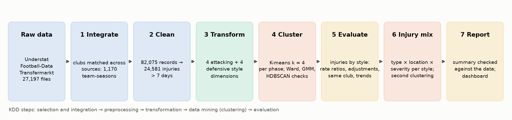
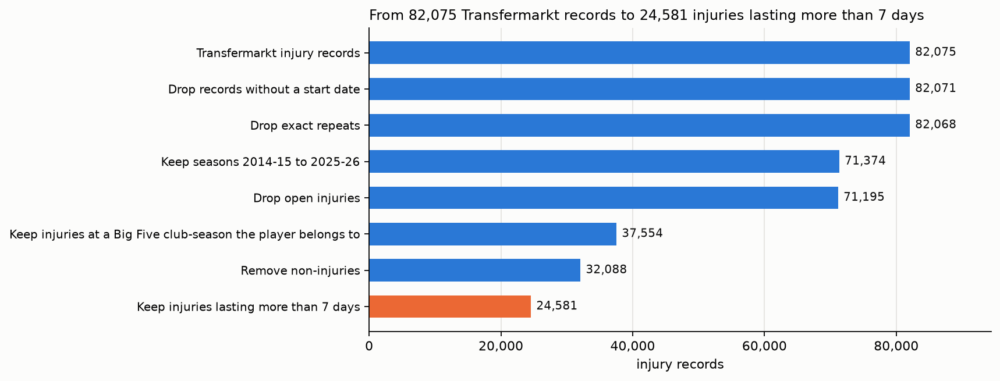
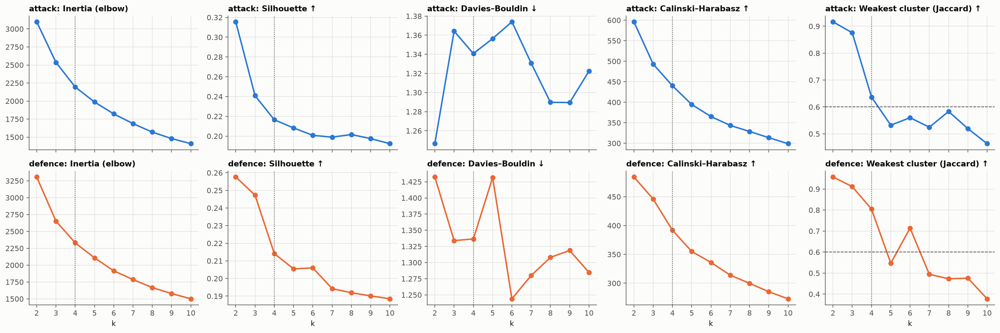
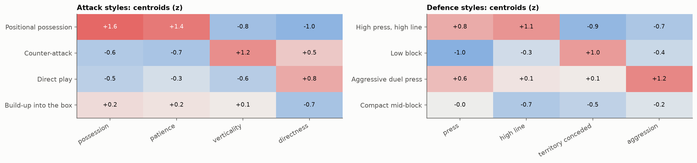
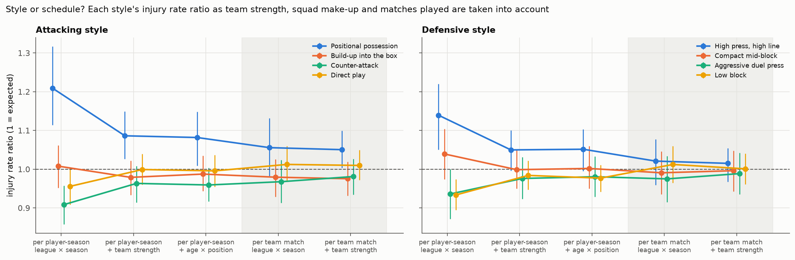
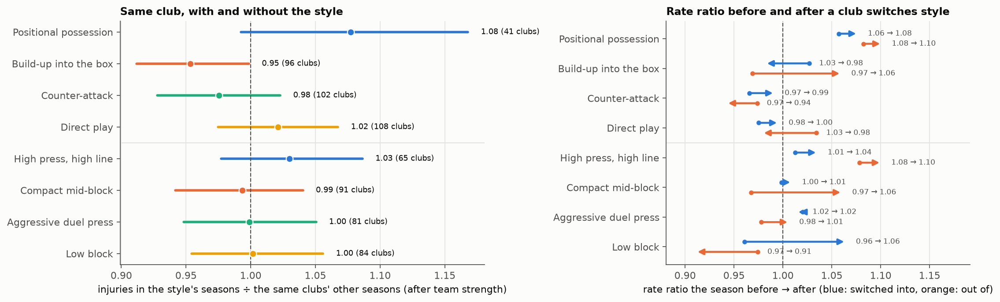
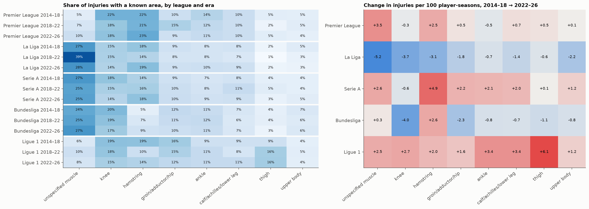

# Playing Style and Injury Patterns in Europe's Big Five Football Leagues (2014/15–2025/26)

*Style changes the kind of injury more than the number, but most of it travels with team strength.*

Master's data mining project, An-Najah National University. Summary of methods and results for the course report.
Every number below is produced by the notebooks in `notebooks/` (00–06) and checked by `notebooks/07_report.ipynb`;
decisions are logged in `docs/DECISIONS.md`, every preprocessing step with row counts in `docs/PREPROCESSING_LOG.md`.

## Abstract

We clustered all 1,170 team-seasons of the Premier League, La Liga, Serie A, Bundesliga and Ligue 1 from 2014/15 to
2025/26 by **playing style per phase of play**: an attacking style (K-means on possession, patience, verticality and
directness) and a defensive style (K-means on pressing, line height, territory conceded and aggression), each with
four clusters and compared against Ward clustering. Every player-season (36,525) inherits its team's styles, and
24,581 injuries lasting more than seven days from Transfermarkt were compared across styles, seasons and leagues.
Football changed markedly: patient positional possession grew from 6% to 25% of team-seasons, direct and
counter-attacking play shrank, pressing and fouling declined, and back-three systems rose from 13% to 31% of minutes.
Players in **positional-possession** teams had 21% more injuries per player-season than the league-season average
(rate ratio 1.21, 95% CI 1.11–1.32), and high-press, high-line teams 14% more. Most of that comes with being a strong
team that plays more matches: the possession ratio falls to 1.09 after team strength, 1.08 after age and position,
and 1.05 per team match after strength (CI 1.00–1.10); the high press falls to 1.05 and 1.02. A small excess for
possession remains in every version; it is an association, not a cause. Comparing the same clubs' seasons with and
without possession gives 1.08 after team strength (CI 0.99–1.17), and clubs switching into or out of a style show no
consistent change, so the evidence for an effect of the style itself is weak. The **kind** of injury differs more
consistently than the number. Compared with the injury mix of the same leagues and seasons, the injuries of possession
and high-press teams lean to muscle injuries and are less often severe (possession: 13% fewer severe injuries,
profile ratio 0.87), while those of low-block, duel-pressing and counter-attacking teams lean to contact and joint
injuries and are more often severe; 18 of 184 style × injury-category patterns survive the false-discovery-rate
correction. A second clustering of team-seasons by injury mix finds two weak but real groups, a muscle-heavy one and a
joint- and contact-heavy one (silhouette 0.12 vs 0.08 for shuffled data), which line up with the defensive styles
(Cramér's V 0.11, p = 0.005). Most of this travels with team strength: with strength in the expected mix only 1 pattern
remains (Build-up into the box: fewer thigh contusions) and the agreement with style is no longer significant
(p = 0.07). Body-area differences alone are small: only 2 of 72 patterns survive a permutation test with correction for multiple comparisons (the low block has
fewer hamstring injuries, the high press fewer knee injuries). Between 2014–18 and 2022–26 injuries rose by
+0.043 per player-season; a Kitagawa decomposition attributes +0.038 to the shift in attacking styles beyond team
strength (+0.073 when strength is ignored).

## 1. Research questions and related work

**Aim.** Find whether changes in how football is played in the Big Five leagues coincide with changes in how often
players get injured, how badly and where, and whether this differs between leagues. The data mining task is
unsupervised: discover playing styles by clustering team-seasons, then compare injuries across the discovered styles.

- **RQ1. Styles:** which attacking and defensive styles exist in 2014/15–2025/26, and how did their mix change?
- **RQ2. Frequency and severity:** do players of teams in different styles get injured more often or for longer, and
  does any difference remain after team strength, squad make-up and matches played are taken into account?
- **RQ3. Kind of injury:** do styles differ in which injuries players get (type, body area, severity), and do
  team-seasons group by their injury mix in a way that matches the styles? (Injury type and this injury-mix analysis
  were added on 2026-10-25, after the rate results; their research questions and tests were written down before
  their results, `docs/ANALYSIS_PLAN.md`.)
- **RQ4. Seasons and leagues:** do injury frequency, severity and body areas change over the seasons, how much of the
  change goes with the changing style mix, and do the patterns differ between leagues?

**Success criteria** used throughout: a clustering is usable when every cluster's mean bootstrap Jaccard is at least
0.6 (Hennig 2007) and no cluster holds less than 3% of team-seasons; a style difference counts when its 95% confidence
interval excludes 1 and it keeps its direction in every sensitivity check; a body-area pattern counts when it survives
the false-discovery-rate correction (q < 0.05); an injury-mix pattern counts when it survives the correction over all
184 style × category tests, and is robust when its 95% CI still excludes 1 with position and team strength in the
expected mix; injury-profile groups count when they are stable (the same Jaccard rule) and separate better than data
with the features shuffled.

**Related work.** Mavriopoulos, Sarlis and Tjortjis (2026) asked whether high-possession teams in the Big Five have a
greater reported injury burden, using machine learning across leagues; after correction for multiple comparisons
they found more injuries or matches missed for higher-possession profiles in some leagues and not others. Hoenig et
al. (2022) showed that Transfermarkt injury data are usable mainly for severe injuries. Playing styles have been
described per phase of play (Fernandez-Navarro et al. 2016; Plakias et al. 2025) and found by clustering event data
(Demir, Şahin and Üre). This project differs in four ways: styles are **discovered by clustering**, separately for the
attacking and the defensive phase, rather than measured by one variable such as possession; the **kind of injury**
(type, body area, severity) is compared per style, and team-seasons are clustered a second time by their injury mix; the comparison is **adjusted step by step** for team strength, squad make-up and matches played,
with a same-club comparison; and the injury **trend** is decomposed into the part that goes with the changing style
mix.



*Figure 0. The pipeline, from the three raw sources to the report, following the KDD steps; each box is one phase of
`analysis/phases/` with what it produces.*

## 2. Data

Collected raw from three public sources and combined for the first time (`docs/scraper/scraper-spec.md`).

| Source | What | Volume |
|---|---|---|
| Understat | per-match PPDA, deep completions, xG (league data); per team-season attack speed, shot situations, formations, shot zones (team data) | 60 league-season + 1,170 team-season payloads |
| Football-Data.co.uk | per-match fouls, cards, corners, scores, dates | 60 CSVs, 21,589 matches |
| Transfermarkt | squads, injury histories, per-match player records (minutes, participation), fixtures in all competitions | 27,077 responses, 12,848 players, 82,075 injury records |

Raw responses are stored unchanged (`data/raw/`, ~17 GB); coverage is complete for all 60 league-seasons (Phase 0).
Sources: understat.com, football-data.co.uk, transfermarkt.com (collected October 2026). Every variable is defined in
`reports/data_dictionary.md`.

### 2a. Ethics and data use

- **Public sources only**, collected for non-commercial academic use. Requests were rate-limited with back-off and
  every response was stored once and reused, so no page was fetched more than needed
  (`docs/scraper/scraper-spec.md`). Each site's terms of use apply to the raw data.
- **No redistribution:** raw responses and parsed tables (`data/`) are kept out of the repository and are not shared;
  only code, hand-reviewed mappings and aggregate results are.
- **Health data about identifiable people:** injury histories are public on Transfermarkt but are health information
  about named players. Results are reported only for groups (styles, team-seasons, leagues, eras); no individual
  player's injuries are discussed. Player photos in the dashboard come from Wikimedia Commons with their licences.
- **Data quality is reported, not hidden:** under-reporting and uneven recording are stated wherever they matter
  (Sections 5 and 7).

## 3. Preprocessing

| Step | What was done | Result |
|---|---|---|
| Integration (Phase 1) | Clubs matched across the three sources within each league-season (exact → normalised → fuzzy, one-to-one Hungarian assignment), verified on fixtures | 1,170 team-seasons; all 21,589 matches found in all three sources |
| Injury cleaning (Phase 2) | Dates and durations parsed; injuries tied to the club the player was at on the injury date (per-match records); Big Five membership (≥ 1 appearance or marked injured); 315 labels mapped to injury vs non-injury and 12 body areas (reviewed); summer-2020 season rule | 82,075 → 24,581 injuries > 7 days (13,588 moderate, 10,993 severe); 5,466 non-injuries and 5,180 mild injuries kept separately |
| Features (Phase 3) | Per team-season: pressing, ball progression, attack type and shape, physical intensity (style); npxG (outcome); matches, European games, short rest, rotation (exposure); global z-scores; correlated features combined into phase-of-play dimensions | 4 attacking + 4 defensive style dimensions; shots on target dropped (Serie A source error); rest gaps > 21 days excluded |



*Figure P1. Injury records through each cleaning step (Phase 2): most records drop out because the player was not at a
Big Five club that season, or the absence was not an injury or lasted 7 days or less.*

Missing values: none in the 1,170 team-season features; 179 injuries still open when collected were dropped, and 21
players without a date of birth have no age (left out of the age-adjusted comparison only). Every step with its exact
row counts is in `docs/PREPROCESSING_LOG.md`.

## 4. Method

**What is clustered, and why it differs from the proposal.** The proposal planned to cluster style and workload
together. With workload and outcome features (matches, European games, short rest, xG) included, the clusters mostly
sorted teams by strength rather than by how they play, so the final clustering uses **style only**: 4 attacking and
4 defensive dimensions, each the equal-weight mean of its features' z-scores (standardised over all team-seasons, so
change over time stays visible). Workload is used as **exposure** in the injury comparison instead. Distance is
Euclidean on these standardised dimensions. Outliers were kept (at most 14 team-seasons beyond 3 SD on any dimension):
they are real extreme seasons, not errors, and the consensus and density checks below show the styles do not hinge on
them.

**Clustering (the data mining step).** For each phase, K-means (50 starts, seed 42) for k = 2…10, judged by elbow,
silhouette, Davies–Bouldin, Calinski–Harabasz, bootstrap stability (mean ARI and per-cluster Jaccard, Hennig 2007)
and interpretability, and compared with Ward hierarchical clustering. k = 4 was chosen for both phases (attack:
silhouette 0.22, weakest cluster Jaccard 0.64; defence: 0.21 and 0.80). For attack this is an interpretive choice
on a continuum (k = 2–3 score better on silhouette); k = 3 loses the modern styles and k = 5 produces dissolving
clusters. The independent checks agree only moderately: Ward (ARI 0.39 attack, 0.35 defence) and a Gaussian mixture
(0.30 and 0.54; its BIC prefers k = 2), so styles form a continuum and the clusters are useful divisions of it. A
consensus of bootstrap K-means, bootstrap GMM and Ward partitions (ARI 0.89 and 0.92 with K-means) summarises
stability, not independent validation. A density-based check (HDBSCAN, 10 settings per phase) finds no separated
groups: at most two small ones, with most team-seasons labelled noise. Clusters are named by rule (Figure 1). Each team-season also gets a **fuzzy
membership** (0–1) in every style from the K-means centroids (fuzzy c-means memberships, m = 2); ≥ 0.5 in its own
style makes it a clear member (703 attack, 679 defence). Two sensitivity clusterings check the injury results: k = 3,
and K-means on the dimensions centred within each league-season (style relative to the league that season).



*Figure M1. Cluster quality against the number of clusters k for each phase of play: within-cluster spread (elbow),
silhouette, Davies–Bouldin, Calinski–Harabasz and bootstrap stability. k = 4 is usable for both phases (every cluster's
Jaccard ≥ 0.6) and gives interpretable styles; the measures change gradually, as expected for a continuum.*

**Injury analysis.** Unit: player-club-season. Rates: injuries and days lost per player-season (overlapping
absences merged so no day counts twice), injuries per 1,000 minutes, severe share. Because Transfermarkt records
injuries at very different rates per league and season, groups are compared by a **rate ratio** (observed ÷ expected;
indirect standardisation) with **nested expected values**: league × season (main), then + team strength (thirds of
points per match), then + age band × position; and with two exposures, per player-season and per team match
(matches in all competitions). 95% confidence intervals come from 1,000 bootstrap resamples of **clubs**; absolute
excess injuries per 100 player-seasons are shown next to each ratio. Body-area patterns are tested by permutation
(style labels shuffled among team-seasons within each league-season, 10,000 times) and corrected for the 72
comparisons (Benjamini–Hochberg, q < 0.05). Small attack × defence cells are shrunk towards the average (empirical
Bayes); season trends are shown with 3-season rolling means. Trends: three eras (2014–18, 2018–22, 2022–26), style
transitions between seasons, and a Kitagawa decomposition of injury changes into strength mix, style mix and
within-style change. No regression or classification model is used (course constraint).

**Injury mix and the second clustering (Phase 6).** Each injury has a type (muscle, ligament/joint, impact,
fracture/bone, tendon, other; 30% unspecified, e.g. "Knee injury"), a body area and a severity. For each style and
category, the **profile ratio** is observed ÷ expected injuries of that category, expected from the category's share
among injuries of the same league and season (then + position, then + team strength): 1 means the style's injuries
have the usual mix. Shares within a style's injuries largely cancel exposure and under-reporting, which act on all
kinds of injury alike. CIs come from the club bootstrap, p-values from shuffling style labels among team-seasons within
league-seasons (10,000 times), corrected over the 184 tests. Then 1,023 team-seasons with at least 10 injuries are
clustered by K-means on how their injury mix departs from their league-season's (5 types, 6 locations, severe share;
shares smoothed with 10 pseudo-injuries, standardised), with k chosen by the same stability rule and compared with a
null in which each feature is shuffled within league-seasons. The adjustments for team
strength and matches, the club bootstrap and the permutation test were added after an independent methods review
(`docs/DECISIONS.md`).

## 5. Results

### 5.1 The playing styles

| Phase | Style | How it plays (core teams) | Typical team-seasons |
|---|---|---|---|
| Attack | **Positional possession** | dominates the ball, slow patient build-up; 10.0 deep completions per match (all teams 6.1) | Barcelona 14-15, Inter 17-18, Real Madrid 21-22, Napoli 22-23 |
| Attack | **Build-up into the box** | moderate possession, works the ball into the box; 34% of shots from outside the box (38%) | Gladbach 17-18, Lille 21-22, Leicester 21-22, Nice 25-26 |
| Attack | **Counter-attack** | little of the ball, fast vertical attacks; 8% of shots from fast attacks (6%) | Stoke 16-17, Burnley 19-20, Cagliari 23-24 |
| Attack | **Direct play** | long-range shots and set plays; 41% of shots from outside the box | Swansea 14-15, Saint-Étienne 20-21, Genoa 23-24 |
| Defence | **High press, high line** | PPDA 8.9 (10.9), exposed to counters | Atalanta 18-19, PSG 21-22, Brighton 22-23 |
| Defence | **Compact mid-block** | protected line, concedes little, clean | Gladbach 19-20, Rennes 23-24, Atlético 25-26 |
| Defence | **Aggressive duel press** | presses through fouls and duels; 14.8 fouls per match (12.5) | Betis 19-20, Verona 21-22, Alavés 25-26 |
| Defence | **Low block** | sits deep; PPDA 13.6, 7.8 deep completions conceded | Freiburg 16-17, Everton 21-22, Girona 25-26 |

Positional possession pairs with the high press in 60% of its team-seasons (PSG 21-22, Brighton 22-23, Napoli
22-23); counter-attack and direct play pair with the low block or the aggressive duel press. Formation is not a style:
back-three minutes are similar across styles (18–29%).

**Plausibility.** Team-seasons whose coaches' styles are widely described land where expected in 8 of 9 cases on the
described trait: Manchester City 2017-18, Brighton 2022-23 and Napoli 2017-18 are Positional possession with a high
press; Leverkusen 2023-24 is Positional possession; Atalanta 2019-20 presses high; Leicester 2015-16 is
Counter-attack with a low block; Burnley 2017-18 is Direct play with a low block. Atlético 2015-16 comes out as a
compact mid-block but not as counter-attacking. Styles are not just leagues or seasons (Cramér's V with league 0.11
for attack and 0.29 for defence; with season 0.24 and 0.20).



*Figure 1. Style centroids (`figures/04_centroids.png`): the mean of each standardised dimension per style, orange
above and blue below the all-team average; the defining dimension of each style stands out (e.g. possession +1.6 for
Positional possession). Figure A4 (`figures/04_pca.png`) places every team-season on the first two principal
components of its phase, coloured by style: the styles touch, consistent with a continuum.*

### 5.2 How football changed

| Measure (all leagues) | 2014–18 | 2018–22 | 2022–26 | Shape |
|---|---|---|---|---|
| Shots from slow, patient attacks | 4.4% | 5.7% | 7.1% | rising in every league |
| Deep completions per match | 5.7 | 6.0 | 6.5 | rising |
| Shots from outside the box | 41% | 38% | 34% | falling in every league |
| PPDA (higher = less pressing) | 9.7 | 11.1 | 11.9 | pressing falling in every league |
| Fouls per match | 13.3 | 12.4 | 11.9 | falling |
| Minutes in a back three | 13% | 26% | 31% | rising in every league |

Style mix: Positional possession 6% → 25% of team-seasons and Build-up into the box 17% → 42%, while Direct play
40% → 18% and Counter-attack 36% → 14%; Low block 19% → 41%, Aggressive duel press 38% → 13%, High press steady at
about 20%. Clubs keep their attacking style from one season to the next about half the time.


*Figure 2. Style shares per league and season (`figures/05_style_shares_by_league.png`): the share of team-seasons in
each attacking and defensive style; Positional possession and the low block grow in every league while direct and
counter-attacking play shrink. Figure A2 shows the underlying dimensions season by season.*

### 5.3 Injuries by style

Rate ratios against the league-season average (95% CI over clubs):

| Style | Injuries / player-season | Days lost / player-season | Injury RR (95% CI) | Days-lost RR (95% CI) |
|---|---|---|---|---|
| Positional possession | 0.85 | 33.8 | **1.21 (1.11–1.32)** | 1.07 (0.98–1.17) |
| Build-up into the box | 0.68 | 30.8 | 1.01 (0.95–1.06) | 1.01 (0.95–1.06) |
| Counter-attack | 0.60 | 29.0 | **0.91 (0.86–0.96)** | 0.96 (0.91–1.02) |
| Direct play | 0.64 | 29.0 | 0.96 (0.91–1.00) | 0.99 (0.94–1.04) |
| High press, high line | 0.75 | 31.9 | **1.14 (1.05–1.22)** | 1.04 (0.98–1.10) |
| Compact mid-block | 0.66 | 27.6 | 1.04 (0.97–1.10) | 0.98 (0.93–1.03) |
| Aggressive duel press | 0.64 | 28.9 | 0.94 (0.87–1.00) | 0.99 (0.93–1.06) |
| Low block | 0.66 | 32.4 | **0.93 (0.89–0.97)** | 0.99 (0.95–1.04) |
| Back three / back four | – | – | 0.98 / 1.00 | – |

**Adjusting step by step** (injury RR, 95% CI):

| Expected value | Positional possession | High press, high line |
|---|---|---|
| league × season (per player-season) | 1.21 (1.11–1.32) | 1.14 (1.05–1.22) |
| + team strength | 1.09 (1.03–1.15) | 1.05 (1.00–1.10) |
| + age × position | 1.08 (1.01–1.15) | 1.05 (0.99–1.10) |
| per team match, league × season | 1.06 (0.98–1.13) | 1.02 (0.96–1.08) |
| per team match, + team strength | 1.05 (1.00–1.10) | 1.02 (0.97–1.05) |



*Figure 3b. Each style's injury rate ratio (95% CI) as the comparison is made stricter, left to right: league-season
average, then teams of the same strength, then the same age and position mix; shaded, per team match played. The
possession and high-press excess shrinks towards 1; the other styles stay close to 1 throughout.*

- **Team strength and match load explain most of the style differences.** 88% of possession team-seasons are in the
  strongest third, and these teams play 51.7 matches a season against 41.8 for counter-attacking teams. Compared with
  teams of the same strength, Positional possession is 1.09 after team strength, 1.08 after age and position, and
  1.05 per team match after strength. For the high press: 1.05 after team strength and 1.02 per match.
  Counter-attack, direct play, the duel press and the low block are all within 0.96–1.01 once strength and matches
  are taken into account.
- What remains is a **small, consistent possession excess**: above 1 in every adjusted version, with every
  defensive style (1.14–1.25 in the common combinations, unadjusted), in all five leagues (1.04–1.71 unadjusted), with
  k = 3 clusters (1.15) and with style measured relative to the league-season (1.21; 1.08 after strength).
- Robust in direction in every sensitivity check (≥ 900 minutes, injuries > 3 days, multi-club players out, players
  with ≥ 1 appearance only, COVID seasons out), but **smaller for severe injuries** (1.07), which are reported more
  reliably. Days lost show no clear style difference (days-lost RR 0.96–1.07, all CIs include 1).
- Busy schedules go with more injuries: the busiest third of teams by short rest has RR 1.13 (1.06–1.20).
- **Same club, with and without the style:** for the 41 clubs that played some seasons in Positional possession and
  some not, injuries in their possession seasons are 1.15 times those in their other seasons against the league-season
  average, 1.08 after team strength (CI 0.99–1.17) and 1.07 per match (0.99–1.14). Clubs switching into possession go
  from 1.06 to 1.08 the next season, and clubs switching out from 1.08 to 1.10: no consistent change. For every other
  style the same-club ratio after strength is 0.95–1.03.



*Figure 3c. Left: injuries in a style's seasons divided by the same clubs' injuries in their other seasons, after team
strength (95% CI over clubs); every interval includes or nearly touches 1. Right: the rate ratio the season before and
after a club switched into (blue) or out of (orange) a style. For Positional possession both moves change little
(1.06 → 1.08 in, 1.08 → 1.10 out). Only the low block moves the way a style effect would (0.96 → 1.06 in, 0.97 → 0.91
out), although its overall and same-club ratios are about 1; with 76–98 switches each, this is read as noise.*


*Figure 3. Injury and days-lost rate ratios by style with 95% confidence intervals (`figures/05_rates_by_style.png`;
1 = the league-season average), and the attack × defence grid (`figures/05_attack_defence_grid.png`): reading along a
row changes only the defensive style, down a column only the attacking style.*

### 5.4 What kind of injuries: the injury mix by style

The mix of injuries differs between styles more consistently than their number, although every difference is small
(effect sizes V 0.02–0.06). Omnibus permutation tests reject "same mix" for location, type × location patterns and
severity in both phases of play; for type alone only in the defensive phase. 18 of 184 style × injury-category
patterns survive the false-discovery-rate correction, and they form one picture:

| Style | Leans towards (profile ratio, 95% CI) | With team strength in the expected mix |
|---|---|---|
| Positional possession | fewer severe injuries, 0.87 (0.82–0.92) | 0.95 (0.90–1.00) |
| High press, high line | fewer severe (0.92), fewer knee (0.92), more ankle ligament (1.26) | 0.98, 0.97, 1.12 |
| Low block | more severe (1.06), fewer hamstring (0.91), more thigh contusions (1.37) | 1.00, 0.95, 1.11 |
| Aggressive duel press | more ligament/joint (1.10), more severe (1.07) | 1.07, 1.04 |
| Counter-attack | more severe (1.06), more thigh contusions (1.68) | 1.00, 1.34 |
| Build-up into the box | fewer thigh contusions, 0.62 (0.40–0.89) | 0.71 (0.50–0.99): the only robust pattern |

Ball-dominant, proactive teams have relatively more muscle injuries and fewer severe ones; reactive, deep or
duel-seeking teams have relatively more contact and joint injuries (contusions, ligaments) and more severe ones. With
team strength added to the expected mix the ratios move most of the way back to 1, and only 1 pattern remains
(Build-up into the box: fewer thigh contusions).


*Figure 7. Profile ratios (`figures/06_profile_ratios.png`): for each style, injuries of each type, location, type ×
location pattern and severity relative to the mix of the same leagues and seasons (1 = same; red more, blue fewer;
★ survives the false-discovery-rate correction).*

**Do team-seasons group by injury mix?** Yes, weakly. Clustering 1,023 team-seasons by their injury mix gives two
stable groups (bootstrap Jaccard 0.89) that separate better than shuffled data (silhouette 0.12 vs 0.08 for shuffled data, 95th
percentile): a **muscle-heavy** group (591 team-seasons: more muscle, hamstring and groin injuries, fewer severe) and a
**joint- and contact-heavy** group (432: more ligament, knee, ankle and impact injuries, more severe). The groups
line up with the defensive styles (Cramér's V 0.11, p = 0.005): 65% of high-press and 62% of mid-block team-seasons are
in the muscle-heavy group against 52% of duel-press and 54% of low-block ones; they barely follow the attacking styles
(V 0.07, p = 0.11), the league (0.04) or the era (0.05), so they are not a recording habit of one league. They follow
team strength about as much as defensive style (V 0.10), and with style labels shuffled only within strength thirds
the agreement is no longer significant (p = 0.07).


*Figure 7b. The two injury-profile groups (`figures/06_profile_clusters.png`): group centres (z-scores of the departure
from the league-season mix) and the share of each attacking and defensive style in each group.*

#### Body areas alone (Phase 5)


Body-area patterns were tested by shuffling style labels among team-seasons within each league-season, which keeps a
squad's injuries together. 2 of 72 patterns survive the false-discovery-rate correction (q < 0.05):
- **Low block: fewer hamstring injuries** (Mantel–Haenszel odds ratio 0.82, q = 0.02).
- **High press, high line: fewer knee injuries** (0.85, q = 0.04).

Tendencies that do not survive the correction (q 0.05–0.10): fewer groin injuries with the low block, fewer knee
injuries with Positional possession, more knee injuries with the aggressive duel press (above the league in 4 of 5
leagues). The earlier per-injury test overstated these patterns, because it treated injuries of one squad as
independent. The overall effect is small (Cramér's V 0.04–0.05): styles differ more in **how often** players get
injured than in **where**.

**Across leagues and eras.** Hamstring injuries rose from 8.3 to 10.1 per 100 player-seasons between 2014–18 and
2022–26 and rose in 4 of five leagues (all but La Liga); knee injuries fell from 10.5 to 9.4 and fell in four of five
(all but Ligue 1). The shares of the other areas move with each league's labelling (unspecified muscle is common in La
Liga), so areas are compared over time within a league rather than between leagues.




*Figure 4. Body areas by style (`figures/05_body_areas_by_style.png`): each style's share of injuries in an area relative
to its league's share (median over leagues; x/5 = leagues above 1). Figure 4b (`figures/05_body_areas_by_league_era.png`):
the share of known-area injuries by league and era, and the change in injuries per 100 player-seasons between the
first and last era.*

### 5.5 Injury trends and the style shift

Injuries rose from 0.646 to 0.689 per player-season and days lost from 30.1 to 31.8 between 2014–18 and 2022–26
(Figure 5). The Kitagawa decomposition, with cells league × strength third × style, splits the change into the
strength mix, the style mix beyond strength, and change within styles:

| Outcome per player-season | Change | Strength mix | Style mix (beyond strength) | Within styles | Style mix, strength ignored |
|---|---|---|---|---|---|
| Injuries | +0.043 | +0.008 | +0.046 | −0.011 | +0.065 |
| Days lost | +1.7 | +0.1 | +1.6 | +0.1 | +2.5 |
| Hamstring injuries | +0.018 (+22%) | +0.002 | +0.008 | +0.008 | +0.010 |
| Knee injuries | −0.011 | 0.000 | +0.004 | −0.016 | +0.009 |

Most of the style-mix part comes from the **attacking** shift: +0.038 beyond team strength (+0.073 when strength is
ignored), against +0.007 from the defensive shift. The style-mix part is positive in four of five leagues (La Liga
−0.009). It is an upper bound on the role of style: the possession cluster itself got weaker on average over time
(points per match 2.19 → 1.86), so it is not the same group of teams in each era. The within-style part differs by
league, partly because of recording changes.


*Figure 5. Injuries per player-season by season with 95% confidence intervals and calendar events
(`figures/05_season_trend.png`), and the decomposition of the change between eras into style mix and change within
styles, overall and per league (`figures/05_trend_decomposition.png`).*

### 5.6 Leagues

- **Premier League:** positional possession 10% → 35%; injuries 0.56 → 0.71, of which +0.09 from the style mix
  beyond strength.
- **La Liga:** counter-attack 48% → 16%, aggressive duel press 76% → 39%; injuries fell (0.71 → 0.49) within styles;
  the style mix had no effect beyond strength (−0.01).
- **Serie A:** the back three became the norm (29% → 52% of minutes), aggressive duel press 55% → 6%; injuries
  0.74 → 0.89, hamstring injuries 0.083 → 0.133.
- **Bundesliga:** low block 15% → 61%, direct play 44% → 6%; injuries fell within styles.
- **Ligue 1:** build-up into the box 12% → 41%, counter-attack 41% → 9%; injuries 0.37 → 0.60.


*Figure 6. Style rate ratios within each league (`figures/05_style_within_league.png`): the same comparison as Figure 3,
league by league, to show which patterns hold everywhere.*

## 6. Discussion

The main finding is that **style goes with the kind of injury more than with the number, and most of both travels
with team strength.** Proactive, ball-dominant teams' injuries lean to muscle and overuse injuries and are less
severe; reactive, deep and duel-seeking teams' injuries lean to contact and joint injuries and are more severe. This
fits how the game is played (fewer duels and tackles faced, more high-speed running in possession), but strong teams
play the proactive styles, and with strength taken into account little remains: one robust pattern, and an injury-mix
clustering whose agreement with style is no longer significant. Better recording of minor injuries at prominent clubs
could also make their injuries look less severe. For the number of injuries (style or schedule? mostly schedule):
possession and the high press are played
mostly by strong teams with long seasons (European football), and once team strength and matches played are taken
into account their excess falls from 21% and 14% to about 5% and 2%. A plausible reading, not measured here (no
tracking data), is that match load and squad demands drive most of the difference, and that possession play may add a
little through more high-speed actions in the opponent's half. The same-club comparison points the same way: a club's
possession seasons have slightly more injuries than its other seasons (about 8% after strength, not significant), and
switching style does not move its injury rate. Styles barely change **where** players get hurt; the
two robust patterns are protective (low block: fewer hamstring injuries; high press: fewer knee injuries). As the Big
Five moved towards patient possession, the style mix shifted towards the slightly more injury-prone styles, which
accounts for part of the rise in injuries (+0.038 of +0.043 from the attacking shift beyond strength), but this is an
upper bound and the link holds between styles and across eras, not season to season (within-league season-to-season
correlations |r| ≤ 0.3), so other long-run changes (sports science, calendars, recording) move in parallel.

## 7. Limitations

- **Transfermarkt under-reports injuries** (about 0.63 per player-season vs 1.5–2.5 in clinical studies) and records
  them unevenly by league and over time (Premier League 2018-19 jump; rising share of unknown body areas). League-
  adjusted rates and within-league checks reduce, but cannot remove, this.
- **Coverage bias:** injuries at famous clubs are probably recorded more completely; the possession effect shrinks for
  severe, better-reported injuries (1.21 → 1.07), and part of the remaining excess may still be recording.
- **Style proxies:** Understat and Football-Data give team-level match statistics; tracking and event data (pressing
  height, crossing, width, long balls, running load) are not available, so some literature styles (crossing, wide vs
  narrow possession) cannot be measured.
- **League matches only** for style; workload uses all competitions. No training load or exposure data; injuries on
  international duty cannot be separated.
- **Association, not causation:** styles go with team strength (eta² 0.39 attack, 0.34 defence) and match load; results
  are adjusted for both and checked within leagues, but unmeasured factors (squad depth, medical staff, rotation
  policy) remain.
- **Clusters on a continuum:** silhouette about 0.2, moderate Ward and GMM agreement, and no dense groups for HDBSCAN; borderline teams are assigned
  to the nearer style (core-only, k = 3 and relative-style checks give the same direction).
- **Ecological assignment:** every player-season takes its team's style, including players who barely played; the
  ≥ 900-minute check gives the same direction (Positional possession 1.26).
- **Analytic flexibility:** the clustering was redesigned twice during the project (style and workload; 8 dimensions
  with k = 7; then per phase with k = 4) for interpretability, and k was chosen from the clustering measures. Injury
  results were computed for earlier versions too, so the final choice was not independent of having seen them; the
  sensitivity clusterings (k = 3, relative style) and the stable direction of the results limit, but do not remove,
  this risk.
- **Injury type is often missing:** 30% of injuries have no type (labels such as "Knee injury"), most of them knee and
  ankle injuries, so joint injuries are compared on the minority of labels that say what happened. Labels that name
  only a muscle group (e.g. "Hamstring injury") count as muscle injuries.
- **The injury-mix analysis came last:** it was added after the rate results were known, with its questions and tests
  written down before its results; after the first run two criteria were made stricter (robustness needs the adjusted
  CI to exclude 1; the cluster–style agreement is also tested within strength thirds), which can only remove findings.
- **Multiple comparisons:** the false-discovery-rate correction covers the 72 body-area tests and the 184 injury-mix
  tests; the eight style rate
  ratios and their sensitivity variants are not corrected, so single borderline intervals (several touch 1 after
  adjustment) should not be read as findings.
- **Censoring:** 179 injuries still open when the data were collected (mostly 2025-26) were dropped, so days lost in the
  last season are slightly under-counted.

## 8. Conclusion

**In one sentence:** style changes the kind of injury more than the number, but most of it travels with team strength.

- **RQ1:** Four attacking styles (Positional possession, Build-up into the box, Counter-attack, Direct play) and four
  defensive styles (High press, high line; Compact mid-block; Aggressive duel press; Low block) describe the Big Five,
  as divisions of a continuum rather than separate groups. Football moved towards patient possession and deep
  defending: Positional possession 6% → 25% of team-seasons, Low block 19% → 41%.
- **RQ2:** Players of Positional-possession and high-press teams have more injuries (rate ratios 1.21 and 1.14), but
  mostly because these are strong teams that play more matches; after both adjustments a small possession excess
  remains (about 1.05), the same club's possession seasons are not clearly different from its other seasons, and
  severity (days lost) does not differ by style. Style or schedule? Mostly schedule.
- **RQ3:** Styles differ in the kind of injury, slightly but consistently: proactive, ball-dominant styles lean to
  muscle injuries and fewer severe ones, reactive and duel-seeking styles to contact and joint injuries and more severe
  ones (18 of 184 patterns after correction), and team-seasons form two injury-mix groups (muscle-heavy; joint- and
  contact-heavy) that line up with the defensive styles. With team strength taken into account only one pattern
  remains and the agreement is no longer significant. Body areas alone: two patterns hold (low block: fewer hamstring
  injuries; high press: fewer knee injuries).
- **RQ4:** Injuries rose slightly between 2014–18 and 2022–26 (0.646 → 0.689 per player-season), hamstring injuries
  rose in four of five leagues and knee injuries fell in four. The shift in styles goes with part of the rise, but
  the link holds across eras, not season to season, and leagues differ, partly through recording.

**Future work.** Tracking or event data to measure high-speed running and pressing height directly; training load and
minutes-based exposure per player; clinical injury records to check the Transfermarkt patterns; injury rates weighted
by fuzzy style membership instead of hard assignment; and a player-level analysis of players who changed clubs and
styles.

## 9. Reproducing

```sh
cd scraper && docker compose up --build          # collect raw data (or reuse data/raw) and parse to data/tables
uv run --group analysis python -m analysis.run all --force   # every phase, step by step, from the tables
uv run --group analysis python -m analysis.run status        # each phase: up to date or stale, and why
```

Each phase is one script in `analysis/phases/`; the runner records every step's checks, row counts and outputs in
`data/NN_*/_run.json` with the input hashes, the git commit and the seed (42). Notebooks are generated from the same
scripts (`scripts/notebooks/build_notebook.py`), and `analysis/phases/p07_report.py` checks that the numbers in this
summary match the data.

## Interactive results

The analysis app (`app/`, step 2 of the local dashboard at http://127.0.0.1:8765/analysis) walks every phase and step,
shows the clustering diagnostics and all results interactively, and records reviews and releases. A static results
page is also published at https://claude.ai/artifact/PzWvuXE97B84QyZy6q4qnN (private until shared). Both read the
files exported by Phase 7 to `data/07_report/dashboard/`.

## Figures for the report

| # | File | Shows |
|---|---|---|
| 0 | `figures/07_pipeline.png` | Analysis pipeline (KDD steps) |
| P1 | `figures/07_injury_funnel.png` | Injury-cleaning funnel |
| M1 | `figures/04_k_selection.png` | Choosing k |
| 1 | `figures/04_centroids.png` | Attacking and defensive style centroids |
| 2 | `figures/05_style_shares_by_league.png` | Style shares per league over time |
| 3 | `figures/05_rates_by_style.png`, `figures/05_attack_defence_grid.png` | Injury and days-lost rate ratios by style |
| 3b | `figures/05_adjustment_ladder.png` | Rate ratios as adjustments are added |
| 3c | `figures/05_same_club.png` | Same club with and without each style; style switches |
| 7 | `figures/06_profile_ratios.png` | Injury mix by style: profile ratios |
| 7b | `figures/06_profile_clusters.png` | Injury-profile groups and their style shares |
| 4 | `figures/05_body_areas_by_style.png` | Body areas by style, within leagues |
| 4b | `figures/05_body_areas_by_league_era.png` | Body areas by league and era |
| 5 | `figures/05_season_trend.png`, `figures/05_trend_decomposition.png` | Injury trend with calendar events; decomposition |
| 6 | `figures/05_style_within_league.png` | Style effect within each league |
| A1 | `figures/04_dendrograms.png` | Ward dendrograms |
| A2 | `figures/05_style_dimensions_over_time.png` | Style dimensions per league and season |
| A3 | `figures/00_injury_records_per_season.png` | Raw injury records (audit) |
| A4 | `figures/04_pca.png` | Team-seasons on the first two principal components, by style |
| A5 | `figures/06_profile_k.png` | Choosing k for the injury-profile clustering, against the shuffled null |

## References

**Football and injuries**
- Demir, E., Şahin, Y. H. & Üre, N. K. *How do football teams play? A deep embedded clustering approach to reveal playing
  styles.* Conference paper; extended version in SN Computer Science (2026).
- Dupont, G. et al. (2010). *Effect of 2 soccer matches in a week on physical performance and injury rate.* American
  Journal of Sports Medicine 38(9), 1752–1758.
- Fernandez-Navarro, J., Fradua, L., Zubillaga, A., Ford, P. R. & McRobert, A. P. (2016). *Attacking and defensive styles
  of play in soccer: analysis of Spanish and English elite teams.* Journal of Sports Sciences 34(24), 2195–2204.
- Fuller, C. W. et al. (2006). *Consensus statement on injury definitions and data collection procedures in studies of
  football (soccer) injuries.* British Journal of Sports Medicine 40(3), 193–201.
- Hoenig, T. et al. (2022). *Analysis of more than 20,000 injuries in European professional football by using a citizen
  science-based approach: an opportunity for epidemiological research?* Journal of Science and Medicine in Sport 25(4),
  300–305. doi:10.1016/j.jsams.2021.11.038
- Mavriopoulos, N., Sarlis, V. & Tjortjis, C. (2026). *Do high-possession teams have greater reported injury burden? A
  machine learning cross-league analysis of Europe's Big Five football competitions.* Big Data and Cognitive Computing
  10(9), 298. doi:10.3390/bdcc10090298
- Plakias, S. et al. (2025). *A grounded theory for professional soccer teams' playing styles: towards a consensus.*
  International Journal of Sports Science & Coaching 20(1), 159–172.

**Data mining and statistics**
- Arthur, D. & Vassilvitskii, S. (2007). *k-means++: the advantages of careful seeding.* Proceedings of the 18th ACM-SIAM
  Symposium on Discrete Algorithms, 1027–1035.
- Benjamini, Y. & Hochberg, Y. (1995). *Controlling the false discovery rate.* Journal of the Royal Statistical Society B
  57(1), 289–300.
- Bezdek, J. C. (1981). *Pattern Recognition with Fuzzy Objective Function Algorithms.* Plenum.
- Caliński, T. & Harabasz, J. (1974). *A dendrite method for cluster analysis.* Communications in Statistics 3(1), 1–27.
- Campello, R. J. G. B., Moulavi, D. & Sander, J. (2013). *Density-based clustering based on hierarchical density
  estimates.* PAKDD 2013, LNCS 7819, 160–172.
- Chapman, P. et al. (2000). *CRISP-DM 1.0: Step-by-step data mining guide.* SPSS.
- Davies, D. L. & Bouldin, D. W. (1979). *A cluster separation measure.* IEEE Transactions on Pattern Analysis and Machine
  Intelligence 1(2), 224–227.
- DerSimonian, R. & Laird, N. (1986). *Meta-analysis in clinical trials.* Controlled Clinical Trials 7(3), 177–188.
- Efron, B. & Tibshirani, R. J. (1993). *An Introduction to the Bootstrap.* Chapman & Hall.
- Fayyad, U., Piatetsky-Shapiro, G. & Smyth, P. (1996). *From data mining to knowledge discovery in databases.* AI
  Magazine 17(3), 37–54.
- Fred, A. L. N. & Jain, A. K. (2005). *Combining multiple clusterings using evidence accumulation.* IEEE Transactions on
  Pattern Analysis and Machine Intelligence 27(6), 835–850.
- Hennig, C. (2007). *Cluster-wise assessment of cluster stability.* Computational Statistics & Data Analysis 52(1),
  258–271.
- Hubert, L. & Arabie, P. (1985). *Comparing partitions.* Journal of Classification 2, 193–218.
- Kitagawa, E. M. (1955). *Components of a difference between two rates.* Journal of the American Statistical
  Association 50(272), 1168–1194.
- Lloyd, S. P. (1982). *Least squares quantization in PCM.* IEEE Transactions on Information Theory 28(2), 129–137.
- Mantel, N. & Haenszel, W. (1959). *Statistical aspects of the analysis of data from retrospective studies of
  disease.* Journal of the National Cancer Institute 22(4), 719–748.
- Pedregosa, F. et al. (2011). *Scikit-learn: machine learning in Python.* Journal of Machine Learning Research 12,
  2825–2830.
- Rousseeuw, P. J. (1987). *Silhouettes: a graphical aid to the interpretation and validation of cluster analysis.*
  Journal of Computational and Applied Mathematics 20, 53–65.
- Schwarz, G. (1978). *Estimating the dimension of a model.* Annals of Statistics 6(2), 461–464.
- Ward, J. H. (1963). *Hierarchical grouping to optimize an objective function.* Journal of the American Statistical
  Association 58(301), 236–244.

**Data sources** (accessed October 2026): Understat, https://understat.com; Football-Data.co.uk,
https://www.football-data.co.uk; Transfermarkt, https://www.transfermarkt.com.
